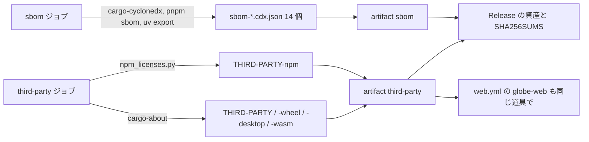

# S380 配布物のライセンス表の続きと CycloneDX の SBOM

| | |
| --- | --- |
| セッション | S380 |
| 日付 | 2026-11-16 |
| ブランチ | `feature/s380-release-licenses` |
| Phase | 公開に向けた持ち越し（P8 リリース・運用） |
| スライド | [slides.html](slides.html) |
| 作業記録 | `log/work/2026-11-16-s380-release-licenses.md` |

## 1. 目的

[roadmap.md](../../roadmap.md) の S052 の持ち越し（npm・wasm のライセンス表、CycloneDX の SBOM。Desktop の `THIRD-PARTY.md` は S135 の持ち越し）を、**足りない分だけ最小で**済ませる。`release.yml` が作る配布物（`globe`・Python の wheel・Desktop の bundle）とブラウザ版（`web.yml`）に、サードパーティのライセンス表と CycloneDX の SBOM を artifact として添える。タグの打ち方・公開・鍵は触らない。

すでにあったもの（S052・S074）: `globe` のアーカイブへの `THIRD-PARTY.md`（cargo-about）と、wheel の `THIRD-PARTY-wheel.md`。

## 2. 決定と理由

| 項目 | 決定 | 理由 |
| --- | --- | --- |
| Desktop の表 | cargo-about を `src/Rust/apps/desktop/Cargo.toml` に当てる。設定は `src/Rust/apps/desktop/about.toml`（別の workspace なので別ファイル） | Desktop は別の Cargo workspace と Cargo.lock を持つ。`accepted` は desktop の deny.toml の allow と同じで、`CDLA-Permissive-2.0` と、改変せずに使う MPL-2.0（5 crate）が要る |
| wasm の表 | `--target wasm32-unknown-unknown` で `about.toml` の targets を上書き | 設定ファイルを増やさない |
| npm の表 | `.github/scripts/npm_licenses.py`（標準ライブラリだけ）。`pnpm licenses list --long --json` から、各パッケージの LICENSE の写しつきで作る。dev 依存も含める | MIT などは著作権表示の写しが要る。Svelte の実行時などが dist に入るので prod だけでは足りない（多めに載せる側に倒す） |
| 許可外の判定 | npm の表は allow を deny.toml と同じ集合（＋ビルド時だけの `lightningcss` 用の MPL-2.0）にし、外れたら失敗。SPDX の `OR` はどれか 1 つ、`AND` は全部が許可のとき通す | cargo-about の `accepted` と同じ基準にそろえる |
| SBOM の形式 | CycloneDX 1.5 の JSON | cargo-cyclonedx（1.3〜1.5）・`pnpm sbom`・`uv export` がそろって出せる最大公約数 |
| Rust の SBOM の道具 | cargo-cyclonedx 0.5.9（Apache-2.0）。`mise.toml` に `"github:CycloneDX/cyclonedx-rust-cargo" = "cargo-cyclonedx-0.5.9"` で固定し、mise.lock に checksum と provenance | 0.5.10 は 2026-11-06 公開で 2 週間たっていない。Release の実行ファイルなので `cargo install` の 2 分のコンパイルが要らない（wasm-bindgen と同じ `github:` の道） |
| Rust の SBOM の粒度 | 配布する target ごとに 1 つ（`globe`・wheel は 4、Desktop は 3、wasm は 1） | `about.toml` の targets と同じ。target 専用の crate（`windows-sys` など）を正確に分ける |
| npm・Python の SBOM | npm は `pnpm sbom --sbom-format cyclonedx`、Python は `uv export --format cyclonedx1.5 --extra widget --no-dev` | どちらも既存のツールで出る。新しい依存を足さない。Python は wheel が宣言する依存（wheel には入らない） |
| 置き場所 | artifact `third-party`・`sbom`。タグの push では Release の資産にもして SHA256SUMS の対象に入れる。web.yml は `globe-web/` に wasm・npm の表と SBOM を入れる | アーカイブ・wheel・bundle の中身は変えない（Desktop の bundle への同梱は Tauri の `bundle.resources` が要り、持ち越し） |
| `about.hbs` | 前書きを「`globe` のバイナリ」に限らない書き方にした | wheel・Desktop・wasm にも同じテンプレートを使うため |

## 3. 図



## 4. 再現手順

```bash
# 手元（worktree では CARGO_TARGET_DIR=<main>/.git-worktree/target-shared）
cargo install --locked --features cli --version 0.9.2 cargo-about
cargo about generate --locked --fail --manifest-path src/Rust/apps/desktop/Cargo.toml about.hbs -o THIRD-PARTY-desktop.md
cargo about generate --locked --fail --target wasm32-unknown-unknown --manifest-path src/Rust/mod/globe-mode-wasm/Cargo.toml about.hbs -o THIRD-PARTY-wasm.md
(cd src/Svelte && pnpm install --frozen-lockfile >&2 && pnpm licenses list --long --json) | python3 .github/scripts/npm_licenses.py > THIRD-PARTY-npm.md
python3 .github/scripts/npm_licenses.py --test
mise exec -- bash .github/scripts/make_sbom.sh sbom          # 14 個の sbom-*.cdx.json
# CI（dry run。Release は作らない）
git push -u origin feature/s380-release-licenses
gh workflow run release.yml --ref feature/s380-release-licenses
gh workflow run web.yml --ref feature/s380-release-licenses
gh run download <run-id> -n third-party
gh run download <run-id> -n sbom
```

検証の結果（数字）は作業記録に書いた。

## 5. 次回

- Desktop の bundle・wheel の中へのライセンス表の同梱（Tauri の `bundle.resources`、wheel の `license-files`）。
- `sundials` ビルドの表。SBOM の署名・検証（cyclonedx-cli など）。
- Python の依存（`sbom-python`）には、uv の出力の仕様でライセンスの欄が無い。表は作っていない（wheel に入らない依存）。
- **既存の不具合**: `release.yml` の dry run で `build (aarch64-unknown-linux-gnu)` が wheel の pytest `test_export_fmu_p5b`（`FMI 2.0 に置き場の名前が無い`）で落ち、`release` ジョブが skipped になる。S380 より前の main でも同じ（run 43868055458）。タグを打つ前に直す（[roadmap.md](../../roadmap.md) の S380 の節）。S380 の dry run は、その step だけ `continue-on-error` にした一時のブランチで全ジョブ success を確かめた（`SHA256SUMS` 30 行）。
