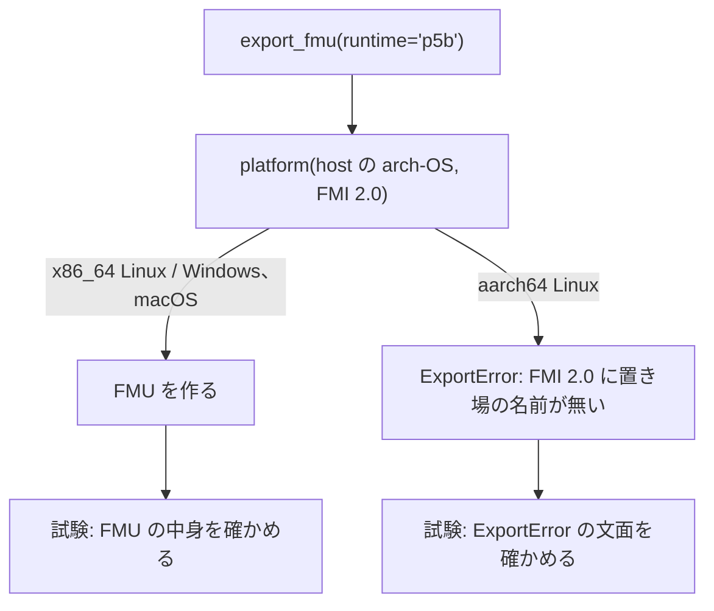

# S381 aarch64 Linux の FMI 2.0 の試験

| | |
| --- | --- |
| セッション | S381 |
| 日付 | 2026-11-17 |
| ブランチ | `feature/s381-aarch64-fmi2-test` |
| Phase | P8（公開に向けた持ち越し） |
| スライド | [slides.html](slides.html) |
| 作業記録 | `log/work/2026-11-17-s381-aarch64-fmi2-test.md` |

## 1. 目的

`release.yml` の dry run で、`build (aarch64-unknown-linux-gnu)` の wheel の pytest `test_export_fmu_p5b` が 11-08 以降ずっと落ちていた（S380 の節に既存の不具合として書いた）。落ちると `release` ジョブが skipped になり、タグを打つ前の dry run が通らない。直して、dry run を全ジョブ success にする。

## 2. 決定と理由

| 項目 | 決定 | 理由 |
| --- | --- | --- |
| 落ちる原因 | `globe-mode-fmi` の `platform` が aarch64 Linux の FMI 2.0 を `FMI 2.0 に置き場の名前が無い` で断る | FMI 2.0 の規格の `binaries/` の名前は `linux64`・`win64`・`darwin64`（Linux は x86_64 だけ）。P5b は host の OS・arch の名前で置くので、aarch64 Linux の host では引けない |
| どちらを直すか | **断るのを正しい動きとし、試験を直す**（ユーザーの決定）。Rust は変えない | `platform` の試験（`platform_names`）も aarch64 Linux の FMI 2.0 が `Err` になることを確かめている。断る理由が規格にある |
| 試験の直し方 | host が aarch64 Linux のときは `ExportError`（`FMI 2.0 に置き場の名前が無い`）を確かめ、それ以外は今までの確認（FMU の中身と `runtime_lib` の無い場合）。p5a の旗との組み合わせと不正な `runtime` の確認は host に依らない | 最小の変更。`platform` の検査は `runtime_lib` の存在の検査より前なので、aarch64 Linux では「`runtime_lib` が無い」の試験に届かない（これは else 側に置いた） |
| 他の試験 | 同じ前提の試験は無い | `git grep` で `src/Python` の `p5b`・`aarch64`・`export_fmu` を洗った。FMU を書く Python の試験は `test_export_fmu`（p5a、ソースだけ。host に依らない）と `test_export_fmu_p5b` だけ |
| 文書 | CHANGELOG の「既知の限界」に一行 | aarch64 Linux 向けの FMI 2.0 の FMU は作れない、と利用者が読める場所に無かった。FMI 3.0 の `aarch64-linux` は作れる |

## 3. 図



## 4. 再現手順

```bash
CARGO_TARGET_DIR=<main>/.git-worktree/target-shared CARGO_BUILD_JOBS=2 \
  uv run pytest -q src/Python/tests/test_api.py -k export_fmu   # 手元（x86_64 Linux）は else 側
gh workflow run release.yml --ref feature/s381-aarch64-fmi2-test  # 手動は dry run
```

検証の結果（数字）は作業記録の「検証」にある。

## 5. 次回

- 手元が x86_64 なので、aarch64 Linux 側の分岐は CI の `build (aarch64-unknown-linux-gnu)` でだけ動く。
- aarch64 Linux の FMI 2.0 の FMU を作れるようにするか（`aarch64-linux` の名前で置く。Reference-FMUs の FMU は実際にその名前で置いている。[doc/research/fmi-2026-11-01.md](../../research/fmi-2026-11-01.md)）は、今回は決めていない。
