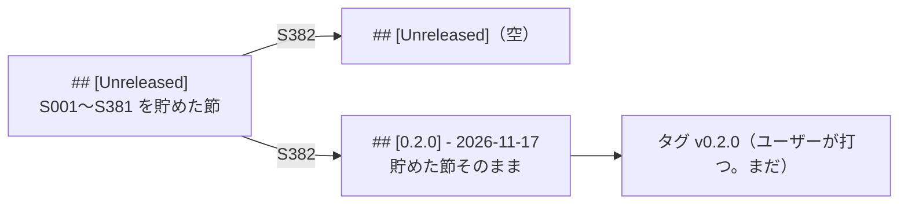

# S382 CHANGELOG の 0.2.0 の節

| | |
| --- | --- |
| セッション | S382 |
| 日付 | 2026-11-17 |
| ブランチ | `feature/s382-changelog-020` |
| Phase | P8（公開に向けた持ち越し） |
| スライド | [slides.html](slides.html) |
| 作業記録 | `log/work/2026-11-17-s382-changelog-020.md` |

## 1. 目的

[CHANGELOG.md](../../../CHANGELOG.md) の `## [Unreleased]` に S001 から S381 までを貯めてきた。0.2.0 の内容が固まったので、Keep a Changelog の形に直す。上に空の `## [Unreleased]` を置き、貯めた節を `## [0.2.0] - 2026-11-17` にする。タグも公開もしない（[release.md](../../release.md) の 3 と 6 はユーザーの判断）。文書だけの作業で、コードは変えない。

## 2. 決定と理由

| 項目 | 決定 | 理由 |
| --- | --- | --- |
| 見出し | 上に空の `## [Unreleased]`、その下に `## [0.2.0] - 2026-11-17` | Keep a Changelog の形。以降のセッションは `[Unreleased]` に足す |
| 冒頭の段落 | 「**次の版は 0.2.0**」を「**0.2.0 の変更点**」にした。「日付と比較リンクは公開のときに入れる」を、日付は版の内容を確定した日で公開した日ではないこと、比較リンクはタグを打つときに入れることに直した。「どれにも出していない」は「まだ出していない」にした | 0.2.0 の節の説明として読める文にする。タグも Release も 0 件のままなので、日付が公開日と読まれないようにした |
| 比較リンク | 足さない | いまの CHANGELOG に `[Unreleased]: …compare…` の行は無く、`v0.2.0` のタグも無い（足すと存在しない比較を指す） |
| ほかの参照 | 直すものは無かった | README・[release.md](../../release.md)・[architecture.md](../../architecture.md)・CLAUDE.md・`.github/`・スキルに「Unreleased に書く」の参照は無い。`log/`・`doc/sessions/`・`doc/research/` の `[Unreleased]` は当時の記録なので触らない |
| 中身 | 1 行も触らない | 依頼は見出しと冒頭の段落だけ |

## 3. 図



## 4. 再現手順

```bash
git diff main..feature/s382-changelog-020 -- CHANGELOG.md        # 見出し 1 つと冒頭の段落だけ
gh workflow run release.yml --ref main -f tag=v0.2.0             # タグの経路の予行（Release もタグも作らない）
```

予行の結果（全ジョブの成否と `SHA256SUMS` の行数）は作業記録の「検証」にある。

## 5. 次回

- `v0.2.0` のタグを打つか、公開するかはユーザーの判断。打つときに CHANGELOG の末尾へ比較リンク（`[Unreleased]: …/compare/v0.2.0...HEAD`、`[0.2.0]: …/releases/tag/v0.2.0`）を足す。
- 以降の変更は `## [Unreleased]` に足す。Rumoca の rev を v0.10.4 に上げるかの判断（S338 は中止）は 0.2.0 のあと。
