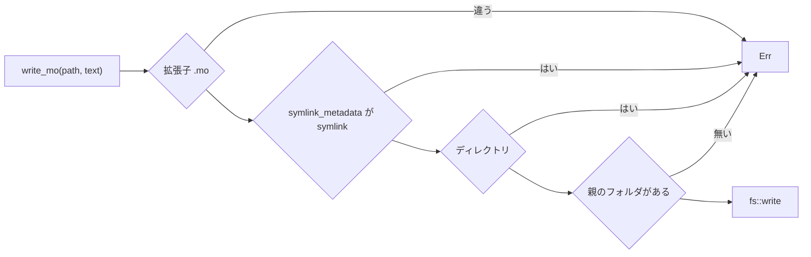

# S383 監査の 5 件

| | |
| --- | --- |
| セッション | S383 |
| 日付 | 2026-11-19 |
| ブランチ | `feature/s383-audit-fixes` |
| Phase | P8（公開に向けた持ち越し） |
| スライド | [slides.html](slides.html) |
| 作業記録 | `log/work/2026-11-19-s383-audit-fixes.md` |

## 1. 目的

監査で出た 5 件を、1 件ずつ再現してから最小の変更で直す。各修正に、直す前なら落ちる試験を 1 本ずつ足す。依存は足さない。

## 2. 決定と理由

| # | 場所 | 再現した症状 | 直し方 | 試験 |
| --- | --- | --- | --- | --- |
| 1 | `.claude/hooks/save_session_log.py` | `redact()` が `{"password": "hunter2hunter2"}`、PEM の秘密鍵、`Authorization: token gho_short` を残す。`leftovers()`（`--check`）は同じ `REDACTIONS` を使うので同じものを見逃す | キーの正規表現に「引用符・コロン・引用符」の枝を足す。PEM の規則（`BEGIN`〜`END`。`END` が切れていれば続く base64 だけの行まで）と `Authorization: token / basic` の規則を足す | `test_save_session_log.py` に 2 本（漏れの 6 形と、数値は伏せないこと） |
| 2 | `globe-mode-fmt/src/layout.rs` と Rust の 4 アプリ | `width = usize::MAX` で `self.opt.width + 1` が溢れて panic（debug）。4 アプリは `indent` だけ検査していた | `saturating_add(1)`。4 アプリは `indent` と同じ形で `width` を 1〜1000 に絞る（範囲外は HTTP 200 の `ok: false`） | `tests/format.rs` の `huge_width_does_not_overflow`、各アプリに範囲外の幅の試験 |
| 3 | `fastapi_fmt/app.py`・`Astro/fmt` | `width` に上限が無い | FastAPI は `Field(80, ge=1, le=1000)`（422）。Astro は `intIn(v, lo, hi)` を `lib/globe.ts` に置き、`indent` と `width` の検査に使う（400） | FastAPI の `test_width_is_1_to_1000`、Astro の `intIn` の試験 |
| 4 | `fastapi_fmt/app.py` | `Content-Length: abc` で `int()` の `ValueError` が 500 になる | `ValueError` を拾って 400 | `test_non_numeric_content_length_is_400` |
| 5 | `apps/desktop/src/main.rs` の `write_mo` | `.mo` の名前の symlink（先が無いものを含む）越しに別のファイルを書き換え、または作る | `symlink_metadata` が symlink なら `{path}: シンボリックリンクである` で断る（既存のエラーの形） | 既存の `write_mo_writes_only_mo_files_in_an_existing_folder` に symlink（先あり・先なし）を足した |

- **「4xx」ではなく HTTP 200 にした理由**: 依頼は「既存の `indent` の誤りと同じ形の 4xx」だったが、Rust の 4 アプリの `indent` の誤りは HTTP 200 の `ok: false` で、[web-apps.md](../../web-apps.md) の 3 が「HTTP は常に 200」と決めている。同じ形に揃えるほうを選んだ（4xx にすると契約と既存の試験が崩れる）。FastAPI は pydantic の 422、Astro は既存の 400。
- **依頼の `:407` の `self.opt.width + 1`**: 407 行目には `+ 1` が無く（`<= self.opt.width` だけ）、溢れるのは 341 行目の 2 か所だった。`let limit = self.opt.width.saturating_add(1)` にまとめた。ほかに幅を足す所は無い（`lint.rs` の `column: width + 1` は、幅を超える行が無ければ通らず、`usize::MAX` では通らない）。
- **伏せ字の規則を絞った理由**: キーの後ろの引用符を単に任意にすると、コミット済みの `log/sessions/2026-10-18-40153c9b-….md` にある `'time_to_first_token': 25.680112`（LM Studio の統計の数値）を拾った。値が引用符で始まるときだけ伏せるようにした。
- **コミット済みの `log/sessions/` への `--check`**: 新しい規則で 14 枚、取りこぼし 0 件。書き直したファイルは無い。
- **lint 側の洗い出し**: `width` を取る API は format だけで、lint は `disable` だけ。Streamlit・marimo は固定の選択肢で `width` を取らない。Phoenix と Gleam は前から 1〜1000。

## 3. 図



## 4. 再現手順

```bash
export CARGO_TARGET_DIR=<main>/.git-worktree/target-shared CARGO_BUILD_JOBS=2
python3 -I .claude/hooks/test_save_session_log.py
python3 -I .claude/hooks/save_session_log.py --check log/sessions/*.md   # 取りこぼし 0 件
cargo test -p globe-mode-fmt --test format huge_width
for a in actix axum rocket loco; do (cd src/Rust/apps/web-$a && cargo test --locked); done
(cd src/Python/fastapi_fmt && GLOBE_BIN=<globe> uv run --locked pytest -q)
(cd src/Astro/fmt && GLOBE_BIN=<globe> node --test test/api.test.mjs)
```

Desktop（Tauri）は webkit2gtk が手元に無いので、`write_mo` と試験だけを切り出して `rustc --test` で、直す前（落ちる）と直したあと（通る）を確かめた。本番の試験は CI のジョブ `desktop`（と手動の `android.yml`）で回る。

検証の数字は作業記録の「検証」にある。

## 5. 次回

- `read_mo` は symlink を辿って読む（読むだけなので今回は変えていない）。
- Desktop の `write_mo` の試験は、手元では回せないので CI の結果を見る。
- 0.2.0 のタグと公開はユーザーの判断。
