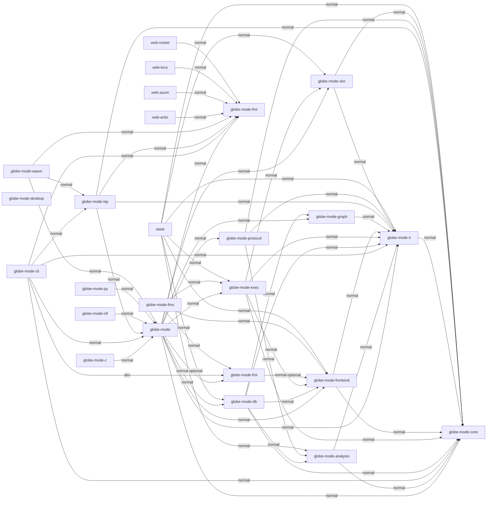
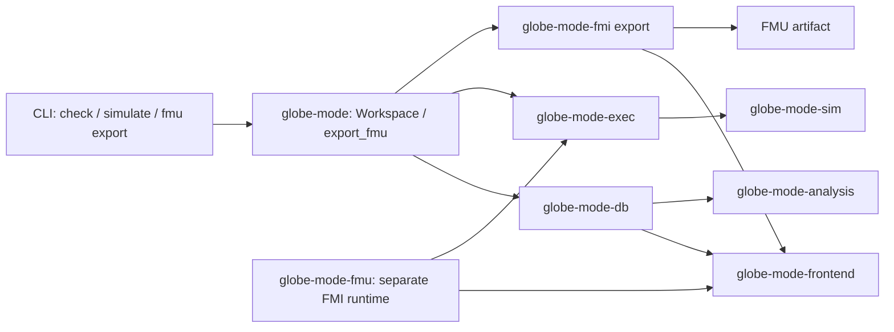

# S149 Review map — English

[README](../../../README.md) · [architecture](../../../doc/architecture.md) · [Cargo workspace](../../../Cargo.toml) · [session index](../../../doc/sessions/README.md)

**Baseline:** `origin/main` at `e73af106c8b7b220a09e162d69798abfae0efcad`. This map is an inventory and plan, not a completed audit.

## Scope and evidence

This is an inventory and a future review plan, not an audit result. Sources: tracked paths (`git ls-files`), root and package Cargo manifests, language package manifests, README and architecture; baseline commit above. Architecture may describe plans; only containment and declared Cargo edges are asserted below. The application runtime was not verified. All three Mermaid graphs were parsed and rendered to SVG locally with Mermaid 11.12.2; the rendered diagrams were inspected.

Status key: **unvisited** = no file-level evidence recorded; **partially examined** = limited prior investigation, not the whole area; **verified** = an exact file, revision, scope and real evidence recorded and checked. Earlier investigations covered limited portions of fmt, FastAPI and fmu only; no exact prior file-level ledger was supplied, so no individual file is marked verified. A previously cited 27/1130 (2.39%) is an approximate area/file comparison, **not an audit completion rate**. Begin exact per-file ledger now; record path, revision, scope, status, evidence/command and outcome before changing status. At this baseline the ledger contains no verified file. Inventory/manifests were inspected for this map only, not audited for correctness.

Formatter origin insertion is a user-confirmed specification and is **not an Issue**. At initial drafting, posting, commit and push were not authorized; this was a historical constraint, not a continuing publication prohibition.

Numbering: S149 is the session identifier; `SNNN-topic` names sessions, not issues. DFS numbers are local planned preorder, not durable file IDs or issue numbers. Give candidate findings a local `S149-C001` sequence only after evidence; remote Issue numbers are assigned by the host after user approval, not guessed. No candidate is asserted here.

## Repository structure / リポジトリ構造

Containment only, not execution or review order. Top-level files are individually shown; each directory node includes all tracked descendants. `data/` contains tracked material only; fetched libraries are not represented. / 矢印は格納関係だけで実行順でも監査順でもない。ディレクトリは追跡済みの全子孫を含む。取得済み外部データは対象外。

```mermaid
flowchart TD
  repo["Tracked repository (git ls-files)"]
  src["src/ — source and fixtures"]
  repo --> src
  s0["src/Astro/"]
  src --> s0
  s1["src/Elixir/"]
  src --> s1
  s2["src/Gleam/"]
  src --> s2
  s3["src/Julia/"]
  src --> s3
  s4["src/Modelica/"]
  src --> s4
  s5["src/Python/"]
  src --> s5
  s6["src/Rust/"]
  src --> s6
  s7["src/Svelte/"]
  src --> s7
  s8["src/VSCode/"]
  src --> s8
  s9["src/Zig/"]
  src --> s9
  t0[".cargo/"]
  repo --> t0
  t1[".claude/"]
  repo --> t1
  t2[".gitattributes"]
  repo --> t2
  t3[".github/"]
  repo --> t3
  t4[".gitignore"]
  repo --> t4
  t5[".python-version"]
  repo --> t5
  t6["CHANGELOG.md"]
  repo --> t6
  t7["CLAUDE.md"]
  repo --> t7
  t8["Cargo.lock"]
  repo --> t8
  t9["Cargo.toml"]
  repo --> t9
  t10["LICENSE-APACHE"]
  repo --> t10
  t11["LICENSE-MIT"]
  repo --> t11
  t12["README.md"]
  repo --> t12
  t13["about.hbs"]
  repo --> t13
  t14["about.toml"]
  repo --> t14
  t15["data/"]
  repo --> t15
  t16["deny.toml"]
  repo --> t16
  t17["doc/"]
  repo --> t17
  t18["log/"]
  repo --> t18
  t19["mise.lock"]
  repo --> t19
  t20["mise.toml"]
  repo --> t20
  t21["pyproject.toml"]
  repo --> t21
  t22["uv.lock"]
  repo --> t22
```

Baseline `git ls-tree -r`: 1170 tracked files; src breakdown: src/Astro 13, src/Elixir 34, src/Gleam 18, src/Julia 4, src/Modelica 84, src/Python 30, src/Rust 260, src/Svelte 30, src/VSCode 12, src/Zig 5. Baseline excludes these new map documents; not an audit denominator.

## Cargo internal dependencies / Cargo 内部依存

Arrow means manifest-declared dependent → dependency, not observed calls or review completion. Union of normal, build, dev, target and optional declarations, regardless of active feature/target. External crates omitted. Apps have separate manifests; desktop is an isolated node, not a claimed workspace member. / 矢印はマニフェスト上の依存元 → 依存先。optional / dev も含む宣言の和集合で、実際の呼出・有効 feature を意味しない。外部 crate は省略。apps は別マニフェスト。

### Package locations / パッケージの場所

- `globe-mode`: `src/Rust/mod/globe-mode/Cargo.toml`
- `globe-mode-analysis`: `src/Rust/mod/globe-mode-analysis/Cargo.toml`
- `globe-mode-c`: `src/Rust/mod/globe-mode-c/Cargo.toml`
- `globe-mode-cli`: `src/Rust/mod/globe-mode-cli/Cargo.toml`
- `globe-mode-core`: `src/Rust/mod/globe-mode-core/Cargo.toml`
- `globe-mode-db`: `src/Rust/mod/globe-mode-db/Cargo.toml`
- `globe-mode-desktop`: `src/Rust/apps/desktop/Cargo.toml`
- `globe-mode-exec`: `src/Rust/mod/globe-mode-exec/Cargo.toml`
- `globe-mode-fmi`: `src/Rust/mod/globe-mode-fmi/Cargo.toml`
- `globe-mode-fmt`: `src/Rust/mod/globe-mode-fmt/Cargo.toml`
- `globe-mode-fmu`: `src/Rust/mod/globe-mode-fmu/Cargo.toml`
- `globe-mode-frontend`: `src/Rust/mod/globe-mode-frontend/Cargo.toml`
- `globe-mode-graph`: `src/Rust/mod/globe-mode-graph/Cargo.toml`
- `globe-mode-ir`: `src/Rust/mod/globe-mode-ir/Cargo.toml`
- `globe-mode-lsp`: `src/Rust/mod/globe-mode-lsp/Cargo.toml`
- `globe-mode-nif`: `src/Rust/mod/globe-mode-nif/Cargo.toml`
- `globe-mode-protocol`: `src/Rust/mod/globe-mode-protocol/Cargo.toml`
- `globe-mode-py`: `src/Rust/mod/globe-mode-py/Cargo.toml`
- `globe-mode-sim`: `src/Rust/mod/globe-mode-sim/Cargo.toml`
- `globe-mode-wasm`: `src/Rust/mod/globe-mode-wasm/Cargo.toml`
- `web-actix`: `src/Rust/apps/web-actix/Cargo.toml`
- `web-axum`: `src/Rust/apps/web-axum/Cargo.toml`
- `web-loco`: `src/Rust/apps/web-loco/Cargo.toml`
- `web-rocket`: `src/Rust/apps/web-rocket/Cargo.toml`
- `xtask`: `src/Rust/xtask/Cargo.toml`

## Main feature paths / 主要機能の経路

The arrows show specific calls or data handoffs in the cited source, not a single mandatory pipeline. Check, simulation and export branch after the facade; analysis is a check path, not a prerequisite asserted for every export. The FMU export uses `globe-mode-fmi`, not the separate `globe-mode-fmu` runtime. The latter is shown separately with its actual runtime dependencies. Feature `fmu` is enabled by the CLI manifest. / 矢印は下記の実装にある呼出またはデータの受渡しであり、単一の必須パイプラインではない。検査・シミュレーション・出力は facade から分岐する。analysis を全 export の前提とはしない。FMU の出力は `globe-mode-fmi` を使い、別の `globe-mode-fmu` ランタイムとは区別する。CLI manifest は `fmu` feature を有効化する。

Evidence / 根拠: [CLI](../../../src/Rust/mod/globe-mode-cli/src/main.rs), [CLI simulation](../../../src/Rust/mod/globe-mode-cli/src/simulate.rs), [CLI manifest](../../../src/Rust/mod/globe-mode-cli/Cargo.toml), [facade](../../../src/Rust/mod/globe-mode/src/lib.rs), [db](../../../src/Rust/mod/globe-mode-db/src/lib.rs), [execution](../../../src/Rust/mod/globe-mode-exec/src/lib.rs), [integrators](../../../src/Rust/mod/globe-mode-exec/src/rumoca/plugins/fixed.rs), [FMI export](../../../src/Rust/mod/globe-mode-fmi/src/export.rs), [FMU runtime](../../../src/Rust/mod/globe-mode-fmu/src/lib.rs). These are static source/manifest checks, not runtime tests. / 実行試験ではなく静的照合。

## Planned DFS / 今後の DFS 計画

Roots (in order): `globe-mode-fmt`, `globe-mode`, `globe-mode-c`, `globe-mode-cli`, `globe-mode-desktop`, `globe-mode-fmu`, `globe-mode-nif`, `globe-mode-py`, `globe-mode-wasm`, `web-actix`, `web-axum`, `web-loco`, `web-rocket`, `xtask`.

Preorder, globally shared `visited`; start at `globe-mode-fmt`, follow outgoing internal dependencies in ASCII package-name order, recurse to exhaustion then return; already visited nodes are skipped. After each root, choose the lexicographically first unvisited Cargo package. Include optional/dev/build/target edges as a conservative manifest union. The numbers below are **planned first visits**, not visits already performed. / 依存先を辞書順に深掘りして戻り、共有依存は全ルート共通 visited で一度だけ。最初は fmt、以後は未訪問の最小名を根にする。番号は予定であり実施結果ではない。

1. `globe-mode-fmt`
2. `globe-mode`
3. `globe-mode-core`
4. `globe-mode-db`
5. `globe-mode-analysis`
6. `globe-mode-ir`
7. `globe-mode-frontend`
8. `globe-mode-graph`
9. `globe-mode-exec`
10. `globe-mode-sim`
11. `globe-mode-fmi`
12. `globe-mode-protocol`
13. `globe-mode-c`
14. `globe-mode-cli`
15. `globe-mode-lsp`
16. `globe-mode-desktop`
17. `globe-mode-fmu`
18. `globe-mode-nif`
19. `globe-mode-py`
20. `globe-mode-wasm`
21. `web-actix`
22. `web-axum`
23. `web-loco`
24. `web-rocket`
25. `xtask`

Repository-wide root forest after Cargo: `Cargo manifests / Rust crate forest` → `src/Astro/` → `src/Elixir/` → `src/Gleam/` → `src/Julia/` → `src/Modelica/` → `src/Python/` → `src/Svelte/` → `src/VSCode/` → `src/Zig/` → `src/Rust/ remaining tracked files` → `.cargo` → `.claude` → `.gitattributes` → `.github` → `.gitignore` → `.python-version` → `CHANGELOG.md` → `CLAUDE.md` → `Cargo.lock` → `Cargo.toml` → `LICENSE-APACHE` → `LICENSE-MIT` → `README.md` → `about.hbs` → `about.toml` → `data` → `deny.toml` → `doc` → `log` → `mise.lock` → `mise.toml` → `pyproject.toml` → `uv.lock`. Each directory root recursively visits its tracked files in bytewise `git ls-files` path order, skipping Cargo package files already recorded in the same global file-level visited set; individual top-level files are singleton roots. The Cargo forest visits the tracked files below each package directory in path order on first package visit, and the root `Cargo.toml` and `Cargo.lock` at the Cargo root. A final pass over all tracked paths in bytewise order catches any unvisited file. This is a coverage plan, not a claim of semantic dependency traversal outside Cargo. / Cargo の各 package に初訪問したら配下の追跡済みファイルをパス順に記録し、ルートの Cargo.toml / Cargo.lock も最初に処理する。残りの根を記載順に、各根内部はバイト順で処理し、全体共通のファイル visited で重複を飛ばす。最後に全追跡ファイルのバイト順走査で漏れを回収する。Cargo 以外は格納関係であり依存関係の実証ではない。
