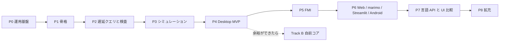

# セッション記録 0e301cfb-c9ff-440e-b48e-89148a3cfe93

| | |
| --- | --- |
| 開始 | 2026-10-30 02:06:35 |
| 最終更新 | 2026-10-30 07:10:37 |
| ブランチ | `main` |
| 作業ディレクトリ | `~/monorepo/Chaos/20261018_GlobeMode` |
| やり取り | 267 件 |

> 読むための整形版。ツール結果と思考は先頭だけを抜いてある。
> メールアドレス・ローカルのユーザー名とパス・トークンらしき文字列は伏せ字にしてある。
> 完全な生ログは作業者の手元の `log/local/raw/` にだけある（コミットしない）。

## 👤 ユーザー　`2026-10-30 02:06:43`

<local-command-caveat>The command below was run directly in Claude Code, not sent to you as a request, and its output goes straight to the user. It's recorded here as context for later messages.</local-command-caveat>

## 👤 ユーザー　`2026-10-30 02:06:43`

<command-name>/model</command-name>
            <command-message>model</command-message>
            <command-args></command-args>

## 👤 ユーザー　`2026-10-30 02:06:43`

<local-command-stdout>Set model to `Fable 5.1` and saved as your default for new sessions</local-command-stdout>

## 👤 ユーザー　`2026-10-30 02:13:30`

# リポジトリを俯瞰し設計方針へのアドバイス、並行して進められそうな作業プランを考えて他のエージェントに与えられる形にして

- このリポジトリでリリースできるまでのどのくらいの時間とトークン量になりそうですか？
- Codexを監査役としてレビュー担当にするのでレビュー履歴のみを残すディレクトリもlogにほしい
- HermesAgentkara

## 🤖 Claude　`2026-10-30 02:13:39`

<details><summary>思考</summary>


</details>

## 🤖 Claude　`2026-10-30 02:13:40`

リポジトリの正典（README・architecture・roadmap・features）と直近の作業記録を読んでから、設計の助言と並行作業プランをファイルに書き、`log/review/` を用意します。

## 🤖 Claude　`2026-10-30 02:13:42`

**🔧 Bash** — List canonical docs, ADRs, sessions, logs

<details><summary>入力</summary>

```json
{
 "command": "wc -l README.md doc/architecture.md doc/roadmap.md doc/features.md && ls doc doc/adr doc/sessions log/work log | head -120 && git log --oneline | wc -l && git log -1 --format=%ci",
 "description": "List canonical docs, ADRs, sessions, logs"
}
```

</details>

## 👤 ユーザー　`2026-10-30 02:13:55`

<details><summary>ツール結果</summary>

```
    36 README.md
   365 doc/architecture.md
   317 doc/roadmap.md
    97 doc/features.md
   815 total
doc:
adr
architecture.md
assets
features.md
licenses.md
mise-setup.html
msl-funnel.md
msl-sim.md
omc-compare.md
research
roadmap.md
sessions

doc/adr:
0001-license-policy.md
0002-rumoca-adapter.md
0003-toolchain.md
0004-ui-tauri-svelte.md
0005-lazy-query-db.md
0006-incremental-ci.md
0007-unsupported-classification.md
0008-local-llm-reviewer.md
0009-structural-index-and-init.md
0010-omc-comparison.md
0011-init-system-matching.md
0012-loops-and-preflight.md
0013-exec-backend.md
0014-session-route-wasm.md
0015-auto-and-reference-tolerance.md
0016-preflight-on-build-lowering.md
0017-lowering-limit-and-hard-timeout-retry.md
0018-no-preflight-limit.md
0019-rpi-aarch64-environment.md
0020-init-re
… （残り 1,962 字は生ログを参照）
```

</details>

## 🤖 Claude　`2026-10-30 02:13:58`

**🔧 Bash** — Read README, roadmap, features

<details><summary>入力</summary>

```json
{
 "command": "cat README.md doc/roadmap.md doc/features.md",
 "description": "Read README, roadmap, features"
}
```

</details>

## 🤖 Claude　`2026-10-30 02:14:00`

**🔧 Bash** — Read architecture doc

<details><summary>入力</summary>

```json
{
 "command": "cat doc/architecture.md",
 "description": "Read architecture doc"
}
```

</details>

## 🤖 Claude　`2026-10-30 02:14:02`

**🔧 Bash** — Read latest work log, log README, repo layout, settings

<details><summary>入力</summary>

```json
{
 "command": "cat log/work/2026-10-30-s032-cvode.md log/README.md && cat log/work/_TEMPLATE.md && ls src/Rust/mod src/Rust/apps src/Svelte 2>/dev/null && find src/Rust/mod -name '*.rs' | xargs wc -l | tail -1 && ls src/Svelte/src 2>/dev/null | head; cat .claude/settings.json | head -60; ls .claude/skills .claude/hooks",
 "description": "Read latest work log, log README, repo layout, settings"
}
```

</details>

## 👤 ユーザー　`2026-10-30 02:14:03`

<details><summary>ツール結果</summary>

```
<persisted-output>
Output too large (59.2KB). Full output saved to: ~/.claude/projects/-home-<user>-monorepo-Chaos-20261018-GlobeMode/0e301cfb-c9ff-440e-b48e-89148a3cfe93/tool-results/b3j531j6g.txt

Preview (first 2KB):
# GlobeMode アーキテクチャ

- 版: v0（2026-10-18、S001）。
- 判断の理由は [adr/](adr/) に、機能の一覧は [features.md](features.md) に、順序は [roadmap.md](roadmap.md) にある。

## 1. 全体像

計算はすべて Rust のコアで行う。UI と各言語の API は、同じ facade（`globe-mode`）と同じ protocol 型（`globe-mode-protocol`）を通してコアを呼ぶ。

```mermaid
flowchart LR
  subgraph Front["フロントエンド（Phase A: Rumoca / Track B: native）"]
    P[parse] --> O[outline] --> CI[class_index / class_interface]
    CI --> F[flat] --> D[dae_structure]
  end
  CI --> G[connect_graph]
  D --> S[simulatability S0–S10]
  S --> X[executable]
  X --> 
… （残り 1,469 字は生ログを参照）
```

</details>

## 👤 ユーザー　`2026-10-30 02:14:03`

<details><summary>ツール結果</summary>

```
<persisted-output>
Output too large (84.2KB). Full output saved to: ~/.claude/projects/-home-<user>-monorepo-Chaos-20261018-GlobeMode/0e301cfb-c9ff-440e-b48e-89148a3cfe93/tool-results/b4h9z76ac.txt

Preview (first 2KB):
# GlobeMode

**An open-source Modelica IDE written in Rust.**

GlobeMode is planned to run on Linux (Debian family), Windows 11, Android, in the browser (WebAssembly, computing on the visitor's machine), as a CLI, and inside marimo notebooks. Features planned:

- an incremental (salsa-based) language service, plus a pre-simulation check that reports why a model cannot be simulated;
- multiple ODE/DAE solvers, selectable by their OpenModelica and Dymola names;
- FMI 2.0 and 3.0 import and export (Model Exchange, Co-Simulation, Scheduled Execu
… （残り 1,477 字は生ログを参照）
```

</details>

## 👤 ユーザー　`2026-10-30 02:14:03`

<details><summary>ツール結果</summary>

```
# S032 `cvode`

| | |
| --- | --- |
| 日付 | 2026-10-30 |
| ブランチ | `feature/s032-cvode` |
| worktree | `.git-worktree/s032-cvode` |
| Phase | P3 |
| セッション文書 | `doc/sessions/S032-cvode/` |
| セッション記録 | `log/sessions/2026-10-21-40b9a39f-6e5f-4daa-8928-20b6496f2093.md` |

## 依頼

「進めて。サブエージェントは Sonnet/high、レスポンスは日本語」。候補 6（残りの計画のソルバ）の続き。S031 の報告で「`ida`・`cvode` は依存を足すので方針を確かめる」と書いたあとの「進めて」なので、licenses.md と architecture.md に計画済みの feature `sundials`（SUNDIALS、BSD-3、許可）として進めた。

## 決めたこと

- `cvode` だけを足す（サブエージェント Sonnet・high）。`ida` は次。部品は常微分方程式の形で導関数を返すので CVODE が先。
- crate は `sundials-sys` 0.6.2（BSD-3-Clause、SUNDIALS 7.1.1 を同梱）。`default-features = false` で `cvode`・`build_libraries`・`static_libraries` だけ。`klu`（LGPL）・openmp・pthreads は使わない。licenses.md に計画済みの crate で、`MeIntegratorBackend` に要る `CV_ONE_STEP`・
… （残り 5,846 字は生ログを参照）
```

</details>

## 🤖 Claude　`2026-10-30 02:14:07`

**🔧 Bash** — Read README/roadmap/features output part 1

<details><summary>入力</summary>

```json
{
 "command": "cd ~/.claude/projects/-home-<user>-monorepo-Chaos-20261018-GlobeMode/0e301cfb-c9ff-440e-b48e-89148a3cfe93/tool-results && sed -n 1,400p b4h9z76ac.txt",
 "description": "Read README/roadmap/features output part 1"
}
```

</details>

## 🤖 Claude　`2026-10-30 02:14:09`

**🔧 Bash** — Read README/roadmap/features output part 2

<details><summary>入力</summary>

```json
{
 "command": "cd ~/.claude/projects/-home-<user>-monorepo-Chaos-20261018-GlobeMode/0e301cfb-c9ff-440e-b48e-89148a3cfe93/tool-results && sed -n 400,900p b4h9z76ac.txt",
 "description": "Read README/roadmap/features output part 2"
}
```

</details>

## 🤖 Claude　`2026-10-30 02:14:12`

**🔧 Bash** — Read architecture doc output

<details><summary>入力</summary>

```json
{
 "command": "cd ~/.claude/projects/-home-<user>-monorepo-Chaos-20261018-GlobeMode/0e301cfb-c9ff-440e-b48e-89148a3cfe93/tool-results && sed -n 1,370p b3j531j6g.txt",
 "description": "Read architecture doc output"
}
```

</details>

## 🤖 Claude　`2026-10-30 02:14:15`

**🔧 Bash** — Crate sizes, funnel/sim status, non-Rust dirs, finish-session skill

<details><summary>入力</summary>

```json
{
 "command": "for c in src/Rust/mod/*; do echo \"$c $(find $c -name '*.rs' | xargs cat | wc -l)\"; done; echo; head -40 doc/msl-funnel.md; echo; head -40 doc/msl-sim.md; echo; cat src/Svelte/README.md; ls src/Rust/apps src/Python src/Julia src/Zig src/Elixir src/Gleam 2>&1 | head -30; cat .claude/skills/finish-session/SKILL.md | head -80",
 "description": "Crate sizes, funnel/sim status, non-Rust dirs, finish-session skill"
}
```

</details>

## 👤 ユーザー　`2026-10-30 02:14:15`

<details><summary>ツール結果</summary>

```
| **シミュレーション前のアサーション（S0〜S10）** | △ | △ | **Must** | P2（S005 で S0〜S6、S007 で S7・S8、S010 で S9・S10 の静的な部分） | `assert_simulatable`。Error があれば `--force` 無しでは実行しない。S005 で S6（構造特異、GM-E6001）と「コンパイラが未対応」の GM-U（[ADR-0007](adr/0007-unsupported-classification.md)）。S007 で S7・S8（[ADR-0009](adr/0009-structural-index-and-init.md)）。`globe check` に S7・S8 の行と `--json` の `s7` / `s8` / `init`。S010 で S9（代数ループ、GM-I9001 / GM-W9001）と S10（パラメータと start 値の評価、experiment annotation。GM-E10001〜GM-E10004 ほか）、`--json` の `s9` / `s10`（[ADR-0012](adr/0012-loops-and-preflight.md)）。S011 で S10 の数値の部分を実行の直前に足した（start 値で評価した t0 の値が有限か GM-W10002、ソルバの名前 GM-E10005 / GM-I10003。[ADR-0013](adr/0013-exec-backend.md)）。S018 で初期化の解き直し（初期化系を 2 回解いて動けば GM-W10004。[ADR-0020](adr/0020-init-resettle-check.md)）。初期化のヤコビ行列の階数は、Rumoca に公開の API が無いので後回
… （残り 6,251 字は生ログを参照）
```

</details>

## 👤 ユーザー　`2026-10-30 02:14:15`

<details><summary>ツール結果</summary>

```
<persisted-output>
Output too large (74.7KB). Full output saved to: ~/.claude/projects/-home-<user>-monorepo-Chaos-20261018-GlobeMode/0e301cfb-c9ff-440e-b48e-89148a3cfe93/tool-results/b9zu0gpj5.txt

Preview (first 2KB):
# GlobeMode

**An open-source Modelica IDE written in Rust.**

GlobeMode is planned to run on Linux (Debian family), Windows 11, Android, in the browser (WebAssembly, computing on the visitor's machine), as a CLI, and inside marimo notebooks. Features planned:

- an incremental (salsa-based) language service, plus a pre-simulation check that reports why a model cannot be simulated;
- multiple ODE/DAE solvers, selectable by their OpenModelica and Dymola names;
- FMI 2.0 and 3.0 import and export (Model Exchange, Co-Simulation, Scheduled Execu
… （残り 1,477 字は生ログを参照）
```

</details>

## 👤 ユーザー　`2026-10-30 02:14:15`

<details><summary>ツール結果</summary>

```
<persisted-output>
Output too large (59.2KB). Full output saved to: ~/.claude/projects/-home-<user>-monorepo-Chaos-20261018-GlobeMode/0e301cfb-c9ff-440e-b48e-89148a3cfe93/tool-results/b7yz3pgsq.txt

Preview (first 2KB):
# GlobeMode アーキテクチャ

- 版: v0（2026-10-18、S001）。
- 判断の理由は [adr/](adr/) に、機能の一覧は [features.md](features.md) に、順序は [roadmap.md](roadmap.md) にある。

## 1. 全体像

計算はすべて Rust のコアで行う。UI と各言語の API は、同じ facade（`globe-mode`）と同じ protocol 型（`globe-mode-protocol`）を通してコアを呼ぶ。

```mermaid
flowchart LR
  subgraph Front["フロントエンド（Phase A: Rumoca / Track B: native）"]
    P[parse] --> O[outline] --> CI[class_index / class_interface]
    CI --> F[flat] --> D[dae_structure]
  end
  CI --> G[connect_graph]
  D --> S[simulatability S0–S10]
  S --> X[executable]
  X --> 
… （残り 1,469 字は生ログを参照）
```

</details>

## 👤 ユーザー　`2026-10-30 02:14:17`

<details><summary>ツール結果</summary>

```
src/Rust/mod/globe-mode-analysis 7165
src/Rust/mod/globe-mode-cli 1748
src/Rust/mod/globe-mode-core 568
src/Rust/mod/globe-mode-db 3387
src/Rust/mod/globe-mode-exec 5900
src/Rust/mod/globe-mode-frontend 5816
src/Rust/mod/globe-mode-graph 315
src/Rust/mod/globe-mode-ir 1235
src/Rust/mod/globe-mode-sim 6379
src/Rust/mod/globe-mode-wasm 600

# MSL 4.1.0 の全例題のファネル（globe check）

`cargo xtask msl-funnel` が生成した。手で編集しない。

| | |
| --- | --- |
| MSL | 4.1.0（sha256 `5409cfa17797…`） |
| Rumoca | v0.10.2（rev `276e82bd`、ライブラリとして呼ぶ） |
| 例題 | 566 本（Rumoca の基準値 566 本と一致。うち partial 13 本（Rumoca の基準値は 13 本）） |
| 検査した本数 | 566 本（全部） |
| 検査器 | `globe_mode_frontend::Checker`（MSL を一度だけ読み、Rumoca の Session を使い回す） |
| 段階 | S0〜S10。S007 から S7（インデックス、Pantelides 法）・S8（初期化）、**S010 から S9（代数ループ）・S10（プリフライトの静的な部分）を含む**（S005 
… （残り 6,876 字は生ログを参照）
```

</details>

## 🤖 Claude　`2026-10-30 02:14:19`

<details><summary>思考</summary>


</details>

## 🤖 Claude　`2026-10-30 02:14:22`

**🔧 Bash** — Read roadmap section

<details><summary>入力</summary>

```json
{
 "command": "cd ~/.claude/projects/-home-<user>-monorepo-Chaos-20261018-GlobeMode/0e301cfb-c9ff-440e-b48e-89148a3cfe93/tool-results && awk '/^# GlobeMode ロードマップ|^# ロードマップ/{p=1} /^# GlobeMode 機能一覧|^# 機能/{p=0} p' b4h9z76ac.txt | cut -c1-600 | head -330",
 "description": "Read roadmap section"
}
```

</details>

## 🤖 Claude　`2026-10-30 02:14:26`

**🔧 Bash** — Read architecture crate table and later sections

<details><summary>入力</summary>

```json
{
 "command": "cd ~/.claude/projects/-home-<user>-monorepo-Chaos-20261018-GlobeMode/0e301cfb-c9ff-440e-b48e-89148a3cfe93/tool-results && grep -n '^## \\|^### ' b7yz3pgsq.txt; awk '/^### 2.2/{p=1} /^## 3/{p=0} p' b7yz3pgsq.txt | cut -c1-400; awk '/^## 4|^## 5|^## 6|^## 7|^## 8/{p=1} p' b7yz3pgsq.txt | cut -c1-400 | head -150",
 "description": "Read architecture crate table and later sections"
}
```

</details>

## 🤖 Claude　`2026-10-30 02:14:29`

**🔧 Bash** — Session index, commit cadence, log sizes, gitignore

<details><summary>入力</summary>

```json
{
 "command": "cat doc/sessions/README.md | tail -40; git log --format='%ci' | awk '{print $1}' | sort | uniq -c; ls log/sessions | wc -l; du -sh log/sessions log/local 2>/dev/null; ls -la log/local/raw 2>/dev/null | tail -3; cat .gitignore",
 "description": "Session index, commit cadence, log sizes, gitignore"
}
```

</details>

## 👤 ユーザー　`2026-10-30 02:14:30`

<details><summary>ツール結果</summary>

```
<persisted-output>
Output too large (58.4KB). Full output saved to: ~/.claude/projects/-home-<user>-monorepo-Chaos-20261018-GlobeMode/0e301cfb-c9ff-440e-b48e-89148a3cfe93/tool-results/byixip6ls.txt

Preview (first 2KB):
# GlobeMode ロードマップ

- 版: v0（2026-10-18、S001）。
- **P** は開発の段階（Phase）、**S** はセッション番号（`doc/sessions/SNNN-*`）。
- 1 つの Phase は複数のセッションにまたがる。セッションの数は目安。

## 全体



## Phase ごとの範囲と完了条件

| Phase | 範囲 | 完了条件 | 目安 |
| --- | --- | --- | --- |
| **P0 運用基盤** | 調査、計画、CLAUDE.md、スキル、セッション記録のフック、スライドと解説書の型
… （残り 1,410 字は生ログを参照）
```

</details>

## 👤 ユーザー　`2026-10-30 02:14:30`

<details><summary>ツール結果</summary>

```
6:## 1. 全体像
32:## 2. 配置
34:### 2.1 ディレクトリ
57:### 2.2 Rust crate（`src/Rust/mod/`）
85:### 2.3 ツールチェーン
97:## 3. 中核の設計
99:### 3.1 フロントエンドと Rumoca アダプタ
119:### 3.2 遅延評価とシミュレーション前のアサーション
201:### 3.3 ソルバ
259:### 3.4 FMI 2.0 / 3.0
298:### 3.5 connect のネットワークグラフ
318:## 4. ターゲットごとの実行方法
331:## 5. 言語 API
344:## 6. UI の比較実験（P7）
352:## 7. 検証の基盤
### 2.2 Rust crate（`src/Rust/mod/`）

**（S002）** と書いたものは実装済み。ほかは予定。

| crate | 責務 | 主な依存 |
| --- | --- | --- |
| `globe-mode-core` **（S002）** | `TextRange`、`Diagnostic{code,severity,stage,message,file,range,notes}`、検査段階 `Stage`（S0〜S10）、診断コード。S005 で `normalize`（防火壁 0 の本文の正規化）、GM-U・GM-E6001・GM-I7001 のコード、`Diagnostic::is_unsupported`。S007 で S7・S8 のコード（`GM-I7002`、`GM-E7001`、`GM-E8001`、`GM-W8001`〜`GM-W8004`）�
| `globe-mode-ir` **（S002）** | フロントエンドに依存しない中立 IR: `Outline`
… （残り 8,034 字は生ログを参照）
```

</details>

## 👤 ユーザー　`2026-10-30 02:14:31`

<details><summary>ツール結果</summary>

```
# セッションの索引

各セッションのスライドと解説書。書き方は `.claude/skills/session-docs/SKILL.md`、雛形は [_template/](_template/)。

| S | 日付 | Phase | 題名 | ブランチ | 状態 | スライド | 解説書 | セッション記録 |
| --- | --- | --- | --- | --- | --- | --- | --- | --- |
| S001 | 2026-10-18 | P0 | 調査と計画、運用基盤 | `feature/s001-research-plan` | 完了 | [slides](S001-research-plan/slides.html) | [解説書](S001-research-plan/解説書.md) | [log](../../log/sessions/2026-10-18-cf689fe6-f0d2-41f8-a25d-1a34aca756c7.md) |
| S002 | 2026-10-18 | P1 | workspace の骨格、Rumoca アダプタ、cargo-deny、Playwright | `feature/s002-workspace-skeleton` | 完了 | [slides](S002-workspace-skeleton/slides.html) | [解説書](S002-workspace-skeleton/解説書.md) | [log](../../log/sessions/2026-10-18-cf689fe6-f0d2-41f8-a25d-1a34aca756c7.md)（S001 と同じセッション） |
| S003 | 2026-10-18 | P1 | MSL で Rumoca と突き合わせ（20
… （残り 13,925 字は生ログを参照）
```

</details>

## 🤖 Claude　`2026-10-30 02:14:35`

<details><summary>思考</summary>


</details>

## 🤖 Claude　`2026-10-30 02:14:38`

**🔧 Bash** — Read roadmap phases P4 onward and candidates

<details><summary>入力</summary>

```json
{
 "command": "cd ~/.claude/projects/-home-<user>-monorepo-Chaos-20261018-GlobeMode/0e301cfb-c9ff-440e-b48e-89148a3cfe93/tool-results && sed -n 30,330p byixip6ls.txt | cut -c1-500",
 "description": "Read roadmap phases P4 onward and candidates"
}
```

</details>

## 🤖 Claude　`2026-10-30 02:14:43`

**🔧 Bash** — Sum token usage across raw session logs

<details><summary>入力</summary>

```json
{
 "command": "for f in log/local/raw/*.jsonl.gz; do echo \"== $f\"; gunzip -c \"$f\" | python3 -I -c '\nimport sys,json\ninp=out=cc=cr=0;n=0;models={}\nfor line in sys.stdin:\n    try: d=json.loads(line)\n    except: continue\n    m=d.get(\"message\") or {}\n    u=m.get(\"usage\") if isinstance(m,dict) else None\n    if not u: continue\n    n+=1\n    inp+=u.get(\"input_tokens\",0); out+=u.get(\"output_tokens\",0)\n    cc+=u.get(\"cache_creation_input_tokens\",0); cr+=u.get(\"cache_read_input_tokens\",0)\n    models[m.get(\"model\")]=models.get(m.get(\"model\"),0)+1\nprint(f\"turns={n} in={inp
… （残り 161 字は生ログを参照）
```

</details>

## 👤 ユーザー　`2026-10-30 02:14:45`

<details><summary>ツール結果</summary>

```
<persisted-output>
Output too large (51.4KB). Full output saved to: ~/.claude/projects/-home-<user>-monorepo-Chaos-20261018-GlobeMode/0e301cfb-c9ff-440e-b48e-89148a3cfe93/tool-results/b033j9ar3.txt

Preview (first 2KB):
Track B の B1〜B2 は IDE の機能（補完、アウトライン）から先に使える。コンパイルのパイプラインは引き続き Rumoca が受け持つ。ただし AST が別物なので、両者を混ぜるのは「IDE 機能か、コンパイルか」の境目に限る。

## 進み具合

### S002（P1 の 1 回目、2026-10-18）で済んだこと

- ルートを virtual workspace にし、4 つの crate を作った: `globe-mode-core`、`globe-mode-ir`、`globe-mode-frontend`（Rumoca アダプタ）、`globe-mode-cli`（`globe outline` / `globe check`）。
- **Rumoca v0.10.2（`276e82bd`）の `rumoca-compile` が、stable 1.99.1 でビルドできることを確かめた**。
  - ネイティブでも `wasm32-unknown-unknown` でも `cargo check` が通る。
  - これで [ADR-0003](adr/0003-toolchain.md) を Accepted にした。
- `mise.toml
… （残り 1,553 字は生ログを参照）
```

</details>

## 👤 ユーザー　`2026-10-30 02:14:50`

<details><summary>ツール結果</summary>

```
== log/local/raw/2026-10-18-40153c9b-1d16-414d-85e1-aa59674d1077.jsonl.gz
turns=324 in=662 out=418223 cache_create=974426 cache_read=70074687 models={'claude-opus-5-5': 324}
== log/local/raw/2026-10-18-63325205-fc9c-4ce6-b38e-0337835ead44.jsonl.gz
turns=22 in=44 out=27745 cache_create=108284 cache_read=1013142 models={'claude-sonnet-5-5': 22}
== log/local/raw/2026-10-18-c74fbe25-624e-4092-95b3-282cf3c8d554.jsonl.gz
turns=2022 in=29748 out=3161724 cache_create=6993093 cache_read=575252873 models={'claude-fable-5-1': 982, 'claude-opus-5-5': 1039, '<synthetic>': 1}
== log/local/raw/2026-10-18-cf689fe6-f0d2-41f8-a25d-1a34aca756c7.jsonl.gz
turns=886 in=1800 out=1601965 cache_create=2319282 cache_read=425802906 models={'claude-opus-5-5': 886}
== log/local/raw/2026-10-19-36fc92f3-f36e-4690-bc9d-a
… （残り 1,041 字は生ログを参照）
```

</details>

## 🤖 Claude　`2026-10-30 02:14:54`

<details><summary>思考</summary>


</details>

## 🤖 Claude　`2026-10-30 02:14:59`

**🔧 Bash** — Extract roadmap phase rows and candidate list

<details><summary>入力</summary>

```json
{
 "command": "cd ~/.claude/projects/-home-<user>-monorepo-Chaos-20261018-GlobeMode/0e301cfb-c9ff-440e-b48e-89148a3cfe93/tool-results && grep -n '^| \\*\\*P[4-8]\\|^| \\*\\*Track\\|^## \\|^### ' byixip6ls.txt | cut -c1-200; echo ----; awk '/候補/{c++} c&&/^- |^\\| [0-9]/{print}' byixip6ls.txt | grep -n '候補\\|^| [0-9]\\+ ' | cut -c1-300 | head -50; echo ----; grep -n '^| \\*\\*P[4-8]' byixip6ls.txt | cut -c1-900",
 "description": "Extract roadmap phase rows and candidate list"
}
```

</details>

## 👤 ユーザー　`2026-10-30 02:15:02`

<details><summary>ツール結果</summary>

```
----
1:- 範囲は S007 の候補のうち `deps_closure`（1）、S7（3）、S8（4）。**omc との照合（5）はユーザーの指示で後回し**にした（omc 未導入。OpenModelica のサイトが重くて取得できない。入れたら再開する）。`Checker` のメモリ（2）は P4
3:- **S7（Pantelides 法と状態選択の候補）**と **S8（初期化系の検査）**を足した（[ADR-0009](adr/0009-structural-index-and-init.md)）。
6:- 範囲は S008 の候補のうち **omc との照合（1）だけ**。ユーザーが OpenModelica 1.27.1 を入れたので、S007 で後回しにした項目を最初に再開した。方法は [ADR-0010](adr/0010-omc-comparison.md)、報告は [omc-compare.md](omc-compare.md)。
9:- 食い違い 2 本（`AdvancedSolenoid`: globe は通し omc は Pantelides の内部エラー。`NonCircularPipes`: globe は不足、omc は冗長な初期方程式 2 本）は S009 の候補にした。
11:- 範囲は S009 の候補のうち **omc と食い違った 2 本の調査（1）** と **S8 の精密化（3）**。1 の調査で `NonCircularPipes` の食い違いが「数だけの S8 は冗長を見られない」ことだったので、3 をそのまま主な実装にした。方法は [AD
12:- **`AdvancedSolenoid` は S6 の限界**（直さない）: 接地の無い部品の単体の検査で、枝 8 本 ≥ 節点 7 つなので二部グラフには完全マッチング
… （残り 3,411 字は生ログを参照）
```

</details>

## 🤖 Claude　`2026-10-30 02:15:06`

**🔧 Bash** — Read roadmap phase rows and current candidate list

<details><summary>入力</summary>

```json
{
 "command": "grep -n 'P4 Desktop\\|P5 FMI\\|P6 Web\\|P7 言語\\|P8 拡充\\|Track B' doc/roadmap.md | cut -c1-700 | head -12; echo ----; grep -n '次回の候補\\|候補の一覧\\|^### .*候補\\|^## .*候補' doc/roadmap.md | head; echo ----; tail -60 doc/roadmap.md | cut -c1-400",
 "description": "Read roadmap phase rows and current candidate list"
}
```

</details>

## 👤 ユーザー　`2026-10-30 02:15:29`

<details><summary>ツール結果</summary>

```
11:  P0[P0 運用基盤] --> P1[P1 骨格] --> P2[P2 遅延クエリと検査] --> P3[P3 シミュレーション] --> P4[P4 Desktop MVP]
12:  P4 --> P5[P5 FMI] --> P6[P6 Web / marimo / Streamlit / Android] --> P7[P7 言語 API と UI 比較] --> P8[P8 拡充]
13:  P4 -.余裕ができたら.-> B[Track B 自前コア]
24:| **P4 Desktop MVP** | CodeMirror 6 と LSP、ライブラリツリー、検査パネル、プロット、sigma.js の connect グラフ | ChuaCircuit で開く・検査・実行・プロットが通る。5k ノードのグラフが 30 fps 以上で動く。RSS の基準値を記録する。CI が .deb と .msi を作る | 6 回 |
25:| **P5 FMI** | Import（ME / CS / SE）とマスター。Export は P5a（Rumoca のテンプレート）の後に P5b（自前のランタイム） | Reference-FMUs が linux64 と win64 で一致する。Export した FMU が FMPy・fmusim・fmuCheck を通る。Clocks（SE）が往復できる | 8 回 |
26:| **P6 Web / marimo / Streamlit / Android** | WorkerBackend、MSL のパッケージ単位の分割読み込み、anywidget、wheel、APK | ブラウザが CSP `connect-src 'self'` のまま実行できる（サーバーで計算しない）。marimo の WASM で 2 
… （残り 6,186 字は生ログを参照）
```

</details>

## 🤖 Claude　`2026-10-30 02:17:16`

<details><summary>思考</summary>


</details>

## 🤖 Claude　`2026-10-30 02:17:21`

Read enough. Measured token usage from the raw session logs, roadmap status, and crate layout are in hand. Now I'll cut a worktree and write the plan file and the `log/review/` directory.

## 🤖 Claude　`2026-10-30 02:17:24`

**🔧 Bash** — Create worktree for the plan session and locate table rows to extend

<details><summary>入力</summary>

```json
{
 "command": "git worktree add -b feature/s033-parallel-plan .git-worktree/s033-parallel-plan main 2>&1 | tail -2 && mkdir -p .git-worktree/s033-parallel-plan/log/review .git-worktree/s033-parallel-plan/doc/plan && grep -n 'log/sessions/\\|log/work/' CLAUDE.md log/README.md | head",
 "description": "Create worktree for the plan session and locate table rows to extend"
}
```

</details>

## 👤 ユーザー　`2026-10-30 02:18:03`

<details><summary>ツール結果</summary>

```
Updating files:  83% (307/368)
Updating files:  84% (310/368)
Updating files:  85% (313/368)
Updating files:  86% (317/368)
Updating files:  87% (321/368)
Updating files:  88% (324/368)
Updating files:  89% (328/368)
Updating files:  90% (332/368)
Updating files:  91% (335/368)
Updating files:  92% (339/368)
Updating files:  93% (343/368)
Updating files:  94% (346/368)
Updating files:  95% (350/368)
Updating files:  96% (354/368)
Updating files:  97% (357/368)
Updating files:  98% (361/368)
Updating files:  99% (365/368)
Updating files: 100% (368/368)
Updating files: 100% (368/368), done.
HEAD is now at c48d87b Merge feature/s032-cvode: cvode（SUNDIALS 7.1.1 の CVODE を sundials-sys 0.6.2 で呼ぶ。feature sundials を立てたビルドだけ。密な線形ソルバ、根探索なし）
log/README.md:26:- コミットの前に、`python3 .claude/hooks/save_sess
… （残り 544 字は生ログを参照）
```

</details>

## 🤖 Claude　`2026-10-30 02:18:31`

Now writing the plan document, the review log directory, and the small pointer edits.

## 🤖 Claude　`2026-10-30 02:20:29`

**🔧 Bash** — Create log/review README and template, add pointers in CLAUDE.md and log/README.md

<details><summary>入力</summary>

```json
{
 "command": "cd ~/monorepo/Chaos/20261018_GlobeMode/.git-worktree/s033-parallel-plan && cat > log/review/README.md <<'EOF'\n# log/review — レビュー履歴\n\n監査役（Codex。副次的に `/local-review` の Bonsai）が出した指摘と、その採否だけを残す。コードの変更はここに書かない。\n\n- 1 レビュー 1 枚。名前は `<日付>-sNNN-<topic>-<レビュアー>.md`（例 `2026-10-31-s033-protocol-facade-codex.md`）。雛形は [_TEMPLATE.md](_TEMPLATE.md)。\n- レビュアーの出力は**原文のまま**貼る。採否と理由は実装側（Claude か人）が書く。指摘を直したら、そのコミットの hash を書く。\n- 書くもの: 対象のコミット範囲（`git diff <base>..<head>`）、レビュアーのモデルと版、指摘、採否、結論。\n- 書かないもの: 差分そのもの、ファイルの全文、メールアドレス・ホームのパス・トークン。コミットの前に `python3 .claude/hooks/sav
… （残り 2,085 字は生ログを参照）
```

</details>

## 👤 ユーザー　`2026-10-30 02:21:54`

<details><summary>ツール結果</summary>

```
 CLAUDE.md     | 5 +++++
 log/README.md | 8 ++++++++
 2 files changed, 13 insertions(+)
```

</details>

## 🤖 Claude　`2026-10-30 02:22:02`

<details><summary>思考</summary>


</details>

## 🤖 Claude　`2026-10-30 02:24:36`

**🔧 Bash** — Write the plan document, link it from the roadmap, run the docs link check

<details><summary>入力</summary>

```json
{
 "command": "cat > doc/plan/2026-10-30-release-estimate-and-parallel-plan.md <<'EOF'\n# リリースまでの見積もりと並行作業プラン（2026-10-30、S033）\n\n- 書いた日: 2026-10-30。S032 までの状態（P3 の完了条件は達成、P4 は未着手）を俯瞰した。\n- 目的: (1) 設計への助言、(2) リリースまでの時間とトークンの見積もり、(3) **他のエージェントにそのまま渡せる作業指示書**（§4）、(4) Codex を監査役にする運用（§5）、(5) 無料プロバイダをワーカーにする戦略（§6）。\n- 正典は [roadmap.md](../roadmap.md)・[architecture.md](../architecture.md)・[features.md](../features.md)。この文書は計画を変えない。変えるときは正典を同じコミットで直す。\n\n## 1. 俯瞰\n\n| 項目 | 状態（2026-10-30） |\n| --- | --- |\n| セッション | S001〜S032（13 日間、2026-10-18〜10-30） |\n| Rust | 10 crate、約 33,000 行（analysis 7.2k・sim 6
… （残り 13,174 字は生ログを参照）
```

</details>

## 👤 ユーザー　`2026-10-30 02:24:45`

<details><summary>ツール結果</summary>

```
[slides] doc/sessions/S030-radau5/slides.html: OK
[slides] doc/sessions/S031-qss/slides.html: OK
[slides] doc/sessions/S032-cvode/slides.html: OK
[slides] doc/sessions/_template/slides.html: OK
[links] 文書 165 件 / 相対リンク 937 件 / 切れ 0 件
 M CLAUDE.md
 M doc/roadmap.md
 M log/README.md
?? doc/plan/
?? log/review/
```

</details>

## 🤖 Claude　`2026-10-30 02:24:52`

<details><summary>思考</summary>


</details>

## 🤖 Claude　`2026-10-30 02:25:02`

**🔧 Bash** — Add judge-model subsection to the plan and recheck links

<details><summary>入力</summary>

```json
{
 "command": "python3 - <<'EOF'\np='doc/plan/2026-10-30-release-estimate-and-parallel-plan.md'; s=open(p).read()\ns=s.replace(\"### 最初の 1 回でやること\\n\",\"\"\"### 判断に特化したモデル（judge / verifier）の使い所\n\nユーザーが挙げた「Jev などの判断特化モデル」は、この文書を書いた時点では名前と提供元を確かめていない【未確認】。導入するときは `doc/research/` に URL と確認日を書く。使い所は生成ではなく**採否の判定**に限る。\n\n| 使い所 | 入力 | 出力 | 効くところ |\n| --- | --- | --- | --- |\n| Codex の指摘の一次選別 | 指摘 1 件 + 該当の差分 | 「要確認 / 不要」と 1 行の理由 | Claude が確かめる件数を減らす。`log/review/` の採否欄の下書きになる |\n| 無料ワーカーの成果の合否 | 成果の差分 + WP の完了条件 | 合 / 否 + 外れた条件 | §6 の「確認の時間が本体を上回る」問題を抑える |\n| 作業記録の数字の照合 | 作業記録 + 検査のログ | 食い違いの一覧 | `
… （残り 390 字は生ログを参照）
```

</details>

## 👤 ユーザー　`2026-10-30 02:25:04`

<details><summary>ツール結果</summary>

```
[links] 文書 165 件 / 相対リンク 937 件 / 切れ 0 件
 CLAUDE.md      | 5 +++++
 doc/roadmap.md | 2 ++
 log/README.md  | 8 ++++++++
 3 files changed, 15 insertions(+)
doc/plan:
2026-10-30-release-estimate-and-parallel-plan.md

log/review:
README.md
_TEMPLATE.md
```

</details>

## 🤖 Claude　`2026-10-30 02:25:23`

作業は worktree `.git-worktree/s033-parallel-plan`（ブランチ `feature/s033-parallel-plan`）に置きました。未コミットです。このセッションはサブエージェントを使わずに済んだので、Opus/Medium の指定は次に起動するときに適用します。

## 書いたもの

- `doc/plan/2026-10-30-release-estimate-and-parallel-plan.md`。俯瞰、設計の助言 8 点、実測の費用、リリースの見積もり、エージェントに貼れる指示書 WP-0〜WP-J、Codex の運用、無料プロバイダと判断特化モデルの戦略。roadmap の「運用上の決まり」からリンクした。
- `log/review/`。README と `_TEMPLATE.md`（対象のコミット範囲、レビュアー、指摘を原文のまま、採否と理由）。CLAUDE.md の表と `log/README.md` に 1 行ずつ足した。
- リンク検査は 937 件中の切れ 0 件。

## 設計の助言（要点）

- P3 は完了している。S026〜S032 の 7 回は P8 のソルバで、リリースを近づけていない。`ida` は P8 へ戻す。
- 次の 1 回は `globe-mode-protocol` と facade `globe-mode` を作ることに使う。UI・LSP・Python・Tauri・wasm がすべてここに依存するので、並行化の分岐点になる。
- プロセス構成（検査の RSS 7.2 GiB を UI から分けるか）を P4 の最初に ADR で決める。sidecar に `globe` の CLI をそのまま使えば新しいコードはほぼ要らない。
- UI はブラウザ版から作り、Tauri は PC か RPi で後にする。WSL の RAM 3 GB では Tauri と Android が厳しい。
- Track B は P4 が出るまで触らない。

## 見積もり

主セッションの生ログ 10 本の `usage` を合計した実測から出した。サブエージェント分は含まないので上側に 1.5 倍を見ている。

| 段 | セッション | 壁時計 | 出力トークン | キャッシュ読み出し |
| --- | ---: | ---: | ---: | ---: |
| 実績 S001〜S032 | 32 | 13 日 | 7.06 M | 1.38 G |
| v0.1 CLI + wasm の配布 | 2〜3 | 1〜2 日 | 0.5〜1 M | 90〜200 M |
| v0.2 Desktop MVP（P4） | 12〜15 | 5〜8 日 | 2.6〜5 M | 0.5〜1 G |
| v1.0（P4 + P5 FMI） | 28〜32 | 2〜3 週 | 6〜10 M | 1.2〜2 G |

本体の実装は roadmap の目安の約 2 倍かかっている（P2 4 → 7 回、P3 5 → 10 回）ので係数 2 を掛けた。UI はまだ 1 行も無く、Svelte と Tauri の生産性は未測定なので、P4 の最初の 2 回で測り直すのが前提です。金額は単価を写さず出していません。

## 無料プロバイダと判断特化モデル

- 向く作業は機械的に検証できるもの（上流 issue の下書き、試験の追加、失敗ログの分類、型の生成、文書の整形）。数値・unsafe・ライセンス・ADR は渡さない。
- worktree を分けて push させず、Claude か Codex がレビューする。無料の経路は学習利用の規約を使う前に確かめる【未確認】。`log/local/` と `data/` は渡さない。
- 判断特化モデルは生成ではなく採否の判定（Codex の指摘の一次選別、無料ワーカーの成果の合否、作業記録の数字の検算）に限る。「Jev」の提供元は確かめていないので【未確認】と書いた。

## 次

- コミットするなら `/finish-session`（スライドと解説書、作業記録 `log/work/2026-10-30-s033-parallel-plan.md` はまだ作っていない）。
- 並行して始めるなら、まず WP-0 を 1 人で、その後 WP-A / WP-B / WP-F / WP-G / WP-H / WP-I を同時に。

スキップしたこと: worktree で `mise install` と `uv sync` は回していない（文書だけなので）。markdownlint 本体は入っていないため、リンク検査だけで表と見出しの空行は目視。

## 👤 ユーザー　`2026-10-30 02:35:38`

<command-message>finish-session</command-message>
<command-name>/finish-session</command-name>

## 👤 ユーザー　`2026-10-30 02:35:38`

Base directory for this skill: ~/monorepo/Chaos/20261018_GlobeMode/.claude/skills/finish-session

# セッションの締め

順番に通す。**どれかが落ちたら、そこで止めて報告する。** 検査を通さずにコミットしない。

以下はすべて worktree（`$WT`）で実行する。`MAIN` は main のチェックアウト。

```bash
MAIN=$(git worktree list --porcelain | awk '/^worktree /{print $2; exit}')
```

## 1. コードの検査（Rust・Python・JS を触ったときだけ）

```bash
mise run check              # 下の 4 つと uv sync --locked をまとめて実行する
# cargo fmt --all --check
# cargo clippy --workspace --all-targets -- -D warnings
# cargo test --workspace
# cargo deny check          # ライセンスと bans。doc/licenses.md と食い違ったら止める
```

- workspace ができる前（P0）は不要。
- Python を触ったら `uv run python -m pytest`、Svelte を触ったら `pnpm -C src/Svelte check` も通す（P1 以降に整える）。

## 2. スライドと解説書を検査する

`/session-docs` の手順でスライドと解説書を書き上げてから、検査する。

```bash
python3 -I .claude/skills/session-docs/check_docs.py
uv run python .claude/skills/session-docs/render_slides.py     # Playwright でブラウザ表示を確かめる
```

期待する結果:

- 全デッキが OK（連番、外部参照 0、`<style>` 0、`style=` 0、共通 CSS と JS を読んでいる）
- 相対リンク切れ 0 件（見出しの anchor も含む）
- `render_slides.py` の問題 0 件。スクリーンショットを目で見て、図の文字のはみ出しが無い

## 3. セッション記録をコピーして伏せ字を検査する

フックは main の `log/local/` に整形版を書いている。最新の状態に書き直してから、worktree の `log/sessions/` にコピーする。

```bash
BRANCH=$(git branch --show-current)
MD=$(CLAUDE_PROJECT_DIR="$MAIN" python3 .claude/hooks/save_session_log.py --latest --match "$BRANCH" --out "$MAIN/log/local")
cp "$MD" log/sessions/
python3 .claude/hooks/save_session_log.py --check log/sessions/*.md
```

- 同じプロジェクトで別のセッションが並行して動いていることがある。`--match "$BRANCH"` で、このブランチ名を含む transcript に絞る。セッション ID が分かっているなら `--session <ID>` の方が確実。

- `--check` の取りこぼしが **0 件**であること。1 件でもあれば、フックの `REDACTIONS` に規則を足して作り直す。手で直さない。
- コミットするのはそのセッションの時点の写し。セッションが続く間、main の `log/local/` 側は更新され続ける。
- `log/local/raw/` の生ログは**絶対にコミットしない**（`.gitignore` 済み）。

## 4. 作業記録と索引を仕上げる

- `log/work/<日付>-sNNN-<topic>.md` の「決めたこと / やったこと / 検証 / 残したこと」を埋める。
  - 検証は**数字で**書く。通っていない項目は「通っていない」と書く。
- [doc/sessions/README.md](../../../doc/sessions/README.md) の索引の行を仕上げる（状態、セッション ID、成果物）。
- 計画を変えたなら、[doc/roadmap.md](../../../doc/roadmap.md) と該当する ADR を同じコミットで直す。

## 5. 漏洩を検査してからコミットする

```bash
git add -A
git status --porcelain                                     # 意図していない差分が無いか読む
LEAK="$(whoami)|$(git config user.email)|ghp_[A-Za-z0-9]{36}|github_pat_[A-Za-z0-9_]{20,}|AKIA[0-9A-Z]{16}|sk-[A-Za-z0-9_-]{20,}"
git diff --cached -U0 | grep '^+' | grep -nE "$LEAK" \
  && echo "漏洩の疑いあり。止める" || echo "漏洩の疑い 0 件"
git commit
```

- **feature ブランチにコミットする。`main` へ直接コミットしない。**
- 見るのは、手元のログイン名、git のメールアドレス、長さまで指定したトークンの形。
  - 「~
- 何か出たら、それが意図した記述かを1件ずつ確かめる。疑わしければ止める。
- コミットメッセージは「何を・なぜ」。末尾に、システムが指示する Co-Authored-By の行を付ける。

## 6. main にマージして push する（CI を回す）

CI は **main を直接 push して回す**（ユーザーの決定。PR は使わない）。

```bash
MAIN=$(git worktree list --porcelain | awk '/^worktree /{print $2; exit}')
BRANCH=$(git branch --show-current)
git -C "$MAIN" status --porcelain        # main に未コミットの変更が無いか。あれば止めて伝える
git -C "$MAIN" merge --no-ff -m "Merge $BRANCH: <要約>" "$BRANCH"
git -C "$MAIN" push origin main
```

- push の前に、5 の漏洩検査を **main と origin/main の差分**に対しても実行する。
  - `git -C "$MAIN" diff origin/main..main -U0 | grep '^+' | grep -nE "$LEAK"` が 0 件であることを確かめる。
- feature ブランチは push しない。
- CI は差分だけを検査する（ADR-0006）。push の前に `mise run ci:plan` で計画を見る。
  - 大きな作り直しや、判定に入っていない種類のファイルを触ったときは、マージのコミットメッセージに `[full-ci]` を入れて全体を検査する。
- push したら Actions の結果を確かめる（`gh` は認証済み）。

  ```bash
  gh run list --branch main --limit 3
  gh run watch <run-id> --exit-status     # 完了まで待つ。長いのでバックグラウンドで実行する
  gh run view <run-id> --log-failed       # 落ちたジョブのログ
  ```

- CI が落ちたら、新しいセッション（worktree）で直して、同じ手順でもう一度 push する。

## 7. CI が通ったら、2 つ以上前の worktree を片付ける

**CI が成功したときだけ**行う（ユーザーの決定）。失敗したら片付けずに、直すセッションに進む。

- 対象: 作った順に並べて、**最新から数えて 2 つ以上前**の worktree（最新と 1 つ前は残す）。
- 消す前に、それぞれ次の 2 つを確かめる。どちらかを満たさないものは消さずに報告する。
  - 未コミットの変更が無い
  - ブランチが main に取り込み済み

```bash
cd "$MAIN"
git worktree list                                         # 作った順を確かめる（ブランチの作成日でもよい）
for t in <2 つ以上前の topic>; do
  test -z "$(git -C .git-worktree/$t status --porcelain)" || { echo "$t に未コミットの変更"; continue; }
  git branch --merged main --format='%(refname:short)' | grep -qx "feature/$t" || { echo "$t は未マージ"; continue; }
  git worktree remove ".git-worktree/$t" && git branch -d "feature/$t"
done
git worktree prune
```

- ブランチは `-d`（取り込み済みのものだけを消す）で消す。`-D` や `--force` は使わない。
- 作業記録には触らない（`log/work/` は main に残っている）。

## 8. 報告する

ユーザーには次を伝える。

- 何を作ったか・変えたか
- 検査の結果（数字）
- ブランチ名と worktree のパス、main のコミット、CI の結果（run の ID とジョブごとの成否）
- 片付けた worktree と、残した worktree
- 積み残しと、次のセッションでやること

worktree の片付けは 7 の条件（CI が成功、2 つ以上前、未コミットの変更が無い、取り込み済み）を満たすものだけを行う。それ以外は消さない。

## 🤖 Claude　`2026-10-30 02:36:11`

<details><summary>思考</summary>


</details>

## 🤖 Claude　`2026-10-30 02:36:13`

セッションを締めます。コードは触っていないので 1 は省き、スライドと解説書から始めます。

## 🤖 Claude　`2026-10-30 02:36:14`

**🔧 Skill**

<details><summary>入力</summary>

```json
{
 "skill": "session-docs"
}
```

</details>

## 👤 ユーザー　`2026-10-30 02:36:20`

<details><summary>ツール結果</summary>

```
Launching skill: session-docs
```

</details>

## 👤 ユーザー　`2026-10-30 02:36:19`

Base directory for this skill: ~/monorepo/Chaos/20261018_GlobeMode/.claude/skills/session-docs

# セッションのスライドと解説書

毎セッション `doc/sessions/SNNN-<topic>/` に2つを作る。雛形は [doc/sessions/_template/](../../../doc/sessions/_template/)。

| ファイル | 読み手 | 役割 |
| --- | --- | --- |
| `slides.html` | 後でこのセッションを振り返る人、レビューする人 | 決めたことを一枚ずつ見せる。1 枚 1 メッセージ |
| `解説書.md` | 次のセッションの作業者（人と Claude） | 決定と理由、再現手順を文章で残す。正典の文書（`doc/*.md`、ADR）へリンクする |

## 共通の章立て

どちらも次の順に書く。スライドは各章を 1〜4 枚にする。

1. **目的**: このセッションで何をするか。依頼の要約と、どの Phase の作業か
2. **決定と理由**: 選択肢と、なぜそれを選んだか。ユーザーと決めたことは明記する
3. **図**: 構成・流れ・対応表
4. **再現手順**: 同じ結果を得るためのコマンドと、検証の数字
5. **次回**: 積み残しと、次のセッションでやること

## スライド（slides.html）の約束

- 読むのは `../../assets/slides.css` と `../../assets/slides.js` の **2 つだけ**。
  - 外部 CDN（フォント、mermaid、highlight.js など）を読まない。`file://` でオフラインのまま開けるようにするため。
  - `<style>` 要素も `style=` 属性も書かない。新しい見た目が要るなら、[doc/assets/slides.css](../../../doc/assets/slides.css) にクラスを足す。
- 色は CSS 変数（`--bg` `--fg` `--muted` `--accent` `--accent-2` `--warn` `--ok` `--line` `--panel` `--code-bg`）だけを使う。ライトとダークは `prefers-color-scheme` で切り替わる。
- 1 枚は `<section class="slide" id="S01">`。id は S01 から連番にする。
- 図はインライン SVG で描く。
  - 色は `fill="currentColor"` か、CSS のクラス（`.svg-box` `.svg-accent` `.svg-line` `.svg-text` など）で付ける。生の色値を書くと、ライトかダークのどちらかで読めなくなる。
  - `<svg>` には `viewBox` を付け、幅は CSS に任せる。
- 使えるクラス（詳細は slides.css）:

  | クラス | 用途 |
  | --- | --- |
  | `.tag` | 左上の章ラベル |
  | `.lead` | 副題 |
  | `.cols-2` `.cols-3` | 段組み |
  | `.card` | 囲み |
  | `.big` | 中央の大きな結論 |
  | `.kpi` | 数字のタイル |
  | `.ok` `.warn` `.ng` | 状態の色 |
  | `table.compact` | 詰めた表 |
  | `.foot` | フッター（slides.js が「n / 全体」を入れる） |

- 操作: ← → / PageUp PageDown / Space / Home End / `#S05` のハッシュで移動する。`p` で全スライドの一覧、印刷は 1 枚 1 ページ。

### トピック別のデッキ（任意、S006 から）

話題が多いセッションは、全体の `slides.html` に加えて、トピックごとのデッキを同じフォルダに置いてよい。

- ファイル名は `NN-<topic>.html`（例 `01-wsl-network.html`）。サブフォルダには置かない（`../../assets/` の相対パスが崩れるため）。
- 約束は `slides.html` と同じ。id は各デッキで S01 から振り直し、3 枚以上にする（render_slides.py が `#S03` を開くため）。
- `slides.html` から各デッキへリンクし、各デッキの最後のスライドに `slides.html` へ戻るリンクを置く。check_docs.py が相互のリンクを確かめる。
- `data-deck` は `GlobeMode SNNN 題名 · NN トピック` のようにして、どのデッキかがフッターで分かるようにする。

## 解説書（解説書.md）の約束

- 冒頭に表を置く: セッション番号、日付、ブランチ、Phase、スライドへのリンク。
- 図は mermaid のコードブロックで書く（GitHub で描画される）。
- 調査した事実には出典を付ける。正典の文書にあるものはリンクで済ませ、二重に書かない。
- markdownlint の警告を出さない。

## 検査

```bash
python3 -I .claude/skills/session-docs/check_docs.py
```

デッキが NG、またはリンク切れが 1 件でもあれば直す。

### ブラウザでの確認（Playwright）

```bash
uv run python .claude/skills/session-docs/render_slides.py            # 全デッキ
```

- Playwright は Python の開発依存（`uv sync` で入る）。初回だけ `uv run playwright install chromium` を実行する。
- 3 つの表示で、全スライドを `file://` から開く。
  - デスクトップ（1600x900）のライト
  - デスクトップ（1600x900）のダーク
  - スマートフォン（390x844）
- 検査すること:
  - コンソールのエラーが無い
  - スライドがはみ出さない
  - ページ番号が操作ボタンに隠れない
  - → キーとハッシュで移動できる
- 問題が 0 件でも、スクリーンショット（既定は `log/local/render/`）を**目で見る**。
  - 特にインライン SVG の中の文字のはみ出しは、機械では検出できない。
  - 図や表の多いスライドは、ライト・ダーク・スマートフォンの3つとも見る。

## 🤖 Claude　`2026-10-30 02:36:45`

**🔧 Bash** — Read slide and 解説書 templates and a recent deck header

<details><summary>入力</summary>

```json
{
 "command": "cat doc/sessions/_template/slides.html; echo =====; cat doc/sessions/_template/解説書.md; echo =====; sed -n 1,40p doc/sessions/S032-cvode/slides.html",
 "description": "Read slide and 解説書 templates and a recent deck header"
}
```

</details>

## 👤 ユーザー　`2026-10-30 02:37:12`

<details><summary>ツール結果</summary>

```
Exit code 1
<!doctype html>
<html lang="ja">
<head>
<meta charset="utf-8">
<meta name="viewport" content="width=device-width, initial-scale=1">
<title>SNNN 題名 — GlobeMode</title>
<link rel="stylesheet" href="../../assets/slides.css">
</head>
<body data-deck="GlobeMode SNNN 題名">

<section class="slide" id="S01">
  <span class="tag">SNNN · YYYY-MM-DD · P?</span>
  <h1>題名</h1>
  <p class="lead">このセッションの結論を1文で</p>
  <div class="big">結論を<b>強調</b>して1〜2行で</div>
</section>

<section class="slide" id="S02">
  <span class="tag">目的</span>
  <h1>このセッションでやること</h1>
  <ul>
    <li>依頼の要約</li>
    <li>どの Phase のどの完了条件に向けた作業か</li>
  </ul>
</section>

<section class="slide" id="S03">
  <span class="tag">決定と理由</span>
  <h1>決めたこと</h1>
  <table>
    <tr><th>項目</th><th>決定</th><th>理由</th></tr>
    <tr><td>…</td><
… （残り 1,055 字は生ログを参照）
```

</details>

## 🤖 Claude　`2026-10-30 02:37:20`

**🔧 Bash** — Read 解説書 template and recent example header

<details><summary>入力</summary>

```json
{
 "command": "cat doc/sessions/_template/解説書.md; echo ----; grep -c 'class=\"slide\"' doc/sessions/S032-cvode/slides.html; grep -n 'cols-2\\|class=\"card\"\\|kpis' doc/sessions/S032-cvode/slides.html | head -5; sed -n 1,25p doc/sessions/S032-cvode/解説書.md",
 "description": "Read 解説書 template and recent example header"
}
```

</details>

## 👤 ユーザー　`2026-10-30 02:37:24`

<details><summary>ツール結果</summary>

```
# SNNN 題名

| | |
| --- | --- |
| セッション | SNNN |
| 日付 | YYYY-MM-DD |
| ブランチ | `feature/sNNN-<topic>` |
| Phase | P? |
| スライド | [slides.html](slides.html) |
| 作業記録 | `log/work/YYYY-MM-DD-sNNN-<topic>.md` |

## 1. 目的

依頼の要約と、どの Phase のどの完了条件に向けた作業か。

## 2. 決定と理由

| 項目 | 決定 | 理由 |
| --- | --- | --- |
| … | … | … |

## 3. 図


## 4. 再現手順

```bash
# 同じ結果を得るためのコマンド
```

検証の結果（数字）:

- …

## 5. 次回

- 積み残し
- 次のセッションでやること
----
6
# S032 cvode

| | |
| --- | --- |
| セッション | S032 |
| 日付 | 2026-10-30 |
| ブランチ | `feature/s032-cvode` |
| Phase | P3 |
| スライド | [slides.html](slides.html) |
| 作業記録 | `log/work/2026-10-30-s032-cvode.md` |

## 1. 目的

ロードマップの候補 6（残りの計画のソルバ）の続き。登録表で未実装（`GM-E10005`）だった `cvode` を、SUNDIALS の CVODE を呼んで使えるようにする。設計は [architecture.md](../../architect
… （残り 759 字は生ログを参照）
```

</details>

## 🤖 Claude　`2026-10-30 02:38:53`

**🔧 Bash** — Write slides, 解説書, work log, index row; run docs check; inspect render_slides options

<details><summary>入力</summary>

```json
{
 "command": "D=doc/sessions/S033-parallel-plan && mkdir -p $D && cat > $D/slides.html <<'EOF'\n<!doctype html>\n<html lang=\"ja\">\n<head>\n<meta charset=\"utf-8\">\n<meta name=\"viewport\" content=\"width=device-width, initial-scale=1\">\n<title>S033 リリースの見積もりと並行作業プラン — GlobeMode</title>\n<link rel=\"stylesheet\" href=\"../../assets/slides.css\">\n</head>\n<body data-deck=\"GlobeMode S033 リリースの見積もりと並行作業プラン\">\n\n<section class=\"slide\" id=\"S01\">\n  <span class=\"tag\">S033 · 2026-10-30 · 計画</span>\n  <h1>リリースの見積もりと並行作業プラン</h1>\n  <p class=\"lead\">S032 までを俯瞰し、他のエージェントに渡せる指示書を書いた</p>\n  <
… （残り 12,514 字は生ログを参照）
```

</details>

## 👤 ユーザー　`2026-10-30 03:28:22`

<details><summary>ツール結果</summary>

```
[links] 文書 168 件 / 相対リンク 946 件 / 切れ 1 件
    doc/sessions/README.md -> ../../log/sessions/2026-10-30-0e301cfb-c9ff-440e-b48e-89148a3cfe93.md（ファイルが無い）
usage: render_slides.py [-h] [--out OUT] [decks ...]

スライドを実際のブラウザ（Playwright の Chromium）で開いて検査する。

positional arguments:
  decks

options:
  -h, --help  show this help message and exit
  --out OUT
```

</details>

## 🤖 Claude　`2026-10-30 03:36:13`

The one broken link is the session log that step 3 will copy. Rendering the new deck and copying the session log now.

## 🤖 Claude　`2026-10-30 03:36:33`

**🔧 Bash** — Render the S033 deck with Playwright

<details><summary>入力</summary>

```json
{
 "command": "MAIN=~/monorepo/Chaos/20261018_GlobeMode && \"$MAIN/.venv/bin/python\" .claude/skills/session-docs/render_slides.py --out \"$MAIN/log/local/render\" doc/sessions/S033-parallel-plan/slides.html 2>&1 | tail -8",
 "description": "Render the S033 deck with Playwright"
}
```

</details>

## 🤖 Claude　`2026-10-30 03:39:38`

**🔧 Bash** — Copy redacted session log into worktree and check for leaks

<details><summary>入力</summary>

```json
{
 "command": "MAIN=~/monorepo/Chaos/20261018_GlobeMode && MD=$(CLAUDE_PROJECT_DIR=\"$MAIN\" python3 .claude/hooks/save_session_log.py --latest --session 0e301cfb-c9ff-440e-b48e-89148a3cfe93 --out \"$MAIN/log/local\") && echo \"$MD\" && cp \"$MD\" log/sessions/ && python3 .claude/hooks/save_session_log.py --check log/sessions/*.md",
 "description": "Copy redacted session log into worktree and check for leaks"
}
```

</details>

## 👤 ユーザー　`2026-10-30 03:49:50`

<details><summary>ツール結果</summary>

```
[render] doc/sessions/S033-parallel-plan/slides.html [desktop-light] 9 枚 → ~/monorepo/Chaos/20261018_GlobeMode/log/local/render/S033-parallel-plan/slides/desktop-light
[render] doc/sessions/S033-parallel-plan/slides.html [desktop-dark] 9 枚 → ~/monorepo/Chaos/20261018_GlobeMode/log/local/render/S033-parallel-plan/slides/desktop-dark
[render] doc/sessions/S033-parallel-plan/slides.html [mobile] 9 枚 → ~/monorepo/Chaos/20261018_GlobeMode/log/local/render/S033-parallel-plan/slides/mobile
[render] デッキ 1 件 / 問題 0 件
```

</details>

## 👤 ユーザー　`2026-10-30 03:49:56`

<details><summary>ツール結果</summary>

```
~/monorepo/Chaos/20261018_GlobeMode/log/local/2026-10-30-0e301cfb-c9ff-440e-b48e-89148a3cfe93.md
検査 10 件 / 取りこぼしのあるファイル 0 件
```

</details>

## 🤖 Claude　`2026-10-30 03:49:59`

**🔧 Read** — ~/monorepo/Chaos/20261018_GlobeMode/log/local/render/S033-parallel-plan/slides/desktop-light/S06.png

<details><summary>入力</summary>

```json
{
 "file_path": "~/monorepo/Chaos/20261018_GlobeMode/log/local/render/S033-parallel-plan/slides/desktop-light/S06.png"
}
```

</details>

## 👤 ユーザー　`2026-10-30 03:50:00`

<details><summary>ツール結果</summary>

```

```

</details>

## 🤖 Claude　`2026-10-30 03:50:00`

**🔧 Read** — ~/monorepo/Chaos/20261018_GlobeMode/log/local/render/S033-parallel-plan/slides/desktop-dark/S05.png

<details><summary>入力</summary>

```json
{
 "file_path": "~/monorepo/Chaos/20261018_GlobeMode/log/local/render/S033-parallel-plan/slides/desktop-dark/S05.png"
}
```

</details>

## 👤 ユーザー　`2026-10-30 03:50:00`

<details><summary>ツール結果</summary>

```

```

</details>

## 🤖 Claude　`2026-10-30 03:50:01`

**🔧 Read** — ~/monorepo/Chaos/20261018_GlobeMode/log/local/render/S033-parallel-plan/slides/mobile/S03.png

<details><summary>入力</summary>

```json
{
 "file_path": "~/monorepo/Chaos/20261018_GlobeMode/log/local/render/S033-parallel-plan/slides/mobile/S03.png"
}
```

</details>

## 👤 ユーザー　`2026-10-30 03:50:01`

<details><summary>ツール結果</summary>

```

```

</details>

## 🤖 Claude　`2026-10-30 03:50:03`

The WP-0 and WP-B labels overflow their boxes in the diagram. Widening those boxes, then finalizing the work log and committing.

## 🤖 Claude　`2026-10-30 03:50:11`

**🔧 Bash** — Fix overflowing SVG labels, fill in work log numbers, rerender and recheck

<details><summary>入力</summary>

```json
{
 "command": "python3 - <<'EOF'\np='doc/sessions/S033-parallel-plan/slides.html'; s=open(p).read()\ns=s.replace('<rect class=\"svg-box-accent\" x=\"20\" y=\"120\" width=\"170\" height=\"60\" rx=\"10\"/>\\n    <text class=\"svg-text-b\" x=\"105\" y=\"156\" text-anchor=\"middle\">WP-0 protocol+facade</text>',\n            '<rect class=\"svg-box-accent\" x=\"10\" y=\"120\" width=\"200\" height=\"60\" rx=\"10\"/>\\n    <text class=\"svg-text-b\" x=\"110\" y=\"156\" text-anchor=\"middle\">WP-0 protocol</text>')\ns=s.replace('x=\"260\" y=\"90\" width=\"140\" height=\"50\" rx=\"10\"/>\\n    <text cl
… （残り 1,005 字は生ログを参照）
```

</details>

## 🤖 Claude　`2026-10-30 03:50:12`

**🔧 Read** — ~/monorepo/Chaos/20261018_GlobeMode/log/local/render/S033-parallel-plan/slides/desktop-light/S06.png

<details><summary>入力</summary>

```json
{
 "file_path": "~/monorepo/Chaos/20261018_GlobeMode/log/local/render/S033-parallel-plan/slides/desktop-light/S06.png"
}
```

</details>

## 👤 ユーザー　`2026-10-30 03:50:20`

<details><summary>ツール結果</summary>

```
[render] デッキ 1 件 / 問題 0 件
[links] 文書 168 件 / 相対リンク 946 件 / 切れ 0 件
```

</details>

## 👤 ユーザー　`2026-10-30 03:50:20`

<details><summary>ツール結果</summary>

```

```

</details>

## 🤖 Claude　`2026-10-30 03:50:21`

Docs pass. Now the leak check and commit, then merge and push.

## 🤖 Claude　`2026-10-30 03:50:25`

**🔧 Bash** — Stage all changes and run the leak check on the staged diff

<details><summary>入力</summary>

```json
{
 "command": "python3 - <<'EOF'\np='log/work/2026-10-30-s033-parallel-plan.md'; s=open(p).read()\ns=s.replace(\"- ステージした差分の漏洩検査: 下に追記\\n\",\"- ステージした差分の漏洩検査: 0 件\\n\")\nopen(p,'w').write(s)\nEOF\ngit add -A && git status --porcelain && LEAK=\"$(whoami)|$(git config user.email)|ghp_[A-Za-z0-9]{36}|github_pat_[A-Za-z0-9_]{20,}|AKIA[0-9A-Z]{16}|sk-[A-Za-z0-9_-]{20,}\" && (git diff --cached -U0 | grep '^+' | grep -nE \"$LEAK\" && echo \"漏洩の疑いあり。止める\" || echo \"漏洩の疑い 0 件\")",
 "description": "Stage all changes and run the leak check on the staged diff"
}
```

</details>

## 👤 ユーザー　`2026-10-30 03:50:27`

<details><summary>ツール結果</summary>

```
M  CLAUDE.md
A  doc/plan/2026-10-30-release-estimate-and-parallel-plan.md
M  doc/roadmap.md
M  doc/sessions/README.md
A  doc/sessions/S033-parallel-plan/slides.html
A  doc/sessions/S033-parallel-plan/解説書.md
M  log/README.md
A  log/review/README.md
A  log/review/_TEMPLATE.md
A  log/sessions/2026-10-30-0e301cfb-c9ff-440e-b48e-89148a3cfe93.md
A  log/work/2026-10-30-s033-parallel-plan.md
漏洩の疑い 0 件
```

</details>

## 🤖 Claude　`2026-10-30 03:50:38`

**🔧 Bash** — Commit on feature branch, merge into main with --no-ff, leak-check, show CI plan, push, list the new run

<details><summary>入力</summary>

```json
{
 "command": "git commit -q -F - <<'EOF'\nS033: リリースの見積もりと並行作業プラン（生ログの実測から見積もり、エージェントに渡す指示書 WP-0〜WP-J、Codex の監査のための log/review/、無料プロバイダと判断特化モデルの戦略）\n\n- doc/plan/2026-10-30-release-estimate-and-parallel-plan.md: 俯瞰、設計への助言 8 点、S001〜S032 の usage の合計、v0.1 / v0.2 / v1.0 の見積もり、作業パッケージの指示書\n- log/review/: 監査役（Codex）のレビュー履歴の置き場（README と雛形）。CLAUDE.md と log/README.md に項目を追加\n- doc/roadmap.md から計画へリンク。セッション文書 S033 と作業記録\n\nCo-Authored-By: Claude Fable 5.1 <<email>>\nEOF\ngit log --oneline -1 && MAIN=~/monorepo/Chaos/20261018_GlobeMode && git -C \"$MAIN\" status --por
… （残り 827 字は生ログを参照）
```

</details>

## 👤 ユーザー　`2026-10-30 03:51:11`

<details><summary>ツール結果</summary>

```
ba9c0b3 S033: リリースの見積もりと並行作業プラン（生ログの実測から見積もり、エージェントに渡す指示書 WP-0〜WP-J、Codex の監査のための log/review/、無料プロバイダと判断特化モデルの戦略）
main clean
main の差分の漏洩の疑い 0 件
  "docs": true,
  "slides": true,
  "msl": false,
  "changed_files": 11,
  "reasons": "差分のみ"
}
40bd57a Merge feature/s033-parallel-plan: リリースの見積もりと並行作業プラン（生ログの実測、指示書 WP-0〜WP-J、log/review/、無料プロバイダと判断特化モデルの戦略）
[{"databaseId":40999650416,"headSha":"40bd57ab86d3d675ca524f8837c581d7dce45d76","status":"in_progress"}]
```

</details>

## 🤖 Claude　`2026-10-30 03:51:13`

Pushed. CI run 40999650416 is in progress; watching it in the background.

## 🤖 Claude　`2026-10-30 03:51:16`

**🔧 Bash** — Wait for the CI run to finish and print per-job results

<details><summary>入力</summary>

```json
{
 "command": "cd ~/monorepo/Chaos/20261018_GlobeMode && gh run watch 40999650416 --exit-status >/dev/null 2>&1; echo \"exit=$?\"; gh run view 40999650416 --json conclusion,jobs --jq '.conclusion, (.jobs[] | \"\\(.name): \\(.conclusion)\")'",
 "description": "Wait for the CI run to finish and print per-job results",
 "timeout": 600000,
 "run_in_background": true
}
```

</details>

## 🤖 Claude　`2026-10-30 03:51:17`

**🔧 Bash** — List worktrees and feature branches already merged into main

<details><summary>入力</summary>

```json
{
 "command": "cd ~/monorepo/Chaos/20261018_GlobeMode && git worktree list && git branch --merged main --format='%(refname:short)' | grep '^feature/' | sort",
 "description": "List worktrees and feature branches already merged into main"
}
```

</details>

## 👤 ユーザー　`2026-10-30 03:51:19`

<details><summary>ツール結果</summary>

```
Command running in background with ID: b1jraax1y. Output is being written to: /tmp/claude-1000/-home-<user>-monorepo-Chaos-20261018-GlobeMode/0e301cfb-c9ff-440e-b48e-89148a3cfe93/tasks/b1jraax1y.output. You will be notified when it completes — do not poll that file or sleep while waiting. Read the file only if the user asks for progress, or if you need a line it prints before you can go on, such as a server's ready line or port.
Session cwd remains ~/monorepo/Chaos/20261018_GlobeMode/.git-worktree/s033-parallel-plan; directory changes made by the backgrounded command do not apply to subsequent commands.
```

</details>

## 👤 ユーザー　`2026-10-30 03:51:19`

<details><summary>ツール結果</summary>

```
~/monorepo/Chaos/20261018_GlobeMode                                          40bd57a [main]
~/monorepo/Chaos/20261018_GlobeMode/.git-worktree/s031-qss                   72564a7 [feature/s031-qss]
~/monorepo/Chaos/20261018_GlobeMode/.git-worktree/s032-cvode                 36ab1ff [feature/s032-cvode]
~/monorepo/Chaos/20261018_GlobeMode/.git-worktree/s033-ida                   c48d87b [feature/s033-ida]
~/monorepo/Chaos/20261018_GlobeMode/.git-worktree/s033-parallel-plan         ba9c0b3 [feature/s033-parallel-plan]
~/orca/workspaces/.orca-preparing/10840-23ea592f-de22-44aa-8b20-9b0c75e3d8ed 14e1aa8 (detached HEAD) locked
feature/s031-qss
feature/s032-cvode
feat
… （残り 39 字は生ログを参照）
```

</details>

## 🤖 Claude　`2026-10-30 03:51:27`

<details><summary>思考</summary>


</details>

## 🤖 Claude　`2026-10-30 03:51:27`

<details><summary>思考</summary>

CI is still running in the background. I noticed the worktree `s033-ida` already exists on branch `feature/s033-ida` with no commits yet, causing an S number collision — I'll handle cleanup once CI finishes.

</details>

## 🤖 Claude　`2026-10-30 03:51:27`

**🔧 Bash** — Check uncommitted changes in the ida, s031, s032 worktrees

<details><summary>入力</summary>

```json
{
 "command": "git -C .git-worktree/s033-ida status --porcelain | head; git -C .git-worktree/s031-qss status --porcelain | wc -l; git -C .git-worktree/s032-cvode status --porcelain | wc -l",
 "description": "Check uncommitted changes in the ida, s031, s032 worktrees"
}
```

</details>

## 👤 ユーザー　`2026-10-30 03:51:29`

<details><summary>ツール結果</summary>

```
 M Cargo.toml
 M doc/architecture.md
 M doc/features.md
 M doc/licenses.md
 M doc/roadmap.md
 M doc/sessions/README.md
 M src/Rust/mod/globe-mode-cli/Cargo.toml
 M src/Rust/mod/globe-mode-cli/src/main.rs
 M src/Rust/mod/globe-mode-cli/src/simulate.rs
 M src/Rust/mod/globe-mode-exec/Cargo.toml
0
0
```

</details>

## 🤖 Claude　`2026-10-30 03:51:32`

<details><summary>思考</summary>


</details>

## 🤖 Claude　`2026-10-30 03:51:32`

The `s033-ida` worktree has uncommitted work in progress from another session, so it will stay untouched. Waiting on the CI result before cleaning up `s031-qss` and `s032-cvode`.

## 👤 ユーザー　`2026-10-30 03:53:54`

<task-notification>
<task-id>b1jraax1y</task-id>
<tool-use-id>toolu_016fLCLmwpLMHc92xeKRmonf</tool-use-id>
<output-file>/tmp/claude-1000/-home-<user>-monorepo-Chaos-20261018-GlobeMode/0e301cfb-c9ff-440e-b48e-89148a3cfe93/tasks/b1jraax1y.output</output-file>
<status>completed</status>
<summary>Background command "Wait for the CI run to finish and print per-job results" completed (exit code 0)</summary>
</task-notification>

## 🤖 Claude　`2026-10-30 03:53:58`

**🔧 Bash** — Read CI watch result

<details><summary>入力</summary>

```json
{
 "command": "cat /tmp/claude-1000/-home-<user>-monorepo-Chaos-20261018-GlobeMode/0e301cfb-c9ff-440e-b48e-89148a3cfe93/tasks/b1jraax1y.output",
 "description": "Read CI watch result"
}
```

</details>

## 👤 ユーザー　`2026-10-30 03:53:59`

<details><summary>ツール結果</summary>

```
exit=0
success
plan: success
docs: success
msl: skipped
wasm-node: skipped
rust-linux: skipped
rust-windows: skipped
deny: skipped
python: skipped

[exited with code 0]
```

</details>

## 🤖 Claude　`2026-10-30 03:54:03`

**🔧 Bash** — Remove the two older merged worktrees and their branches

<details><summary>入力</summary>

```json
{
 "command": "for t in s031-qss s032-cvode; do test -z \"$(git -C .git-worktree/$t status --porcelain)\" || { echo \"$t に未コミットの変更\"; continue; }; git branch --merged main --format='%(refname:short)' | grep -qx \"feature/$t\" || { echo \"$t は未マージ\"; continue; }; git worktree remove \".git-worktree/$t\" && git branch -d \"feature/$t\"; done; git worktree prune; git worktree list",
 "description": "Remove the two older merged worktrees and their branches"
}
```

</details>

## 👤 ユーザー　`2026-10-30 03:54:09`

<details><summary>ツール結果</summary>

```
Deleted branch feature/s031-qss (was 72564a7).
Deleted branch feature/s032-cvode (was 36ab1ff).
~/monorepo/Chaos/20261018_GlobeMode                                          40bd57a [main]
~/monorepo/Chaos/20261018_GlobeMode/.git-worktree/s033-ida                   c48d87b [feature/s033-ida]
~/monorepo/Chaos/20261018_GlobeMode/.git-worktree/s033-parallel-plan         ba9c0b3 [feature/s033-parallel-plan]
~/orca/workspaces/.orca-preparing/10840-23ea592f-de22-44aa-8b20-9b0c75e3d8ed 14e1aa8 (detached HEAD) locked
```

</details>

## 🤖 Claude　`2026-10-30 03:54:23`

セッションを締め、main に取り込んで CI も通りました。

## 作ったもの

- `doc/plan/2026-10-30-release-estimate-and-parallel-plan.md`。俯瞰、設計の助言、生ログの実測から出した見積もり、エージェントに貼れる指示書 WP-0〜WP-J、Codex の運用、無料プロバイダと判断特化モデルの戦略。roadmap からリンク。
- `log/review/`（README と雛形）。CLAUDE.md の表と「6. ログ」、`log/README.md` に項目を足した。
- `doc/sessions/S033-parallel-plan/`（スライド 9 枚と解説書）、作業記録、索引の行、セッション記録のコピー。

## 検査

| 項目 | 結果 |
| --- | --- |
| コードの検査 | 触っていないので省略 |
| `check_docs.py` | デッキ 39 件 OK、リンク 946 件中の切れ 0 |
| `render_slides.py` | 問題 0（図の文字のはみ出し 1 枚を直した） |
| セッション記録の `--check` | 取りこぼし 0（10 件） |
| 漏洩検査（feature と main の差分） | 0 件 |

## ブランチと CI

- feature `feature/s033-parallel-plan`（コミット ba9c0b3、worktree `.git-worktree/s033-parallel-plan`）。
- main のマージコミット 40bd57a を push 済み。
- CI run 40999650416 は success。plan と docs が成功、msl・wasm-node・rust-linux・rust-windows・deny・python は差分の判定で skipped。

## worktree

- 片付けた: `s031-qss`、`s032-cvode`（ブランチも `-d` で削除）。
- 残した: `s033-parallel-plan`（今回）、`s033-ida`（別セッションが作業中で未コミットの変更あり）、Orca の locked な worktree。

## 注意が要ること

**S 番号が衝突しています。** 別セッションが `feature/s033-ida` で S033 を取っていますが、こちらの S033 が先に main に入りました。ida の側は S034 に振り直し、`doc/roadmap.md` と `doc/sessions/README.md` をマージ前に main と合わせる必要があります。

## 次

- WP-0（`globe-mode-protocol` と facade）を 1 人で終え、その後 WP-A / WP-B / WP-F / WP-G / WP-H / WP-I を同時に。
- 最初の WP から Codex のレビューを `log/review/` に残す。

スキップしたこと: worktree での `mise install` と `uv sync`（文書だけ。Playwright は main の `.venv` で回した）。見積もりはサブエージェントの transcript を含まない。

## 👤 ユーザー　`2026-10-30 05:20:49`

/compact

## 👤 ユーザー　`2026-10-30 05:21:53`

This session is being continued from a previous conversation that ran out of context. The summary below covers the earlier portion of the conversation.

<system-reminder>
<tools-used-before-summary>Bash, Read, Skill</tools-used-before-summary>
</system-reminder>
Summary:
1. Primary Request and Intent:
   - User (working in the GlobeMode repo, a Rust OSS Modelica IDE at `~/monorepo/Chaos/20261018_GlobeMode`) asked, in Japanese: survey the repository, give design-direction advice, and produce a parallelizable work plan in a form that can be handed to other agents. Sub-questions:
     - How much time and how many tokens until the repo can be released?
     - Codex will be used as an auditor/reviewer, so add a directory under `log/` that keeps only review history.
     - (Truncated "HermesAgentkara", later clarified as:) keep a strategy in the plan for using free providers (Orca / Hermes Agent / Nemotron via OpenRouter) as workers for this repo.
     - Also consider using judgment-specialized models ("Jev など判断特化モデル").
     - Subagents in this session should be Opus / medium (none were ultimately needed).
   - Then the user invoked `/finish-session` to close the session per the repo's checklist (docs checks, session-log copy with redaction check, work log, commit on feature branch, `--no-ff` merge into main, push to run CI, watch CI, clean up old worktrees, report).
   - Ponytail "full" mode was active for the session (lazy senior dev: smallest complete change; end replies with what was skipped/risks).

2. Key Technical Concepts:
   - GlobeMode: Rust workspace (crates `globe-mode-core/ir/frontend/db/analysis/graph/exec/sim/wasm/cli`, ~33k lines), Rumoca v0.10.2 as Phase A compiler frontend via adapter, salsa lazy queries, S0–S10 simulatability checks, MSL 4.1.0 funnel (566 examples: OK 369), `msl:sim` (356 run, 309 executed, 301/308 in tube), 20 solvers (+`cvode` behind feature `sundials`), wasm via wasm-bindgen tested on Node.
   - Roadmap phases P0–P8 and Track B; P3 complete; P4 Desktop MVP (Svelte 5 + Tauri 2, CodeMirror, LSP, uPlot, sigma.js) not started; planned-but-missing crates: `globe-mode-protocol`, `globe-mode` facade, `globe-mode-lsp`, `globe-mode-fmi`, `globe-mode-capi`, `globe-mode-py`, `globe-mode-nif`, `globe-mode-testkit`.
   - Repo workflow rules (CLAUDE.md): work in git worktree feature branches `feature/sNNN-<topic>` under `.git-worktree/<topic>`; never edit main directly; CI runs by pushing main directly (no PRs); incremental CI (ADR-0006); every session needs `doc/sessions/SNNN-<topic>/slides.html` + `解説書.md` (no external CDN, no `<style>`, no `style=`), a work log `log/work/<date>-sNNN-<topic>.md`, redacted session log copied to `log/sessions/`; license policy MIT OR Apache-2.0 (no GPL/AGPL/LGPL static link, Rumoca only from frontend/exec, OpenModelica read-only / separate process only).
   - Token-usage measurement from `log/local/raw/*.jsonl.gz` (`message.usage` fields).
   - Constraints: WSL has RAM 3 GB + swap 16 GB (Tauri/Android builds impractical there); RPi aarch64 has no elixir; S-number collisions between parallel sessions (memory `s-number-collision`).
   - Security/redaction rules (from CLAUDE.md/finish-session, preserved): `log/local/raw/` raw logs must never be committed; redact emails, local usernames/home paths, token-like strings; before commit run `python3 .claude/hooks/save_session_log.py --check log/sessions/*.md` expecting 0 misses; staged-diff leak check with regex `LEAK="$(whoami)|$(git config user.email)|ghp_[A-Za-z0-9]{36}|github_pat_[A-Za-z0-9_]{20,}|AKIA[0-9A-Z]{16}|sk-[A-Za-z0-9_-]{20,}"`; do not search for generic "/home/" or "@"; feature branches are not pushed; if main has uncommitted changes stop and tell the user (no auto commit/stash); never use bare `git stash`; worktree cleanup only after CI success, only for worktrees ≥2 behind latest with no uncommitted changes and merged into main, using `git worktree remove` + `git branch -d` (never `-D`/`--force`). Plan also states: don't send `log/local/`, `data/`, raw session logs, or emails to Codex or free providers; free workers get their own worktree and must not push.

3. Files and Code Sections:
   - Read (for context): `CLAUDE.md`, `README.md`, `doc/architecture.md`, `doc/roadmap.md`, `doc/features.md`, `doc/msl-funnel.md`, `doc/msl-sim.md`, `log/README.md`, `log/work/_TEMPLATE.md`, `log/work/2026-10-30-s032-cvode.md`, `doc/sessions/README.md`, `doc/sessions/_template/{slides.html,解説書.md}`, `.claude/settings.json`, `.gitignore`, `src/Svelte/README.md`, finish-session and session-docs skill files.
   - Created in worktree `.git-worktree/s033-parallel-plan` (branch `feature/s033-parallel-plan`):
     - `doc/plan/2026-10-30-release-estimate-and-parallel-plan.md` — main deliverable: §1 overview + 8 design recommendations (stop adding solvers, `ida` → P8; next session = `globe-mode-protocol` + facade `globe-mode` as parallelization pivot; process-architecture ADR first in P4 (Checker RSS 7.2 GiB, sidecar `globe` CLI); browser UI (WorkerBackend) before Tauri; don't create `globe-mode-solver` yet; add `--features sundials` only to weekly full CI; file Rumoca upstream reports first; Track B after P4). §2 measured cost table. §3 release estimates table. §4 agent-ready work-package briefs WP-0…WP-J (goal / read first / owned files / don't touch / done-when / checks / report; model tiers A=Opus/Fable, B=Sonnet, C=free providers) with mermaid dependency graph. §5 Codex auditor workflow. §6 free-provider strategy (suitable vs unsuitable tasks, guardrails, first trial = WP-H issue drafts) plus a "判断に特化したモデル（judge / verifier）" subsection (use only for accept/reject judgments: triaging Codex findings, pass/fail of free-worker output, checking work-log numbers; record agreement rate; "Jev" marked 【未確認】).
     - `log/review/README.md` and `log/review/_TEMPLATE.md` — one review per file named `<date>-sNNN-<topic>-<reviewer>.md`; reviewer output pasted verbatim; implementer writes 採用/保留/不採用 + reason + fixing commit hash; no diffs; run redaction `--check` on `log/review/*.md`; written after `/finish-session` step 1 and before step 5.
     - `doc/sessions/S033-parallel-plan/slides.html` (9 slides, inline SVG dependency diagram; labels shortened to "WP-0 protocol" / "WP-B UI" to fix overflow) and `解説書.md`.
     - `log/work/2026-10-30-s033-parallel-plan.md` (filled with verification numbers).
     - `log/sessions/2026-10-30-0e301cfb-c9ff-440e-b48e-89148a3cfe93.md` (redacted session log copy).
   - Modified: `CLAUDE.md` (added `log/review/` row to the directory table and a "レビュー履歴（手動・1レビュー1枚）" subsection in §6), `log/README.md` (tree entry + "review/ — 手動" section), `doc/roadmap.md` (link to the plan under 運用上の決まり), `doc/sessions/README.md` (S033 index row).

4. Errors and fixes:
   - `check_docs.py` reported 1 broken link (index row pointing to the not-yet-copied session log) — resolved by copying the session log in step 3; rerun showed 946 links / 0 broken.
   - Playwright render showed SVG text overflowing boxes on slide S06 (WP-0 and WP-B labels) — shortened labels and widened the WP-0 box; rerender: 1 deck / 0 problems.
   - `heredoc` with `=====` echo separator produced a spurious zsh error ("==== not found"); harmless, re-ran the read.
   - Mid-turn user clarifications were incorporated (free-provider strategy, judge models, Opus/medium subagents).

5. Problem Solving:
   - Estimated cost from actual usage: 10 main-session transcripts → 5,427 API turns, 7.06 M output tokens, 18.8 M cache-write, 1.38 G cache-read over 32 sessions / 13 days (~220 k output and ~43 M cache-read per session; subagent transcripts not included, so ×1.3–1.5). Roadmap estimates ran ~2× over for P2/P3, so factor 2 applied. Release tiers: v0.1 CLI+wasm 2–3 sessions / 1–2 days / 0.5–1 M out; v0.2 Desktop MVP 12–15 / 5–8 days / 2.6–5 M; v1.0 (P4+P5) 28–32 / 2–3 weeks / 6–10 M; full P4–P7 50–60 / 4–6 weeks / 11–20 M. No dollar figures (pricing not quoted from memory).
   - finish-session completed: no code touched (step 1 skipped); docs check 39 decks OK, 946 links / 0 broken; render 0 problems; session-log `--check` 10 files / 0 misses; staged-diff leak check 0; committed `ba9c0b3` on feature branch; main was clean; merged `--no-ff` as `40bd57a`; main-vs-origin leak check 0; `mise run ci:plan` → docs+slides only, 11 changed files; pushed; CI run 40999650416 succeeded (plan ✓, docs ✓; msl, wasm-node, rust-linux, rust-windows, deny, python skipped per incremental CI); removed worktrees/branches `s031-qss` and `s032-cvode`.
   - Discovered an S-number collision: another active session has worktree `.git-worktree/s033-ida` on `feature/s033-ida` with uncommitted changes (Cargo.toml, architecture/features/licenses/roadmap, sessions README, cli and exec files). Left untouched; it will need renumbering to S034 and will conflict on `doc/roadmap.md` and `doc/sessions/README.md`. Also noticed an Orca workspace worktree (`~/orca/workspaces/.orca-preparing/...`, locked) — Orca is already in use.

6. All user messages:
   - "リポジトリを俯瞰し設計方針へのアドバイス、並行して進められそうな作業プランを考えて他のエージェントに与えられる形にして - このリポジトリでリリースできるまでのどのくらいの時間とトークン量になりそうですか？ - Codexを監査役としてレビュー担当にするのでレビュー履歴のみを残すディレクトリもlogにほしい - HermesAgentkara"
   - "Orca/HermesAgent/OpenRouter経由でNemotronなどの無料プロバイダをこのリポジトリのワーカーとして活用する戦略もプランとして残して"
   - "Jevなどの判断特モデルの活用も視野に入て" / "このセッションではサブエージェントをOpus/Medium"
   - "/finish-session" (skill invocation)

7. Pending Tasks:
   - Step 8 of finish-session: deliver the final report to the user (what was built, verification numbers, branch/worktree, main commit, CI run and job results, cleaned/remaining worktrees, leftovers and next session). Everything else in the checklist is done.
   - Inform the user about the S033 number collision with the `s033-ida` worktree (it must be renumbered to S034 and will merge-conflict on roadmap/sessions index).

8. Current Work:
   Immediately before this summary, the CI watch finished with success and the cleanup command ran:
   ```
   Deleted branch feature/s031-qss (was 72564a7).
   Deleted branch feature/s032-cvode (was 36ab1ff).
   remaining worktrees: main (40bd57a), .git-worktree/s033-ida (c48d87b, uncommitted changes, another session), .git-worktree/s033-parallel-plan (ba9c0b3), orca workspace (locked)
   ```
   The only remaining action was the final report message (finish-session step 8).

9. Optional Next Step:
   Write the step-8 report to the user: artifacts created (`doc/plan/2026-10-30-release-estimate-and-parallel-plan.md`, `log/review/`, S033 session docs, work log), verification numbers (docs 39 decks OK / 946 links / 0 broken; render 0 problems; redaction check 0; leak check 0), branch `feature/s033-parallel-plan` at `ba9c0b3`, main merge `40bd57a` pushed, CI run 40999650416 success (plan, docs ran; others skipped), worktrees removed `s031-qss` and `s032-cvode`, kept `s033-parallel-plan` and the foreign `s033-ida` (uncommitted, S-number collision → should become S034), and next steps (WP-0 protocol+facade, then parallel WPs; first Codex review into `log/review/`; trial free provider on WP-H). Per ponytail, end with one line on what was skipped (no `mise install`/`uv sync` in the worktree; markdownlint not run, only link check).

If you need specific details from before compaction (like exact code snippets, error messages, or content you generated), read the full transcript at: ~/.claude/projects/-home-<user>-monorepo-Chaos-20261018-GlobeMode/0e301cfb-c9ff-440e-b48e-89148a3cfe93.jsonl
Continue the conversation from where it left off without asking the user any further questions. Resume directly — do not acknowledge the summary, do not recap what was happening, do not preface with "I'll continue" or similar. Pick up the last task as if the break never happened.

The messages after this summary are the most recent messages from before compaction, kept verbatim. The summary was written without seeing them, so something it says has not happened yet may already have happened in them.

## 👤 ユーザー　`2026-10-30 05:20:49`

<local-command-caveat>The command below was run directly in Claude Code, not sent to you as a request, and its output goes straight to the user. It's recorded here as context for later messages.</local-command-caveat>

## 👤 ユーザー　`2026-10-30 05:20:49`

<command-name>/compact</command-name>
            <command-message>compact</command-message>
            <command-args></command-args>

## 👤 ユーザー　`2026-10-30 05:21:54`

<local-command-stdout>Compacted (ctrl+o to see full summary)</local-command-stdout>

## 👤 ユーザー　`2026-10-30 05:21:54`

# その方針でこのセッションで進める。
- サブエージェントはSonnet/high

## 🤖 Claude　`2026-10-30 05:22:00`

<details><summary>思考</summary>


</details>

## 🤖 Claude　`2026-10-30 05:22:00`

WP-0（`globe-mode-protocol` と facade）を S035 として始めます。まず計画書の WP-0 の指示書と main の状態を確かめます。

## 🤖 Claude　`2026-10-30 05:22:02`

**🔧 Bash** — Show main status, worktrees, session index tail, WP-0 locations

<details><summary>入力</summary>

```json
{
 "command": "git status --porcelain && git log --oneline -3 && git worktree list && tail -5 doc/sessions/README.md && grep -n \"WP-0\" doc/plan/2026-10-30-release-estimate-and-parallel-plan.md | head",
 "description": "Show main status, worktrees, session index tail, WP-0 locations"
}
```

</details>

## 👤 ユーザー　`2026-10-30 05:22:04`

<details><summary>ツール結果</summary>

```
6704a99 Merge feature/s034-ida: ida（SUNDIALS 7.1.1 の IDA を feature sundials に足す。残差 y' − f、IDACalcIC なし、密な線形ソルバ、根探索なし）
365a570 S034: セッション記録と作業記録を更新
fb2212e Merge main into feature/s034-ida
~/monorepo/Chaos/20261018_GlobeMode                                          6704a99 [main]
~/monorepo/Chaos/20261018_GlobeMode/.git-worktree/s033-parallel-plan         ba9c0b3 [feature/s033-parallel-plan]
~/monorepo/Chaos/20261018_GlobeMode/.git-worktree/s034-ida                   365a570 [feature/s034-ida]
~/orca/workspaces/.orca-preparing/10840-23ea592f-de22-44aa-8b20-9b0c75e3d8ed 14e1aa8 (detached HEAD) locked
| S030 | 2026-10-29 | P3 | `radau5`: 未実装だった `radau5` を自前の Radau IIA（3 段 5 次、刻み幅は自動）として足した。簡略 Newton 法で 3n
… （残り 2,855 字は生ログを参照）
```

</details>

## 🤖 Claude　`2026-10-30 05:22:08`

**🔧 Bash** — Read WP-0 brief, wasm request/response types, workspace Cargo, architecture refs

<details><summary>入力</summary>

```json
{
 "command": "sed -n 85,106p doc/plan/2026-10-30-release-estimate-and-parallel-plan.md && echo ---- && cat src/Rust/mod/globe-mode-wasm/src/lib.rs | head -150 && echo ---- && cat src/Rust/mod/globe-mode-wasm/Cargo.toml && echo ---- && sed -n 1,80p Cargo.toml && echo ---- && grep -n \"globe-mode-protocol\\|globe-mode\\b\\|facade\" doc/architecture.md | head -30",
 "description": "Read WP-0 brief, wasm request/response types, workspace Cargo, architecture refs"
}
```

</details>

## 👤 ユーザー　`2026-10-30 05:22:09`

<details><summary>ツール結果</summary>

```
  WPI[WP-I v0.1 リリース] -.独立.-> WP0
  WPH[WP-H 上流報告 + CI sundials] -.独立.-> WP0
  WPJ[WP-J ADR プロセス構成] --> WPC
```

### WP-0 `protocol` と facade（モデル A、先行、1 回）

```text
目的: globe-mode-protocol（serde の型）と globe-mode（facade）を作り、UI・LSP・Python・wasm がこの 2 つだけに依存できるようにする。新しい計算は入れない。
先に読む: doc/architecture.md §2.2（protocol / globe-mode の行）、src/Rust/mod/globe-mode-wasm/src/lib.rs（Request / Response）、src/Rust/mod/globe-mode-cli（check / simulate の --json の形）、doc/adr/0014-session-route-wasm.md。
所有: src/Rust/mod/globe-mode-protocol/**、src/Rust/mod/globe-mode/**、Cargo.toml（workspace members）、globe-mode-wasm/src/lib.rs（protocol の型に差し替えるだけ）、doc/architecture.md §2.2 の 2 行、doc/licenses.md（依存を足したときだけ）。
触らない: db / exec / sim / analysis / frontend の中身。
やること:
  1. protocol: CheckReport・SimRun・SimSettings・Outline・D
… （残り 19,314 字は生ログを参照）
```

</details>

## 🤖 Claude　`2026-10-30 05:22:12`

<details><summary>思考</summary>


</details>

## 🤖 Claude　`2026-10-30 05:22:13`

**🔧 Skill**

<details><summary>入力</summary>

```json
{
 "skill": "start-session",
 "args": "s035-protocol-facade"
}
```

</details>

## 👤 ユーザー　`2026-10-30 05:22:13`

<details><summary>ツール結果</summary>

```
Launching skill: start-session
```

</details>

## 👤 ユーザー　`2026-10-30 05:22:13`

Base directory for this skill: ~/monorepo/Chaos/20261018_GlobeMode/.claude/skills/start-session

# セッションの開始

このリポジトリでは **`main` の作業ツリーを直接編集しない**。理由は [CLAUDE.md](../../../CLAUDE.md) の「1. 作業は git worktree の feature ブランチで行う」。

## 1. S 番号と topic を決める

- S 番号は [doc/sessions/README.md](../../../doc/sessions/README.md) の索引の最後の番号に 1 を足したもの（3 桁、例 `S002`）。
- topic は英小文字とハイフンで、何をするかがわかる短い名前（例 `workspace-skeleton`）。
  - ユーザーの依頼から自分で決めてよい。迷うときだけ確認する。
- ブランチは `feature/sNNN-<topic>`、worktree は `.git-worktree/sNNN-<topic>`。
- どの Phase の作業かを [doc/roadmap.md](../../../doc/roadmap.md) で確かめる。

## 2. worktree を作る

```bash
MAIN=$(git worktree list --porcelain | awk '/^worktree /{print $2; exit}')
TOPIC=sNNN-<topic>
WT="$MAIN/.git-worktree/$TOPIC"

cd "$MAIN"
git worktree list                      # 同名が無いか確認
git status --porcelain                 # main 側に未コミットの変更が無いか確認
git worktree add -b "feature/$TOPIC" "$WT" main
cd "$WT" && mise trust && mise install --locked && uv sync
```

- `main` に未コミットの変更（未追跡ファイルを含む）があったら、**そこで止めてユーザーに伝える**。勝手にコミットも stash もしない。
- `.venv` を main からコピー・symlink しない。

## 3. セッション文書の雛形を作る

```bash
mkdir -p "doc/sessions/SNNN-<topic>"
cp doc/sessions/_template/slides.html "doc/sessions/SNNN-<topic>/slides.html"
cp doc/sessions/_template/解説書.md   "doc/sessions/SNNN-<topic>/解説書.md"
```

- タイトルと日付を書き換える。中身はセッションの終わりに `/session-docs` の手順で書く。
- [doc/sessions/README.md](../../../doc/sessions/README.md) の索引に行を足す。状態は「作業中」にする。

## 4. 作業記録の下書きを作る

`log/work/<YYYY-MM-DD>-sNNN-<topic>.md` を [log/work/_TEMPLATE.md](../../../log/work/_TEMPLATE.md) から作る。

- この時点では「日付 / ブランチ / worktree / Phase / 依頼」まで埋める。
- 残りは作業しながら書き足す。

## 5. 以降は worktree の中で作業する

- すべてのコマンドとファイル編集を `$WT` 側で行う。
- 最初のファイル操作のときに、`$MAIN` のパスを使っていないか一度確かめる。
- シェルのカレントディレクトリが main に戻る環境では、**絶対パスで `$WT` を指す**。

## 終わったら

`/finish-session` を使う（検査 → 文書 → セッション記録 → 作業記録 → コミット）。


ARGUMENTS: s035-protocol-facade

## 🤖 Claude　`2026-10-30 05:22:15`

**🔧 Bash** — Read the rest of wasm lib.rs

<details><summary>入力</summary>

```json
{
 "command": "sed -n 150,400p src/Rust/mod/globe-mode-wasm/src/lib.rs",
 "description": "Read the rest of wasm lib.rs"
}
```

</details>

## 🤖 Claude　`2026-10-30 05:22:18`

**🔧 Bash** — List CLI/db/wasm files and db public API

<details><summary>入力</summary>

```json
{
 "command": "ls src/Rust/mod/globe-mode-cli/src src/Rust/mod/globe-mode-cli/tests 2>/dev/null; wc -l src/Rust/mod/globe-mode-cli/src/*.rs src/Rust/mod/globe-mode-db/src/*.rs src/Rust/mod/globe-mode-wasm/src/*.rs src/Rust/mod/globe-mode-wasm/tests/*.rs 2>/dev/null; grep -n \"pub fn\\|pub struct\\|pub enum\" src/Rust/mod/globe-mode-db/src/lib.rs | head -60",
 "description": "List CLI/db/wasm files and db public API"
}
```

</details>

## 👤 ユーザー　`2026-10-30 05:22:19`

<details><summary>ツール結果</summary>

```
    pub fn run(&mut self, request: &Request) -> Response {
        let mut timings = BTreeMap::new();
        let mut t = now_ms();
        let mut lap = |name: &'static str, timings: &mut BTreeMap<&'static str, f64>| {
            let n = now_ms();
            timings.insert(name, n - t);
            t = n;
        };
        let model = request.model.as_str();
        let mut response = Response {
            model: model.to_string(),
            ok: false,
            refused: None,
            diagnostics: Vec::new(),
            settings: None,
            termination: None,
            stats: None,
            final_values: None,
            csv: None,
            timings_ms: BTreeMap::new(),
            memory_bytes: 0.0,
        };
        let db = &mut self.db;
        for (name, 
… （残り 6,792 字は生ログを参照）
```

</details>

## 👤 ユーザー　`2026-10-30 05:22:19`

<details><summary>ツール結果</summary>

```
src/Rust/mod/globe-mode-cli/src:
main.rs
simulate.rs

src/Rust/mod/globe-mode-cli/tests:
simulate.rs
   943 src/Rust/mod/globe-mode-cli/src/main.rs
   664 src/Rust/mod/globe-mode-cli/src/simulate.rs
   117 src/Rust/mod/globe-mode-db/src/deps.rs
   904 src/Rust/mod/globe-mode-db/src/lib.rs
   391 src/Rust/mod/globe-mode-wasm/src/lib.rs
   209 src/Rust/mod/globe-mode-wasm/tests/decay.rs
  3228 total
69:pub struct SourceFile {
78:pub struct Workspace {
85:pub struct GraphRequest<'db> {
94:pub struct CheckRequest<'db> {
101:pub fn outline(db: &dyn salsa::Database, file: SourceFile) -> Result<Outline, Vec<Diagnostic>> {
110:pub fn outline_shape(db: &dyn salsa::Database, file: SourceFile) -> Option<Outline> {
116:pub fn class_index(db: &dyn salsa::Database, workspace: Workspace) -> ClassIndex {

… （残り 2,578 字は生ログを参照）
```

</details>

## 🤖 Claude　`2026-10-30 05:22:23`

**🔧 Bash** — Create S035 worktree, install tools, sync Python

<details><summary>入力</summary>

```json
{
 "command": "git worktree add -b feature/s035-protocol-facade .git-worktree/s035-protocol-facade main 2>&1 | tail -2 && cd .git-worktree/s035-protocol-facade && mise trust >/dev/null 2>&1; (MISE_DISABLE_TOOLS=elixir mise install --locked 2>&1 | tail -3); uv sync 2>&1 | tail -2",
 "description": "Create S035 worktree, install tools, sync Python",
 "timeout": 600000
}
```

</details>

## 🤖 Claude　`2026-10-30 05:22:25`

**🔧 Bash** — Read CLI main structure and JSON output points

<details><summary>入力</summary>

```json
{
 "command": "sed -n 1,120p src/Rust/mod/globe-mode-cli/src/main.rs && echo ---- && grep -n \"json\\|Json\\|fn \\|struct \" src/Rust/mod/globe-mode-cli/src/main.rs | sed -n 1,200p",
 "description": "Read CLI main structure and JSON output points"
}
```

</details>

## 🤖 Claude　`2026-10-30 05:22:29`

**🔧 Bash** — Read CLI simulate JSON, tests, Cargo, xtask commands

<details><summary>入力</summary>

```json
{
 "command": "grep -n \"json\\|Json\\|fn \\|struct \\|Serialize\" src/Rust/mod/globe-mode-cli/src/simulate.rs | head -80 && echo ---- && sed -n 1,80p src/Rust/mod/globe-mode-cli/tests/simulate.rs && echo ---- && cat src/Rust/mod/globe-mode-cli/Cargo.toml && echo ---- && ls src/Rust/xtask/src && grep -n \"Command\\|=>\" src/Rust/xtask/src/main.rs | head -40",
 "description": "Read CLI simulate JSON, tests, Cargo, xtask commands"
}
```

</details>

## 🤖 Claude　`2026-10-30 05:22:32`

**🔧 Bash** — Read db FullReport and public methods, exec API, mise tasks

<details><summary>入力</summary>

```json
{
 "command": "sed -n 425,470p src/Rust/mod/globe-mode-db/src/lib.rs && sed -n 630,720p src/Rust/mod/globe-mode-db/src/lib.rs && grep -n \"pub struct\\|pub enum\\|pub fn\" src/Rust/mod/globe-mode-exec/src/lib.rs | head -40 && grep -rn \"schemars\\|specta\" Cargo.lock | head -3; grep -n \"wasm\\|schema\" mise.toml | head -20",
 "description": "Read db FullReport and public methods, exec API, mise tasks"
}
```

</details>

## 👤 ユーザー　`2026-10-30 05:22:35`

<details><summary>ツール結果</summary>

```
Preparing worktree (new branch 'feature/s035-protocol-facade')
HEAD is now at 6704a99 Merge feature/s034-ida: ida（SUNDIALS 7.1.1 の IDA を feature sundials に足す。残差 y' − f、IDACalcIC なし、密な線形ソルバ、根探索なし）
hint: Run `mise install` without --locked to update the lockfile
mise ERROR Version: 2026.10.13 linux-x64 (2026-10-17)
mise ERROR Run with --verbose or MISE_VERBOSE=1 for more information
 + uvicorn==0.54.0
 + websockets==17.2
```

</details>

## 👤 ユーザー　`2026-10-30 05:22:35`

<details><summary>ツール結果</summary>

```
//! GlobeMode の CLI `globe`。
//!
//! ```text
//! globe outline <FILE> [--json]
//! globe check [<FILE|DIR>...] [--library <DIR>]... --model <NAME> [--json]
//! globe flat  [<FILE|DIR>...] [--library <DIR>]... --model <NAME> [--json]
//! globe graph <FILE|DIR>... --model <NAME> [--depth N] [--json]
//! globe deps  <FILE|DIR>... --model <NAME> [--json]
//! globe simulate [<FILE|DIR>...] [--library <DIR>]... --model <NAME> [--stop-time T] [--solver NAME] [--step H]
//!                [--tolerance X] [--interval X] [--start-time T] [--timeout S] [--param NAME=VALUE]...
//!                [--output result.csv|result.mat|-] [--format csv|mat] [--list-parameters] [--force] [--json]
//! globe simulate --list-solvers [--json]
//! ```
//!
//! `check` と `flat` は salsa の DB（`globe-mode-db`）を通す。ライブラリは一
… （残り 7,111 字は生ログを参照）
```

</details>

## 👤 ユーザー　`2026-10-30 05:22:35`

<details><summary>ツール結果</summary>

```
    preflight_shape(db, workspace, request)
        .as_ref()
        .map(globe_mode_analysis::analyze_preflight)
}

/// [`GlobeDb::check_model`] の結果: S0〜S5（`check`）、S6（`structural`）、S7（`index_report`）、
/// S8（`init_report`）、S9（`loop_report`）、S10（`preflight_report`）をまとめたもの。
#[derive(Debug, Clone, PartialEq, Eq)]
pub struct FullReport {
    pub model: String,
    /// `check` クエリの結果そのもの（位置は正規化した本文の中）。
    pub check: CheckReport,
    /// S6 の結果。S0〜S5 を通ったときだけ（段階ごとに止める約束）。
    pub structural: Option<StructuralReport>,
    /// S7 の結果。S6 が構造特異でない（regular）ときだけ。
    pub index: Option<IndexReport>,
    /// S8 の結果。S0〜S7 に Error が無く、初期化系の構造を取り出せたときだけ。
    pub init: Option<InitReport>,
    /// S9 の結果。S0〜S8 に Error が無く、S7 の結果があるときだけ。
    pub loops: Option<LoopReport>,
    /// S10 の結果。S0〜S9 に Error が無く
… （残り 6,091 字は生ログを参照）
```

</details>

## 👤 ユーザー　`2026-10-30 05:22:35`

<details><summary>ツール結果</summary>

```
24:pub(crate) struct SimulateArgs {
37:    pub json: bool,
51:    pub(crate) fn resolve(format: Option<OutputFormat>, output: Option<&Path>) -> OutputFormat {
61:pub(crate) fn parse_params(params: &[String]) -> Result<BTreeMap<String, f64>, String> {
83:pub(crate) fn list_solvers(json: bool) -> ExitCode {
84:    if json {
85:        let text = serde_json::to_string_pretty(SOLVERS).expect("serialize solvers");
96:fn solver_lines() -> Vec<String> {
138:fn width(s: &str) -> usize {
148:fn parameter_lines(model: &str, parameters: &[TunableParameter]) -> Vec<String> {
175:fn fallback_parameters(
191:fn list_parameters(
201:    if args.json {
202:        let value = serde_json::json!({
209:            serde_json::to_string_pretty(&value).expect("serialize parameters")
228:pub(crate) fn simulate(
… （残り 5,861 字は生ログを参照）
```

</details>

## 🤖 Claude　`2026-10-30 05:22:39`

<details><summary>思考</summary>


</details>

## 🤖 Claude　`2026-10-30 05:22:41`

**🔧 Bash** — Read CLI load_db, check JSON, early failure JSON

<details><summary>入力</summary>

```json
{
 "command": "sed -n 324,400p src/Rust/mod/globe-mode-cli/src/main.rs && echo ---- && sed -n 786,822p src/Rust/mod/globe-mode-cli/src/main.rs",
 "description": "Read CLI load_db, check JSON, early failure JSON"
}
```

</details>

## 🤖 Claude　`2026-10-30 05:22:43`

**🔧 Bash** — Read CLI simulate flow and JSON finish

<details><summary>入力</summary>

```json
{
 "command": "sed -n 1,60p src/Rust/mod/globe-mode-cli/src/simulate.rs && echo ---- && sed -n 175,300p src/Rust/mod/globe-mode-cli/src/simulate.rs && echo ---- && sed -n 340,405p src/Rust/mod/globe-mode-cli/src/simulate.rs",
 "description": "Read CLI simulate flow and JSON finish"
}
```

</details>

## 🤖 Claude　`2026-10-30 05:22:46`

**🔧 Bash** — Read exec API, ir types, check schemars, wasm smoke

<details><summary>入力</summary>

```json
{
 "command": "sed -n 20,60p src/Rust/mod/globe-mode-exec/src/lib.rs && sed -n 85,160p src/Rust/mod/globe-mode-exec/src/lib.rs && echo ---- && grep -n \"pub struct SimSettings\\|pub struct ResolvedSettings\\|pub struct TunableParameter\\|pub struct SimRun\\|pub struct SimStats\\|pub enum Termination\\|pub struct Trajectory\" -A3 src/Rust/mod/globe-mode-ir/src/*.rs | head -60 && echo ---- && grep -n \"schemars\" Cargo.lock | head -2; cat src/Rust/mod/globe-mode-wasm/node/smoke.mjs | head -40",
 "description": "Read exec API, ir types, check schemars, wasm smoke"
}
```

</details>

## 👤 ユーザー　`2026-10-30 05:22:47`

<details><summary>ツール結果</summary>

```
//! `globe simulate`（S011、ADR-0013）。検査（S0〜S10）を通してから実行し、結果を CSV か MAT v4 に書く。
//!
//! S012 から: `--param 名前=値`（パラメータの上書き）、`--step`（固定刻みの幅）、`--list-parameters`
//! （再コンパイル無しに変えられるパラメータの一覧）、`--list-solvers`（ソルバの登録表）、結果の形式
//! （`-o x.mat` は MAT v4、それ以外は CSV。`--format` で上書き）。

use std::collections::BTreeMap;
use std::io::Write;
use std::path::{Path, PathBuf};
use std::process::ExitCode;

use globe_mode_core::Diagnostic;
use globe_mode_exec::{CompiledModel, SimReport};
use globe_mode_ir::{
    ResolvedSettings, ResultParameter, SettingOrigin, SimRun, SimSettings, Termination,
    TunableParameter, VariableRole,
};
use globe_mode_sim::solvers::{SOLVERS, SolverStatus};

use super::{Loaded, load_db, print_diagnostics, report_early_failure};

/// `globe simulate` の引数（clap の外で受け渡す形）。
#[derive(Debug)]
… （残り 6,921 字は生ログを参照）
```

</details>

## 👤 ユーザー　`2026-10-30 05:22:47`

<details><summary>ツール結果</summary>

```
struct Loaded {
    db: GlobeDb,
    texts: HashMap<String, String>,
}

/// ライブラリを読んだ DB に、入力のファイルを入れる。ライブラリを読めなければ `Ok(Err(診断))`。
fn load_db(
    files: &[PathBuf],
    library: &[PathBuf],
) -> Result<Result<Loaded, Vec<Diagnostic>>, ExitCode> {
    for lib in library {
        if !lib.is_dir() {
            eprintln!("error: ライブラリ {} がディレクトリではない", lib.display());
            return Err(ExitCode::from(2));
        }
    }
    let files = expand_inputs(files)?;
    let mut inputs = Vec::new();
    for f in &files {
        inputs.push(read(f)?);
    }
    let mut db = match GlobeDb::with_libraries(library) {
        Ok(db) => db,
        Err(diags) => return Ok(Err(diags)),
    };
    let mut texts = HashMap::new();
    for (name, text) in inputs {
        db.set_file(&name, text.clone())
… （残り 2,868 字は生ログを参照）
```

</details>

## 👤 ユーザー　`2026-10-30 05:22:47`

<details><summary>ツール結果</summary>

```
#[cfg(feature = "rumoca-exec")]
mod rumoca;

/// 実行系の中の段（[`run_with_progress`] が知らせる。S014）。ソルバと道によって通らない段がある。
#[derive(Debug, Clone, Copy, PartialEq, Eq)]
pub enum ExecStage {
    /// S10 の数値の部分（t0 での評価）
    Preflight,
    /// DAE から実行できる形への変換（Rumoca の構造解析と Solve IR への変換）
    Lowering,
    /// 実行系の部品の組み立て
    Build,
    /// 初期化
    Initialization,
    /// 積分（ネイティブの dopri45 は lowering から積分までを 1 回で呼ぶので、この段だけを知らせる）
    Integration,
}

/// [`run`] の結果。
#[derive(Debug, Clone, Default)]
pub struct SimReport {
    /// 設定・プリフライト・実行の診断（情報と警告を含む）
    pub diagnostics: Vec<Diagnostic>,
    /// 決まった設定（`resolve` が成功した時点で入る。プリフライトや実行で失敗しても残る）
    pub settings: Option<ResolvedSettings>,
    /// 実行できたときの結果
    pub run: Option<SimRun>,
}

impl SimReport {
    /// 結果があり、Error の診断が無ければ true。
    pub fn succee
… （残り 6,668 字は生ログを参照）
```

</details>

## 🤖 Claude　`2026-10-30 05:23:45`

<details><summary>思考</summary>


</details>

## 🤖 Claude　`2026-10-30 05:23:49`

**🔧 Bash** — Read write_result, refused-text tests, serde_json features, wasm tests

<details><summary>入力</summary>

```json
{
 "command": "sed -n 300,340p src/Rust/mod/globe-mode-cli/src/simulate.rs && echo ---- && grep -rn \"強行\\|refused\" src/Rust/mod/*/tests src/Rust/mod/globe-mode-wasm/node/*.mjs | head && echo ---- && grep -n \"preserve_order\" Cargo.lock; cargo tree -e features -p serde_json 2>/dev/null | grep -i preserve | head -3; echo ---- && sed -n 1,60p src/Rust/mod/globe-mode-wasm/tests/decay.rs",
 "description": "Read write_result, refused-text tests, serde_json features, wasm tests"
}
```

</details>

## 🤖 Claude　`2026-10-30 05:23:51`

**🔧 Bash** — Check s034 worktree cleanliness, target dir sizes, memory

<details><summary>入力</summary>

```json
{
 "command": "cd ~/monorepo/Chaos/20261018_GlobeMode && git -C .git-worktree/s034-ida status --porcelain | head -3; du -sh .git-worktree/s034-ida/target .git-worktree/s033-parallel-plan/target target 2>/dev/null; ls .git-worktree/s034-ida/target/debug/globe .git-worktree/s034-ida/target/release/globe 2>/dev/null; free -g | head -2",
 "description": "Check s034 worktree cleanliness, target dir sizes, memory"
}
```

</details>

## 🤖 Claude　`2026-10-30 05:23:54`

**🔧 Bash** — Check CI crate discovery, deny wrappers, workflow crate references

<details><summary>入力</summary>

```json
{
 "command": "cat .github/scripts/workspace_crates.py 2>/dev/null | head -60; ls .github/scripts; grep -n \"wrappers\\|globe-mode\" deny.toml | head; grep -n \"globe-mode\" .github/workflows/*.yml | head -20",
 "description": "Check CI crate discovery, deny wrappers, workflow crate references"
}
```

</details>

## 🤖 Claude　`2026-10-30 05:23:57`

**🔧 Bash** — Read db/exec Cargo, graph API, compare.mjs

<details><summary>入力</summary>

```json
{
 "command": "cat src/Rust/mod/globe-mode-db/Cargo.toml src/Rust/mod/globe-mode-exec/Cargo.toml | grep -v \"^#\" && grep -n \"pub fn to_graphology\\|pub struct ConnectGraph\\|pub enum GraphError\" -A2 src/Rust/mod/globe-mode-graph/src/*.rs | head -20 && sed -n 60,100p src/Rust/mod/globe-mode-wasm/node/compare.mjs",
 "description": "Read db/exec Cargo, graph API, compare.mjs"
}
```

</details>

## 👤 ユーザー　`2026-10-30 05:24:00`

<details><summary>ツール結果</summary>

```
fn write_result(
    run: &SimRun,
    path: &Path,
    format: OutputFormat,
    compiled: &CompiledModel,
) -> std::io::Result<()> {
    // MAT にはパラメータの値を添える。実行系が返さなかったら tunable なパラメータから補う
    let filled;
    let run = if format == OutputFormat::Mat && run.parameters.is_empty() {
        match globe_mode_exec::tunable_parameters(compiled) {
            Ok(p) if !p.is_empty() => {
                filled = SimRun {
                    parameters: fallback_parameters(&p, &run.settings.parameters),
                    ..run.clone()
                };
                &filled
            }
            _ => run,
        }
    } else {
        run
    };
    let write = |out: &mut dyn Write| match format {
        OutputFormat::Csv => globe_mode_sim::store::write_csv(&run.trajectory, out),
     
… （残り 2,813 字は生ログを参照）
```

</details>

## 👤 ユーザー　`2026-10-30 05:24:01`

<details><summary>ツール結果</summary>

```
4.7G	target
               total        used        free      shared  buff/cache   available
Mem:               2           1           0           0           1           1
```

</details>

## 👤 ユーザー　`2026-10-30 05:24:01`

<details><summary>ツール結果</summary>

```
[package]
name = "globe-mode-db"
description = "GlobeMode: salsa query database (lazy, incremental evaluation)"
version.workspace = true
edition.workspace = true
license.workspace = true
repository.workspace = true
rust-version.workspace = true
publish.workspace = true

[dependencies]
globe-mode-core = { workspace = true }
globe-mode-ir = { workspace = true }
globe-mode-frontend = { workspace = true }
globe-mode-graph = { workspace = true }
globe-mode-analysis = { workspace = true }
salsa = { workspace = true }

[lints]
workspace = true
[package]
name = "globe-mode-exec"
description = "GlobeMode: the execution backend (Rumoca's simulation stack behind a neutral API)"
version.workspace = true
edition.workspace = true
license.workspace = true
repository.workspace = true
rust-version.workspac
… （残り 3,158 字は生ログを参照）
```

</details>

## 👤 ユーザー　`2026-10-30 05:24:01`

<details><summary>ツール結果</summary>

```
__pycache__
ci_plan.py
test_ci_plan.py
43:  { crate = "rumoca-compile", wrappers = ["globe-mode-frontend", "globe-mode-exec"], reason = "Rumoca はアダプタからだけ使う（ADR-0002）" },
44:  # S011: 実行系は globe-mode-exec からだけ（ADR-0013）
45:  { crate = "rumoca-sim", wrappers = ["globe-mode-exec"], reason = "Rumoca の実行系は globe-mode-exec からだけ使う（ADR-0013）" },
47:  # wrappers には書けない（書くと Rumoca の内部の依存まで違反になる）。GlobeMode 側の直接依存が frontend だけであることは、
94:        run: cargo check --target wasm32-unknown-unknown -p globe-mode-core -p globe-mode-ir -p globe-mode-frontend -p globe-mode-graph -p globe-mode-db -p globe-mode-analysis -p globe-mode-sim -p globe-mode-exec -p globe-mode-wasm
97:          cargo run -q -p globe-mode-cli -- check src/Modelica/GlobeModeExamples/package.mo -m GlobeModeExamples.RC
98:          ! cargo
… （残り 631 字は生ログを参照）
```

</details>

## 🤖 Claude　`2026-10-30 05:24:14`

<details><summary>思考</summary>


</details>

## 🤖 Claude　`2026-10-30 05:24:14`

手順が見えたので実装に入ります。まず変更前の CLI と wasm の JSON を基準として保存してから、`globe-mode-protocol` と facade `globe-mode` を書きます。

## 🤖 Claude　`2026-10-30 05:24:16`

**🔧 Bash** — Check built binaries, MSL data, CI plan crate discovery

<details><summary>入力</summary>

```json
{
 "command": "ls -la target/debug/globe target/release/globe 2>&1 | cut -c1-120; ls data/msl 2>/dev/null | head -2; grep -n \"cargo metadata\\|members\\|globe-mode\" .github/scripts/ci_plan.py | head -20; git -C .git-worktree/s034-ida status --porcelain | wc -l",
 "description": "Check built binaries, MSL data, CI plan crate discovery"
}
```

</details>

## 👤 ユーザー　`2026-10-30 05:24:18`

<details><summary>ツール結果</summary>

```
ls: cannot access 'target/debug/globe': No such file or directory
ls: cannot access 'target/release/globe': No such file or directory
Complex.mo
LICENSE
42:WASM_CRATES = {"globe-mode-core", "globe-mode-ir", "globe-mode-frontend", "globe-mode-graph", "globe-mode-db", "globe-mode-analysis",
43:               "globe-mode-sim", "globe-mode-exec", "globe-mode-wasm"}
46:WASM_NODE_CRATE = "globe-mode-wasm"
50:    "src/Modelica/msl-known-unsupported.txt": {"globe-mode-frontend"},
51:    "src/Modelica/*": {"globe-mode-frontend", "globe-mode-cli", "globe-mode-db", "globe-mode-exec", "globe-mode-wasm"},
69:    manifests = sorted((ROOT / "src/Rust/mod").glob("globe-mode-*/Cargo.toml"))
75:            deps |= {d for d in data.get(table, {}) if d.startswith("globe-mode-") or d == "xtask"}
0
```

</details>

## 🤖 Claude　`2026-10-30 05:24:21`

**🔧 Bash** — See what's in target, CI plan constants and wasm check step

<details><summary>入力</summary>

```json
{
 "command": "ls target/debug/ | head; ls target/release 2>/dev/null | head -5; ls target/debug/deps 2>/dev/null | grep -c globe_mode; sed -n 36,48p .github/scripts/ci_plan.py; sed -n 88,96p .github/workflows/ci.yml",
 "description": "See what's in target, CI plan constants and wasm check step"
}
```

</details>

## 👤 ユーザー　`2026-10-30 05:24:22`

<details><summary>ツール結果</summary>

```
build
deps
examples
incremental
build
deps
examples
incremental
xtask
35

# これを変えたら全体を検査する
FULL_TRIGGERS = ["Cargo.toml", "Cargo.lock", "mise.toml", "mise.lock", "deny.toml", ".github/*"]
# 依存の集合が変わる（cargo deny が要る）
DEPENDENCY_FILES = ["Cargo.toml", "Cargo.lock", "deny.toml", "src/Rust/mod/*/Cargo.toml"]
# wasm でビルドできることを守る crate（S012 から実行系と wasm の束ねも）
WASM_CRATES = {"globe-mode-core", "globe-mode-ir", "globe-mode-frontend", "globe-mode-graph", "globe-mode-db", "globe-mode-analysis",
               "globe-mode-sim", "globe-mode-exec", "globe-mode-wasm"}
# wasm の束ね。これが影響を受けたら（依存する exec・sim・db・frontend などの変更も含む）、release の wasm を
# ビルドして Node で回す（S012。P3 の「bdf が wasm で動く」）
WASM_NODE_CRATE = "globe-mode-wasm"
# Rust 以外のファイルで、特定の crate のテストが読むもの
EXTRA_INPUTS = {
      - uses: Swatinem/rust-cach
… （残り 487 字は生ログを参照）
```

</details>

## 🤖 Claude　`2026-10-30 05:24:26`

<details><summary>思考</summary>


</details>

## 🤖 Claude　`2026-10-30 05:24:29`

**🔧 Bash** — Build the CLI before changes (baseline), using main's target dir

<details><summary>入力</summary>

```json
{
 "command": "cd ~/monorepo/Chaos/20261018_GlobeMode/.git-worktree/s035-protocol-facade && export CARGO_TARGET_DIR=~/monorepo/Chaos/20261018_GlobeMode/target && time cargo build -q -p globe-mode-cli 2>&1 | tail -5 && ls -la $CARGO_TARGET_DIR/debug/globe | cut -c1-80",
 "description": "Build the CLI before changes (baseline), using main's target dir",
 "timeout": 600000
}
```

</details>

## 👤 ユーザー　`2026-10-30 05:33:30`

<details><summary>ツール結果</summary>

```
cargo build -q -p globe-mode-cli 2>&1  1167.38s user 537.12s system 317% cpu 8:57.30 total
tail -5  0.00s user 0.01s system 0% cpu 8:57.31 total
-rwxr-xr-x 2 <user> <user> 755387576 Oct 30 14:33 ~
```

</details>

## 🤖 Claude　`2026-10-30 05:33:38`

<details><summary>思考</summary>


</details>

## 🤖 Claude　`2026-10-30 05:33:55`

**🔧 Bash** — Capture baseline CLI outputs for byte comparison

<details><summary>入力</summary>

```json
{
 "command": "S=/tmp/claude-1000/-home-<user>-monorepo-Chaos-20261018-GlobeMode/0e301cfb-c9ff-440e-b48e-89148a3cfe93/scratchpad && mkdir -p $S && cat > $S/snap.sh <<'EOF'\n#!/bin/sh\n# usage: snap.sh <outdir>   (run in the worktree; uses $CARGO_TARGET_DIR/debug/globe)\nG=${CARGO_TARGET_DIR:-target}/debug/globe\nO=$1; mkdir -p \"$O\"\nEX=src/Modelica/GlobeModeExamples/package.mo\nVA=src/Modelica/GlobeModeValidation\nstrip() { grep -v '_seconds\"' ; }\n$G check $EX -m GlobeModeExamples.RC --json > $O/check-rc.json; echo \"check-rc $?\" >> $O/codes\n$G check $EX -m GlobeModeExamples.U
… （残り 2,515 字は生ログを参照）
```

</details>

## 👤 ユーザー　`2026-10-30 05:33:59`

<details><summary>ツール結果</summary>

```
check-rc 0
check-unbalanced 1
check-nosuch 1
check-bool 0
check-badlib 2
sim-decay 0
sim-decay-rk4 0
sim-params 0
sim-unbalanced 0
sim-unbalanced-force 0
params-list 0
solvers 0
sim-decay-stdout 0
graph 0
outline 0
flat 0
deps 0
sim-decay-txt 0
check-rc-txt 0
45279 total
{
  "model": "GlobeModeValidation.Simulation.Decay",
  "succeeded": true,
  "refused": null,
  "settings": {
    "start_time": 0.0,
    "stop_time": 1.0,
    "tolerance": 1e-8,
    "interval": 0.002,
    "solver": "bdf",
    "origins": {
      "start_time": "default",
      "stop_time": "experiment",
      "tolerance": "experiment",
      "interval": "default",
      "solver": "default"
    }
  },
  "termination": {
    "kind": "stop_time"
  },
  "stats": {
    "states": 1,
    "points": 501
  },
  "variables": 1,
  "final
… （残り 72 字は生ログを参照）
```

</details>

## 🤖 Claude　`2026-10-30 05:34:58`

<details><summary>思考</summary>


</details>

## 🤖 Claude　`2026-10-30 05:35:02`

**🔧 Bash** — Read CheckReport, SOLVERS, db outline, CLI outline, CompiledModel, sim deps

<details><summary>入力</summary>

```json
{
 "command": "grep -n \"pub struct CheckReport\" -A28 src/Rust/mod/globe-mode-frontend/src/lib.rs | grep -v \"///\" ; echo ----; grep -n \"pub static SOLVERS\\|pub const SOLVERS\\|pub struct SolverEntry\\|pub struct Solver\\b\" src/Rust/mod/globe-mode-sim/src/*.rs; echo ----; sed -n 98,116p src/Rust/mod/globe-mode-db/src/lib.rs; sed -n 294,322p src/Rust/mod/globe-mode-cli/src/main.rs; sed -n 169,175p src/Rust/mod/globe-mode-cli/src/main.rs; echo ----; grep -n \"pub struct CompiledModel\" -B3 -A6 src/Rust/mod/globe-mode-frontend/src/*.rs | head -20; cat src/Rust/mod/globe-mode-sim/Cargo.toml |
… （残り 125 字は生ログを参照）
```

</details>

## 👤 ユーザー　`2026-10-30 05:35:04`

<details><summary>ツール結果</summary>

```
35:pub struct CheckReport {
36-    pub model: String,
38-    pub balance: Option<BalanceCount>,
40-    pub dae: Option<DaeCounts>,
43-    pub structure: Option<DaeStructure>,
46-    pub init: Option<InitStructure>,
49-    pub preflight: Option<PreflightStructure>,
51-    pub flat: Option<FlatSummary>,
52-    pub diagnostics: Vec<Diagnostic>,
54-    pub notes: Vec<String>,
55-}
56-
57-impl CheckReport {
59-    pub fn new(model: impl Into<String>) -> Self {
60-        Self {
61-            model: model.into(),
62-            ..Self::default()
63-        }
----
src/Rust/mod/globe-mode-sim/src/solvers.rs:45:pub struct SolverEntry {
src/Rust/mod/globe-mode-sim/src/solvers.rs:93:pub const SOLVERS: &[SolverEntry] = &[
----

/// ファイルのアウトライン（位置を含む）。構文の誤りは S0 の診断。
#[salsa::tracked(returns(ref))]
pub
… （残り 2,617 字は生ログを参照）
```

</details>

## 🤖 Claude　`2026-10-30 05:35:07`

<details><summary>思考</summary>


</details>

## 🤖 Claude　`2026-10-30 05:35:37`

**🔧 Bash** — Create globe-mode-protocol crate; verify re-export names

<details><summary>入力</summary>

```json
{
 "command": "mkdir -p src/Rust/mod/globe-mode-protocol/src src/Rust/mod/globe-mode/src && cat > src/Rust/mod/globe-mode-protocol/Cargo.toml <<'EOF'\n[package]\nname = \"globe-mode-protocol\"\ndescription = \"GlobeMode: the serde request / response types shared by the CLI, wasm, LSP and language bindings\"\nversion.workspace = true\nedition.workspace = true\nlicense.workspace = true\nrepository.workspace = true\nrust-version.workspace = true\npublish.workspace = true\n\n[dependencies]\nglobe-mode-core = { workspace = true }\nglobe-mode-ir = { workspace = true }\nglobe-mode-analysis = { worksp
… （残り 6,010 字は生ログを参照）
```

</details>

## 👤 ユーザー　`2026-10-30 05:35:38`

<details><summary>ツール結果</summary>

```
3272:name = "serde_json"
3273-version = "1.0.154"
3274-source = "registry+https://github.com/rust-lang/crates.io-index"
3275-checksum = "e7e9cc8b1b85264074fbcc02a88680c4096b1e47df8f739dceb03bf482f04bd6"
3276-dependencies = [
3277- "foldhash 0.2.0",
3278- "indexmap",
3279- "itoa",
3280- "memchr",
src/Rust/mod/globe-mode-core/src/lib.rs:49:pub enum Severity {
src/Rust/mod/globe-mode-core/src/lib.rs:59:pub enum Stage {
src/Rust/mod/globe-mode-ir/src/lib.rs:17:pub use preflight::*;
src/Rust/mod/globe-mode-ir/src/lib.rs:18:pub use sim::*;
src/Rust/mod/globe-mode-analysis/src/lib.rs:24:pub mod init;
src/Rust/mod/globe-mode-analysis/src/lib.rs:25:pub mod init_system;
src/Rust/mod/globe-mode-analysis/src/lib.rs:26:pub mod loops;
src/Rust/mod/globe-mode-analysis/src/lib.rs:28:pub mod pantelides;
sr
… （残り 833 字は生ログを参照）
```

</details>

## 🤖 Claude　`2026-10-30 05:35:41`

<details><summary>思考</summary>


</details>

## 🤖 Claude　`2026-10-30 05:35:41`

protocol の crate を書きました。次は facade `globe-mode` を書き、CLI と wasm を差し替えます。

## 🤖 Claude　`2026-10-30 05:35:46`

**🔧 Bash** — Check which protocol types derive Deserialize; db constructors

<details><summary>入力</summary>

```json
{
 "command": "for t in \"pub struct Diagnostic\" \"pub struct StructuralReport\" \"pub struct IndexReport\" \"pub struct InitReport\" \"pub struct LoopReport\" \"pub struct PreflightReport\" \"pub struct InitStructure\" \"pub struct FlatSummary\" \"pub struct ResolvedSettings\" \"pub struct SimStats\" \"pub enum Termination\" \"pub struct TunableParameter\" \"pub struct BalanceCount\" \"pub struct DaeCounts\" \"pub struct SimSettings\"; do grep -rn -B3 \"^$t\" src/Rust/mod/globe-mode-{core,ir,analysis}/src | grep derive | sed \"s|src/Rust/mod/||\"; done; grep -n \"pub fn with_library_sources\
… （残り 224 字は生ログを参照）
```

</details>

## 👤 ユーザー　`2026-10-30 05:35:48`

<details><summary>ツール結果</summary>

```
globe-mode-core/src/lib.rs-108-#[derive(Debug, Clone, PartialEq, Eq, Serialize)]
globe-mode-analysis/src/lib.rs-53-#[derive(Debug, Clone, PartialEq, Eq, Hash, Default, Serialize)]
globe-mode-analysis/src/pantelides.rs-45-#[derive(Debug, Clone, PartialEq, Eq, Hash, Default, Serialize)]
globe-mode-analysis/src/init.rs-60-#[derive(Debug, Clone, PartialEq, Eq, Hash, Default, Serialize)]
globe-mode-analysis/src/loops.rs-87-#[derive(Debug, Clone, PartialEq, Eq, Hash, Default, Serialize)]
globe-mode-analysis/src/preflight.rs-36-#[derive(Debug, Clone, PartialEq, Eq, Hash, Default, Serialize)]
globe-mode-ir/src/lib.rs-511-#[derive(Debug, Clone, PartialEq, Eq, Hash, Default, Serialize)]
globe-mode-ir/src/lib.rs-491-#[derive(Debug, Clone, PartialEq, Eq, Hash, Default, Serialize)]
globe-mode-ir/src/si
… （残り 1,364 字は生ログを参照）
```

</details>

## 🤖 Claude　`2026-10-30 05:35:50`

<details><summary>思考</summary>


</details>

## 🤖 Claude　`2026-10-30 05:36:49`

**🔧 Bash** — Write facade crate, register in workspace, check it compiles

<details><summary>入力</summary>

```json
{
 "command": "P=src/Rust/mod/globe-mode-protocol/src/lib.rs && python3 - <<'EOF'\nimport re,io\np=\"src/Rust/mod/globe-mode-protocol/src/lib.rs\"\ns=open(p).read()\nfor name in [\"CheckResponse\",\"SimulateResponse\",\"ParametersResponse\"]:\n    s=s.replace(\"#[derive(Debug, Clone, Serialize, Deserialize)]\\npub struct \"+name, \"#[derive(Debug, Clone, Serialize)]\\npub struct \"+name)\ns=s.replace(\"//! 同じ（フィールドの順もそのまま。CLI の snapshot 試験で守る）。\",\"//! 同じ（フィールドの順もそのまま。CLI の snapshot 試験で守る）。応答は Serialize だけ（`Diagnostic` と各段の\\n//! 報告が Deserialize を持たないため。読み戻しが要るときに core / analysis に足す）。\")\nope
… （残り 13,595 字は生ログを参照）
```

</details>

## 👤 ユーザー　`2026-10-30 05:36:51`

<details><summary>ツール結果</summary>

```
101:pub fn outline(db: &dyn salsa::Database, file: SourceFile) -> Result<Outline, Vec<Diagnostic>> {
619:    pub fn outline(&self, path: &str) -> Option<&Result<Outline, Vec<Diagnostic>>> {
455:pub enum UnknownKind {
276:#[derive(Debug, Clone, PartialEq, Serialize, Deserialize)]
277-pub struct SimRun {
error: package ID specification `globe-mode` did not match any packages

help: a package with a similar name exists: `globe-mode-ir`
```

</details>

## 🤖 Claude　`2026-10-30 05:36:54`

<details><summary>思考</summary>


</details>

## 🤖 Claude　`2026-10-30 05:36:58`

**🔧 Bash** — Add facade to workspace members and compile check

<details><summary>入力</summary>

```json
{
 "command": "sed -i 's|^members = \\[\"src/Rust/mod/globe-mode-\\*\", \"src/Rust/xtask\"\\]|members = [\"src/Rust/mod/globe-mode\", \"src/Rust/mod/globe-mode-*\", \"src/Rust/xtask\"]|' Cargo.toml && grep -n \"^members\" Cargo.toml && export CARGO_TARGET_DIR=~/monorepo/Chaos/20261018_GlobeMode/target && cargo check -q -p globe-mode-protocol -p globe-mode 2>&1 | head -60",
 "description": "Add facade to workspace members and compile check",
 "timeout": 600000
}
```

</details>

## 👤 ユーザー　`2026-10-30 05:43:31`

<details><summary>ツール結果</summary>

```
3:members = ["src/Rust/mod/globe-mode", "src/Rust/mod/globe-mode-*", "src/Rust/xtask"]
warning: private item shadows public glob re-export
  --> src/Rust/mod/globe-mode/src/lib.rs:22:5
   |
22 | use globe_mode_core::Diagnostic;
   |     ^^^^^^^^^^^^^^^^^^^^^^^^^^^
   |
note: the name `Diagnostic` in the type namespace is supposed to be publicly re-exported here
  --> src/Rust/mod/globe-mode/src/lib.rs:32:9
   |
32 | pub use globe_mode_protocol::*;
   |         ^^^^^^^^^^^^^^^^^^^^^^
note: but the private item here shadows it
  --> src/Rust/mod/globe-mode/src/lib.rs:22:5
   |
22 | use globe_mode_core::Diagnostic;
   |     ^^^^^^^^^^^^^^^^^^^^^^^^^^^
   = note: `#[warn(hidden_glob_reexports)]` on by default

warning: private item shadows public glob re-export
  --> src/Rust/mod/globe-mode/sr
… （残り 1,571 字は生ログを参照）
```

</details>

## 🤖 Claude　`2026-10-30 05:43:34`

Fix: replace the glob re-export with explicit `pub use` of what the facade needs, and drop the private imports that shadow it.

## 🤖 Claude　`2026-10-30 05:43:43`

**🔧 Bash** — Fix facade re-exports and run clippy on the two new crates

<details><summary>入力</summary>

```json
{
 "command": "python3 - <<'EOF'\np=\"src/Rust/mod/globe-mode/src/lib.rs\"; s=open(p).read()\ns=s.replace(\"\"\"use globe_mode_core::Diagnostic;\nuse globe_mode_db::GlobeDb;\nuse globe_mode_frontend::Source;\nuse globe_mode_ir::{Outline, SimRun, UnknownKind};\nuse globe_mode_protocol::{\n    CheckResponse, ParametersResponse, SimulateRequest, SimulateResponse, StructureCounts,\n};\n\npub use globe_mode_frontend::CompiledModel;\npub use globe_mode_graph::{ConnectGraph, GraphError};\npub use globe_mode_protocol::*;\npub use globe_mode_sim::solvers::{SOLVERS, SolverEntry};\n\"\"\",\"\"\"use globe
… （残り 1,138 字は生ログを参照）
```

</details>

## 👤 ユーザー　`2026-10-30 05:44:06`

<details><summary>ツール結果</summary>

```
(Bash completed with no output)
```

</details>

## 🤖 Claude　`2026-10-30 05:44:09`

<details><summary>思考</summary>


</details>

## 🤖 Claude　`2026-10-30 05:44:09`

Both new crates pass clippy. Now swapping the wasm bundle over to the facade.

## 🤖 Claude　`2026-10-30 05:44:32`

**🔧 Bash** — Rewrite wasm bundle on top of the facade; clippy

<details><summary>入力</summary>

```json
{
 "command": "python3 - <<'EOF'\np=\"src/Rust/mod/globe-mode-wasm/src/lib.rs\"; s=open(p).read()\nstart=s.index(\"use std::collections::BTreeMap;\")\nend=s.index(\"fn js_error(message: String) -> JsValue {\")\nnew='''use std::collections::BTreeMap;\nuse std::sync::Mutex;\n\nuse serde::Serialize;\nuse wasm_bindgen::prelude::*;\n\npub use globe_mode::{SimulateRequest as Request, SimulateResponse as Response};\nuse globe_mode::{Diagnostic, Simulated};\n\n/// 壁時計（ミリ秒）。wasm32-unknown-unknown では std の `Instant::now` が panic するので JS の\n/// `performance.now()`（Node・ブラウザ・Worker にある。`Date.now()` は 1 ms
… （残り 4,167 字は生ログを参照）
```

</details>

## 👤 ユーザー　`2026-10-30 05:44:59`

<details><summary>ツール結果</summary>

```
(Bash completed with no output)
```

</details>

## 🤖 Claude　`2026-10-30 05:45:06`

<details><summary>思考</summary>


</details>

## 🤖 Claude　`2026-10-30 05:45:10`

**🔧 Bash** — Read CLI text-mode printers and the db usages to port

<details><summary>入力</summary>

```json
{
 "command": "sed -n 400,482p src/Rust/mod/globe-mode-cli/src/main.rs; grep -n \"report\\.\\|check\\.\\|db\\.\" src/Rust/mod/globe-mode-cli/src/main.rs | sed -n 1,80p; sed -n 700,760p src/Rust/mod/globe-mode-cli/src/main.rs; sed -n 822,872p src/Rust/mod/globe-mode-cli/src/main.rs; sed -n 616,626p src/Rust/mod/globe-mode-db/src/lib.rs",
 "description": "Read CLI text-mode printers and the db usages to port"
}
```

</details>

## 👤 ユーザー　`2026-10-30 05:45:12`

<details><summary>ツール結果</summary>

```
            println!(
                "{}: 方程式 {} / 変数 {}（状態 {}・代数 {}・出力 {}・離散 {}）",
                report.model,
                b.equations,
                b.unknowns,
                b.states,
                b.algebraics,
                b.outputs,
                b.discrete
            );
        }
        if let Some(d) = check.dae {
            println!(
                "{}: DAE の変数（配列は 1 個）: 状態 {}・代数 {}・出力 {}・連続方程式 {}",
                report.model, d.states, d.algebraics, d.outputs, d.continuous_equations
            );
        }
        for note in &check.notes {
            println!("{}: note: {note}", report.model);
        }
        if let Some(s6) = &report.structural {
            // S6 の判定は x と der(x) を 1 つの列にまとめたグラフ（structural_matching）。
            // der の形（matching）で完
… （残り 9,025 字は生ログを参照）
```

</details>

## 🤖 Claude　`2026-10-30 05:45:51`

<details><summary>思考</summary>


</details>

## 🤖 Claude　`2026-10-30 05:46:39`

**🔧 Bash** — Port the CLI onto the facade and run clippy

<details><summary>入力</summary>

```json
{
 "command": "python3 - <<'EOF'\nimport re\n# --- facade: re-export the layers below for callers that need more than the protocol (the CLI's text mode)\np=\"src/Rust/mod/globe-mode/src/lib.rs\"; s=open(p).read()\ns=s.replace('''pub use globe_mode_sim::solvers::{SOLVERS, SolverEntry};\n''','''pub use globe_mode_sim::solvers::{SOLVERS, SolverEntry};\n// facade に無いものを呼ぶとき（CLI の文字の表示が `FullReport` を読む、結果を CSV / MAT に書く）\npub use globe_mode_db as db;\npub use globe_mode_exec as exec;\npub use globe_mode_sim as sim;\n''')\nopen(p,\"w\").write(s)\n\n# --- CLI main.rs\np=\"src/Rust/mod/globe-mode-cli
… （残り 11,622 字は生ログを参照）
```

</details>

## 👤 ユーザー　`2026-10-30 05:46:54`

<details><summary>ツール結果</summary>

```
src/Rust/mod/globe-mode-cli/tests/simulate.rs:52:    assert_eq!(names.len(), globe_mode_sim::solvers::SOLVERS.len());
src/Rust/mod/globe-mode-cli/tests/simulate.rs:88:    let m = globe_mode_sim::mat::read_mat4(&mut file).unwrap();
error[E0433]: cannot find module or crate `globe_mode_sim` in this scope
  --> src/Rust/mod/globe-mode-cli/tests/simulate.rs:52:29
   |
52 |     assert_eq!(names.len(), globe_mode_sim::solvers::SOLVERS.len());
   |                             ^^^^^^^^^^^^^^ use of unresolved module or unlinked crate `globe_mode_sim`
   |
help: there is a crate or module with a similar name
   |
52 -     assert_eq!(names.len(), globe_mode_sim::solvers::SOLVERS.len());
52 +     assert_eq!(names.len(), globe_mode_ir::solvers::SOLVERS.len());
   |

error[E0433]: cannot find module or
… （残り 1,730 字は生ログを参照）
```

</details>

## 🤖 Claude　`2026-10-30 05:47:03`

**🔧 Bash** — Fix clippy nits, rebuild CLI, diff outputs against the baseline

<details><summary>入力</summary>

```json
{
 "command": "sed -i 's|            print_outline(&o, &text);|            print_outline(o, \\&text);|; s|            print_diagnostics(&diags, &texts, json);|            print_diagnostics(diags, \\&texts, json);|' src/Rust/mod/globe-mode-cli/src/main.rs && sed -i 's|globe_mode_sim::solvers::SOLVERS|globe_mode::sim::solvers::SOLVERS|; s|globe_mode_sim::mat::read_mat4|globe_mode::sim::mat::read_mat4|' src/Rust/mod/globe-mode-cli/tests/simulate.rs && export CARGO_TARGET_DIR=~/monorepo/Chaos/20261018_GlobeMode/target && cargo clippy -q -p globe-mode-cli -p globe-mode-wasm -p
… （残り 466 字は生ログを参照）
```

</details>

## 👤 ユーザー　`2026-10-30 05:47:50`

<details><summary>ツール結果</summary>

```
Exit code 1
diff -r /tmp/claude-1000/-home-<user>-monorepo-Chaos-20261018-GlobeMode/0e301cfb-c9ff-440e-b48e-89148a3cfe93/scratchpad/before/sim-decay-stderr.json /tmp/claude-1000/-home-<user>-monorepo-Chaos-20261018-GlobeMode/0e301cfb-c9ff-440e-b48e-89148a3cfe93/scratchpad/after/sim-decay-stderr.json
24,25c24,25
<     "build_seconds": 0.010286162,
<     "run_seconds": 0.01319556,
---
>     "build_seconds": 0.011666977,
>     "run_seconds": 0.01549096,
diff -r /tmp/claude-1000/-home-<user>-monorepo-Chaos-20261018-GlobeMode/0e301cfb-c9ff-440e-b48e-89148a3cfe93/scratchpad/before/sim-decay.txt /tmp/claude-1000/-home-<user>-monorepo-Chaos-20261018-GlobeMode/0e301cfb-c9ff-440e-b48e-89148a3cfe93/scratchpad/after/sim-decay.txt
2c2
< GlobeModeValidation.Si
… （残り 574 字は生ログを参照）
```

</details>

## 🤖 Claude　`2026-10-30 05:48:09`

<details><summary>思考</summary>


</details>

## 🤖 Claude　`2026-10-30 05:48:09`

差分は時計の数字と、断る文言の 1 語（`--force` → `force`）だけでした。snapshot 試験を足し、CI と文書を直し、wasm の検査を背景で回します。

## 🤖 Claude　`2026-10-30 05:48:15`

**🔧 Bash** — Start wasm:node (release wasm build + Node smoke) detached in the background

<details><summary>入力</summary>

```json
{
 "command": "ls ~/monorepo/Chaos/20261018_GlobeMode/target/wasm32-unknown-unknown/release/*.wasm 2>&1 | head -2; S=/tmp/claude-1000/-home-<user>-monorepo-Chaos-20261018-GlobeMode/0e301cfb-c9ff-440e-b48e-89148a3cfe93/scratchpad; CARGO_TARGET_DIR=~/monorepo/Chaos/20261018_GlobeMode/target MISE_DISABLE_TOOLS=elixir setsid nohup sh -c 'mise run wasm:node > '\"$S\"'/wasm-node.log 2>&1; echo \"exit=$?\" >> '\"$S\"'/wasm-node.log' >/dev/null 2>&1 & echo started",
 "description": "Start wasm:node (release wasm build + Node smoke) detached in the
… （残り 14 字は生ログを参照）
```

</details>

## 🤖 Claude　`2026-10-30 05:48:17`

**🔧 Bash** — Inspect CI plan script for crate lists to extend

<details><summary>入力</summary>

```json
{
 "command": "grep -n \"WASM_CRATES\\|globe-mode-wasm\\|globe-mode-cli\" .github/scripts/test_ci_plan.py | head; grep -n \"wasm\" .github/scripts/ci_plan.py | sed -n 1,30p; sed -n 60,80p .github/scripts/ci_plan.py",
 "description": "Inspect CI plan script for crate lists to extend"
}
```

</details>

## 🤖 Claude　`2026-10-30 05:48:20`

**🔧 Bash** — Find doc rows to update and the work-log template

<details><summary>入力</summary>

```json
{
 "command": "sed -n 60,62p doc/architecture.md; grep -n \"globe-mode-wasm\\|globe-mode-cli\\|protocol\\|facade\" doc/roadmap.md | head; grep -n \"WP-0\\|S035\" doc/plan/2026-10-30-release-estimate-and-parallel-plan.md | head -5; sed -n 1,40p log/work/_TEMPLATE.md",
 "description": "Find doc rows to update and the work-log template"
}
```

</details>

## 👤 ユーザー　`2026-10-30 05:48:22`

<details><summary>ツール結果</summary>

```
(eval):1: no matches found: ~/monorepo/Chaos/20261018_GlobeMode/target/wasm32-unknown-unknown/release/*.wasm
started
```

</details>

## 👤 ユーザー　`2026-10-30 05:48:22`

<details><summary>ツール結果</summary>

```
18:        p = plan(["src/Rust/mod/globe-mode-cli/src/main.rs"])
20:        self.assertEqual(pkgs(p), {"globe-mode-cli"})
30:             "globe-mode-cli", "globe-mode-exec", "globe-mode-sim", "globe-mode-wasm", "xtask"},
41:             "globe-mode-db", "globe-mode-cli", "globe-mode-exec", "globe-mode-sim", "globe-mode-wasm", "xtask"},
48:        self.assertEqual(pkgs(p), {"globe-mode-graph", "globe-mode-db", "globe-mode-cli", "globe-mode-wasm", "xtask"})
53:        self.assertEqual(pkgs(p), {"globe-mode-analysis", "globe-mode-db", "globe-mode-cli", "globe-mode-wasm", "xtask"})
61:            {"globe-mode-frontend", "globe-mode-cli", "globe-mode-db", "globe-mode-exec", "globe-mode-wasm", "xtask"},
68:                     "src/Rust/mod/globe-mode-wasm/src/lib.rs", "src/Rust/mod/globe-mode-
… （残り 1,731 字は生ログを参照）
```

</details>

## 👤 ユーザー　`2026-10-30 05:48:22`

<details><summary>ツール結果</summary>

```
| crate | 責務 | 主な依存 |
| --- | --- | --- |
37:- ルートを virtual workspace にし、4 つの crate を作った: `globe-mode-core`、`globe-mode-ir`、`globe-mode-frontend`（Rumoca アダプタ）、`globe-mode-cli`（`globe outline` / `globe check`）。
164:- **wasm**（`globe-mode-wasm`、wasm32-unknown-unknown + wasm-bindgen 0.2.129）: 検査（S0〜S10）→ DAE への変換 → 実行が Node v24.22.0 で通った。ライブラリ（MSL）はファイルの組で 1 回だけ読む（Rumoca の in-memory の組）。`mise run wasm:compare` の 117 件（`Simulation.*` 13 本 × 9 ソルバ）のうち 114 件がネイティブと一致し、bdf・dopri45・auto は全件一致（最大 3 ulp）。MSL の `ChuaCircuit` も bdf で回った（Node で検査 2.8〜3.2 s・実行 0.45〜0.5 s。MSL の読み込みは 10.5〜11.9 s で 1 回だけ）。最適化した wasm は 14.5 MB（gzip 4.48 MB）。CI に Node のジョブ `wasm-node` を足した。
205:| bdf が wasm で（Node 上で）動く | **済**（S012）。`globe-mode-wasm`（wasm32-unknown-unknown + wasm-bindgen）を Node v24.22.0 で回し、`Simulation.*` 1
… （残り 1,317 字は生ログを参照）
```

</details>

## 🤖 Claude　`2026-10-30 05:48:29`

<details><summary>思考</summary>


</details>

## 🤖 Claude　`2026-10-30 05:48:32`

**🔧 Bash** — Read CI plan tests and affected-crate logic

<details><summary>入力</summary>

```json
{
 "command": "cat .github/scripts/test_ci_plan.py && sed -n 100,135p .github/scripts/ci_plan.py",
 "description": "Read CI plan tests and affected-crate logic"
}
```

</details>

## 🤖 Claude　`2026-10-30 05:48:34`

**🔧 Bash** — Read the session doc templates

<details><summary>入力</summary>

```json
{
 "command": "cat doc/sessions/_template/解説書.md | head -60 && grep -c \"\" doc/sessions/_template/slides.html && sed -n 1,60p doc/sessions/_template/slides.html",
 "description": "Read the session doc templates"
}
```

</details>

## 👤 ユーザー　`2026-10-30 05:48:50`

<details><summary>ツール結果</summary>

```
# SNNN 題名

| | |
| --- | --- |
| セッション | SNNN |
| 日付 | YYYY-MM-DD |
| ブランチ | `feature/sNNN-<topic>` |
| Phase | P? |
| スライド | [slides.html](slides.html) |
| 作業記録 | `log/work/YYYY-MM-DD-sNNN-<topic>.md` |

## 1. 目的

依頼の要約と、どの Phase のどの完了条件に向けた作業か。

## 2. 決定と理由

| 項目 | 決定 | 理由 |
| --- | --- | --- |
| … | … | … |

## 3. 図


## 4. 再現手順

```bash
# 同じ結果を得るためのコマンド
```

検証の結果（数字）:

- …

## 5. 次回

- 積み残し
- 次のセッションでやること
68
<!doctype html>
<html lang="ja">
<head>
<meta charset="utf-8">
<meta name="viewport" content="width=device-width, initial-scale=1">
<title>SNNN 題名 — GlobeMode</title>
<link rel="stylesheet" href="../../assets/slides.css">
</head>
<body data-deck="GlobeMode SNNN 題名">

<section class="slide" id="S01">
  <span class="tag">SNNN · YYYY-MM-DD · P?</
… （残り 1,352 字は生ログを参照）
```

</details>

## 👤 ユーザー　`2026-10-30 05:48:50`

<details><summary>ツール結果</summary>

```
#!/usr/bin/env python3
"""ci_plan.py の判定の単体テスト（CI の plan ジョブで最初に実行する）。"""

import sys
import unittest
from pathlib import Path

sys.path.insert(0, str(Path(__file__).resolve().parent))
from ci_plan import LARGE_CHANGE, plan  # noqa: E402


def pkgs(p):
    return set(p["rust_packages"].replace("-p ", "").split())


class Plan(unittest.TestCase):
    def test_leaf_crate_only_tests_itself(self):
        p = plan(["src/Rust/mod/globe-mode-cli/src/main.rs"])
        self.assertFalse(p["full"])
        self.assertEqual(pkgs(p), {"globe-mode-cli"})
        self.assertFalse(p["wasm"])
        self.assertFalse(p["wasm_node"])
        self.assertFalse(p["deny"])

    def test_change_propagates_to_dependents(self):
        p = plan(["src/Rust/mod/globe-mode-ir/src/lib.rs"])
        self.assertEqual(
… （残り 6,584 字は生ログを参照）
```

</details>

## 🤖 Claude　`2026-10-30 05:49:24`

**🔧 Bash** — Teach the CI plan about the two new crates; run its unit tests

<details><summary>入力</summary>

```json
{
 "command": "python3 - <<'EOF'\np=\".github/scripts/ci_plan.py\"; s=open(p).read()\ndef rep(a,b):\n    global s; assert s.count(a)==1,a; s=s.replace(a,b)\nrep('''WASM_CRATES = {\"globe-mode-core\", \"globe-mode-ir\", \"globe-mode-frontend\", \"globe-mode-graph\", \"globe-mode-db\", \"globe-mode-analysis\",\n               \"globe-mode-sim\", \"globe-mode-exec\", \"globe-mode-wasm\"}''','''WASM_CRATES = {\"globe-mode-core\", \"globe-mode-ir\", \"globe-mode-frontend\", \"globe-mode-graph\", \"globe-mode-db\", \"globe-mode-analysis\",\n               \"globe-mode-sim\", \"globe-mode-exec\", \"g
… （残り 5,168 字は生ログを参照）
```

</details>

## 🤖 Claude　`2026-10-30 05:49:41`

**🔧 Bash** — Add CLI JSON snapshot test with fixtures and run it

<details><summary>入力</summary>

```json
{
 "command": "S=/tmp/claude-1000/-home-<user>-monorepo-Chaos-20261018-GlobeMode/0e301cfb-c9ff-440e-b48e-89148a3cfe93/scratchpad && mkdir -p src/Rust/mod/globe-mode-cli/tests/snapshots && cp $S/after/check-rc.json src/Rust/mod/globe-mode-cli/tests/snapshots/check-rc.json && cp $S/after/check-unbalanced.json src/Rust/mod/globe-mode-cli/tests/snapshots/check-unbalanced.json && cp $S/after/sim-unbalanced.json src/Rust/mod/globe-mode-cli/tests/snapshots/simulate-unbalanced.json && cp $S/after/params-list.json src/Rust/mod/globe-mode-cli/tests/snapshots/list-parameters.json && cat > src/
… （残り 2,475 字は生ログを参照）
```

</details>

## 🤖 Claude　`2026-10-30 05:49:56`

**🔧 Bash** — Update architecture rows and mark WP-0 done in the plan

<details><summary>入力</summary>

```json
{
 "command": "python3 - <<'EOF'\np=\"doc/architecture.md\"; s=open(p).read()\ndef rep(a,b):\n    global s; assert s.count(a)==1,a; s=s.replace(a,b)\nrep('''| `globe-mode-protocol` | serde 型と JSON Schema。TypeScript と Python の型を生成する | serde, specta |\n| `globe-mode` | 公開する Rust API（facade）: `Workspace{open, set_text, outline, check, graph, simulate, export_fmu}` | 上記すべて |''',\n'''| `globe-mode-protocol` **（S035）** | facade の入出力の serde 型: `CheckResponse`（`globe check --json` の形）、`SimulateRequest` / `SimulateResponse`（wasm の `Request` / `Response` の形）、`ParametersResponse`、`StructureCounts`。core・i
… （残り 1,847 字は生ログを参照）
```

</details>

## 👤 ユーザー　`2026-10-30 05:50:05`

<details><summary>ツール結果</summary>

```
Ran 21 tests in 0.354s

OK
48:EXTRA_INPUTS = {
49-    "src/Modelica/msl-compare.txt": {"xtask"},
50-    "src/Modelica/msl-known-unsupported.txt": {"globe-mode-frontend"},
51-    "src/Modelica/*": {"globe-mode-frontend", "globe-mode-cli", "globe-mode-db", "globe-mode-exec", "globe-mode-wasm"},
52-}
53-PYTHON_FILES = ["pyproject.toml", "uv.lock", ".python-version", "src/Python/*"]
54-DOC_FILES = ["*.md", "doc/*", "log/*", ".claude/skills/*", "src/*/README.md"]
--
89:        for pattern, names in EXTRA_INPUTS.items():
90-            if fnmatch(path, pattern):
```

</details>

## 👤 ユーザー　`2026-10-30 05:50:29`

<details><summary>ツール結果</summary>

```
running 2 tests
..
test result: ok. 2 passed; 0 failed; 0 ignored; 0 measured; 0 filtered out; finished in 0.75s
```

</details>

## 👤 ユーザー　`2026-10-30 05:50:35`

<details><summary>ツール結果</summary>

```
297:### S034（P3 の 22 回目、2026-10-30）で済んだこと
313:6. **残りの計画のソルバ**（**S034 で済んだ**: feature `sundials` のビルドで計画だけのソルバは 0。既定のビルドでは `cvode`・`ida` が `GM-E10005`）。S034 で `ida`（SUNDIALS の IDA に残差 y' − f。IDA の本領の DAE は使わない）を、S032 で `cvode`（SUNDIALS、feature `sundials`。密な線形ソルバだけ、CI は feature つきを回していない）を、S031 で `qss`（自前の QSS2。依存の構造を持たず事象ごとに `f` 全体、LIQSS なし）を、S030 で `radau5`（自前の Radau IIA。複素変換・ヤコビ行列の使い回しは省いたので状態の数が多いと遅い）を、S029 で `cerk23`・`cerk34`・`cerk45`（Owren–Zennaro、補間つき）を足した。S026 で `impeuler`・`trapezoid` を、S028 で `dopri853`（diffsol の陽的 RK に自前の係数表。13 段の FSAL で 8 次。刻み幅の制御は 5 次の埋め込みだけで `dop853.f` と違い、Hairer の 7 次の補間は追加の 3 段が要り `beta` で表せないので Hermite のまま）を、S027 で `esdirk23`・`esdirk45`・`sdirk34hw`（diffsol の SDIRK に自前の係数表）を足した。`esdirk23` は TR-BDF2 と同じ方法で、刻みの端の値は `trbdf2` と一致する（補間だけが違う。Decay・Oscillator の終点は 1
… （残り 61 字は生ログを参照）
```

</details>

## 🤖 Claude　`2026-10-30 05:50:40`

<details><summary>思考</summary>


</details>

## 🤖 Claude　`2026-10-30 05:50:44`

**🔧 Bash** — Check wasm build progress, memory, and roadmap section layout

<details><summary>入力</summary>

```json
{
 "command": "S=/tmp/claude-1000/-home-<user>-monorepo-Chaos-20261018-GlobeMode/0e301cfb-c9ff-440e-b48e-89148a3cfe93/scratchpad && tail -3 $S/wasm-node.log; free -m | sed -n 2p; sed -n 290,300p doc/roadmap.md; grep -n \"^## \\|^### P4\\|P4 \" doc/roadmap.md | head -20",
 "description": "Check wasm build progress, memory, and roadmap section layout"
}
```

</details>

## 👤 ユーザー　`2026-10-30 05:50:47`

<details><summary>ツール結果</summary>

```
   Compiling rumoca-phase-typecheck v0.10.2 (https://github.com/CogniPilot/rumoca?rev=276e82bd0fd48960ac201e782918d28bf19cf7ce#276e82bd)
   Compiling rumoca-phase-instantiate v0.10.2 (https://github.com/CogniPilot/rumoca?rev=276e82bd0fd48960ac201e782918d28bf19cf7ce#276e82bd)
   Compiling rumoca-phase-parse v0.10.2 (https://github.com/CogniPilot/rumoca?rev=276e82bd0fd48960ac201e782918d28bf19cf7ce#276e82bd)
Mem:            2907        2371          53           0         572         536

- **`qss`**（候補 6 の一部）: 自前の QSS2（量子化状態法の 2 次）。事象ごとに `f` 全体を呼び（依存の構造を持たない）、硬い系に弱い（LIQSS なし。壁時計の上限で止まる）。`DiodeSwitching` で `bdf` との差は v で最大 5.8e-7、`BouncingBall` は跳ねる回数が同じ。

### S032（P3 の 21 回目、2026-10-30）で済んだこと

- **`cvode`**（候補 6 の一部）: SUNDIALS 7.1.1 の CVODE（BDF、可変次数）を `sundials-sys` 0.6.2 で呼ぶ（feature `sundia
… （残り 1,884 字は生ログを参照）
```

</details>

## 🤖 Claude　`2026-10-30 05:50:51`

<details><summary>思考</summary>


</details>

## 🤖 Claude　`2026-10-30 05:50:53`

**🔧 Bash** — Read roadmap next-session section and slide CSS classes

<details><summary>入力</summary>

```json
{
 "command": "sed -n 215,232p doc/roadmap.md; sed -n 300,306p doc/roadmap.md; sed -n 60,68p doc/sessions/_template/slides.html; grep -n \"svg-box\\|svg-text\\|svg-line\\|\\.kpi\\|\\.cols\\|\\.ok\\b\\|\\.warn\\b\" doc/assets/slides.css | head -20",
 "description": "Read roadmap next-session section and slide CSS classes"
}
```

</details>

## 👤 ユーザー　`2026-10-30 05:50:56`

<details><summary>ツール結果</summary>

```
## 次のセッション

**S017** の候補（P3 の完了条件は 3 つとも満たした。P3 の残りは、止まった例題、ソルバの範囲の残り、ブラウザの前提）:

### S017（運用、2026-10-22）で済んだこと

- 範囲は「S017 の最初にやること」の 3 つ（下）。Claude の実行場所を Raspberry Pi（aarch64、4 コア、RAM 7.9 GiB、glibc 2.36）に移した。決定は [ADR-0019](adr/0019-rpi-aarch64-environment.md)。製品のコードは変えていない。
- **`fetch-rumoca` の aarch64**: `RUMOCA_ASSET: Option<(ファイル名, sha256)>` を `cfg!(target_arch)` の const で選び、`msl-compare` の `--rumoca` の既定も同じ名前にした。対応していない機械では `None`（ビルドは通し、実行時に断る）。RPi で `mise run msl:compare` は 20 / 20 本が一致（ビルド込み 1055 s）。
- **RPi の環境**: mise 本体（linux-arm64）、`mise install --locked` で rust 1.99.1・cargo-deny・wasm-bindgen・zig・julia・gleam・erlang・uv が入り、`uv sync` も通った。**elixir だけ失敗**（erlang の arm64 ビルドが hex.pm の ubuntu-26.04 向けで `GLIBC_2.38` を要求。RPi は 2.36）。`MISE_DISABLE_TOOLS=elixir` で外して進めた。`mise run check`
… （残り 3,573 字は生ログを参照）
```

</details>

## 🤖 Claude　`2026-10-30 05:50:59`

<details><summary>思考</summary>


</details>

## 🤖 Claude　`2026-10-30 05:52:27`

**🔧 Bash** — Write roadmap section, session docs, work-log draft; check docs

<details><summary>入力</summary>

```json
{
 "command": "python3 - <<'EOF'\np=\"doc/roadmap.md\"; s=open(p).read()\na='''これで登録表の計画のソルバは feature `sundials` のビルドでは 0 になった。\n'''\nassert s.count(a)==1\ns=s.replace(a, a+'''\n### S035（P4 の準備、2026-10-30）で済んだこと\n\n- **`globe-mode-protocol` と facade `globe-mode`**（[計画書](plan/2026-10-30-release-estimate-and-parallel-plan.md)の WP-0）: CLI の `--json` と wasm の `Request` / `Response` の形をそのまま protocol の serde 型（`CheckResponse`・`SimulateRequest`・`SimulateResponse`・`ParametersResponse`）に昇格させ、facade の `Workspace` が db の `check_model` / `compiled_model_with_overrides` と exec の `run` を呼ぶ。CLI と wasm はこの 2 
… （残り 14,548 字は生ログを参照）
```

</details>

## 👤 ユーザー　`2026-10-30 05:52:34`

<details><summary>ツール結果</summary>

```
   Compiling web-sys v0.3.106
   Compiling instant v0.1.13
[slides] doc/sessions/S035-protocol-facade/slides.html: OK
[slides] doc/sessions/_template/slides.html: OK
[links] 文書 174 件 / 相対リンク 961 件 / 切れ 0 件
```

</details>

## 🤖 Claude　`2026-10-30 05:52:38`

<details><summary>思考</summary>


</details>

## 🤖 Claude　`2026-10-30 05:52:39`

wasm の release ビルドが背景で進行中（RAM が 3 GB なので同時に `mise run check` は回せません）。終わるのを待ってから全体の検査に進みます。

## 🤖 Claude　`2026-10-30 05:52:40`

**🔧 ToolSearch**

<details><summary>入力</summary>

```json
{
 "query": "select:Monitor",
 "max_results": 1
}
```

</details>

## 👤 ユーザー　`2026-10-30 05:52:40`

<details><summary>ツール結果</summary>

```

```

</details>

## 🤖 Claude　`2026-10-30 05:52:45`

**🔧 Bash** — Wait for the background wasm:node run to finish and show its tail

<details><summary>入力</summary>

```json
{
 "command": "S=/tmp/claude-1000/-home-<user>-monorepo-Chaos-20261018-GlobeMode/0e301cfb-c9ff-440e-b48e-89148a3cfe93/scratchpad; until grep -q \"^exit=\" $S/wasm-node.log; do sleep 5; done; tail -15 $S/wasm-node.log",
 "description": "Wait for the background wasm:node run to finish and show its tail",
 "timeout": 600000,
 "run_in_background": true
}
```

</details>

## 👤 ユーザー　`2026-10-30 05:52:49`

<details><summary>ツール結果</summary>

```
Command running in background with ID: byq3x0u0u. Output is being written to: /tmp/claude-1000/-home-<user>-monorepo-Chaos-20261018-GlobeMode/0e301cfb-c9ff-440e-b48e-89148a3cfe93/tasks/byq3x0u0u.output. You will be notified when it completes — do not poll that file or sleep while waiting. Read the file only if the user asks for progress, or if you need a line it prints before you can go on, such as a server's ready line or port.
```

</details>

## 🤖 Claude　`2026-10-30 05:52:52`

While that runs, I'll run the fast, low-memory checks in the foreground: `cargo fmt --check` and the redaction check on the session-log copy.

## 🤖 Claude　`2026-10-30 05:52:54`

**🔧 Bash** — Run cargo fmt check and show changed files

<details><summary>入力</summary>

```json
{
 "command": "cargo fmt --all --check 2>&1 | head -20; echo \"fmt=$?\"; git status --porcelain | head -30",
 "description": "Run cargo fmt check and show changed files",
 "timeout": 120000
}
```

</details>

## 👤 ユーザー　`2026-10-30 05:52:59`

<details><summary>ツール結果</summary>

```
Diff in ~/monorepo/Chaos/20261018_GlobeMode/.git-worktree/s035-protocol-facade/src/Rust/mod/globe-mode/src/lib.rs:227:
 
     /// 再コンパイル無しに変えられる（tunable な）パラメータの一覧（検査の Error では止めない）。
     /// DAE まで変換できなければ `Err`（その診断）。lowering に失敗したら `parameters` は None。
-    pub fn tunable_parameters(&mut self, model: &str) -> Result<ParametersResponse, Vec<Diagnostic>> {
(B+    pub fn tunable_parameters(
(B+        &mut self,
(B+        model: &str,
(B+    ) -> Result<ParametersResponse, Vec<Diagnostic>> {
(B         let compiled = self.compile(model, &BTreeMap::new())?;
         let (parameters, diagnostics) = match globe_mode_exec::tunable_parameters(&compiled) {
             Ok(p) => (Some(p), Vec::new()),
Diff in ~
… （残り 1,224 字は生ログを参照）
```

</details>

## 🤖 Claude　`2026-10-30 05:53:02`

**🔧 Bash** — Apply rustfmt and confirm it is clean

<details><summary>入力</summary>

```json
{
 "command": "cargo fmt --all && cargo fmt --all --check && echo fmt-ok && git diff --stat Cargo.lock | tail -1",
 "description": "Apply rustfmt and confirm it is clean",
 "timeout": 120000
}
```

</details>

## 👤 ユーザー　`2026-10-30 05:53:09`

<details><summary>ツール結果</summary>

```
fmt-ok
 1 file changed, 28 insertions(+), 10 deletions(-)
[This command modified 1 file you've previously read: src/Rust/mod/globe-mode-cli/src/simulate.rs. Call Read before editing.]
```

</details>

## 🤖 Claude　`2026-10-30 05:53:13`

<details><summary>思考</summary>


</details>

## 🤖 Claude　`2026-10-30 05:53:17`

**🔧 Bash** — Refresh and copy the redacted session log, run the redaction check

<details><summary>入力</summary>

```json
{
 "command": "MAIN=~/monorepo/Chaos/20261018_GlobeMode && MD=$(CLAUDE_PROJECT_DIR=\"$MAIN\" python3 .claude/hooks/save_session_log.py --session 0e301cfb-c9ff-440e-b48e-89148a3cfe93 --out \"$MAIN/log/local\") && echo \"$MD\" && cp \"$MD\" log/sessions/ && python3 .claude/hooks/save_session_log.py --check log/sessions/*.md | tail -2",
 "description": "Refresh and copy the redacted session log, run the redaction check",
 "timeout": 120000
}
```

</details>

## 👤 ユーザー　`2026-10-30 05:53:24`

<details><summary>ツール結果</summary>

```
~/monorepo/Chaos/20261018_GlobeMode/log/local/2026-10-30-0e301cfb-c9ff-440e-b48e-89148a3cfe93.md
検査 10 件 / 取りこぼしのあるファイル 0 件
```

</details>

## 🤖 Claude　`2026-10-30 05:53:31`

<details><summary>思考</summary>


</details>

## 🤖 Claude　`2026-10-30 05:53:32`

wasm の release ビルドと Node の試験が終わり次第、`mise run check`（fmt / clippy / test / deny）と Playwright の表示確認に進みます。ここまでで、fmt・docs のリンク検査・セッション記録の伏せ字検査（取りこぼし 0）は通っています。

## 👤 ユーザー　`2026-10-30 05:56:58`

<task-notification>
<task-id>byq3x0u0u</task-id>
<tool-use-id>toolu_01KDUMe7Zhxn7pUXQTaJ8SQM</tool-use-id>
<output-file>/tmp/claude-1000/-home-<user>-monorepo-Chaos-20261018-GlobeMode/0e301cfb-c9ff-440e-b48e-89148a3cfe93/tasks/byq3x0u0u.output</output-file>
<status>completed</status>
<summary>Background command "Wait for the background wasm:node run to finish and show its tail" completed (exit code 0)</summary>
</task-notification>

## 🤖 Claude　`2026-10-30 05:57:02`

**🔧 Bash** — Show the wasm:node result

<details><summary>入力</summary>

```json
{
 "command": "S=/tmp/claude-1000/-home-<user>-monorepo-Chaos-20261018-GlobeMode/0e301cfb-c9ff-440e-b48e-89148a3cfe93/scratchpad; grep -v \"Compiling\\|^ *Finished\\|warning: unused\" $S/wasm-node.log | tail -25",
 "description": "Show the wasm:node result"
}
```

</details>

## 👤 ユーザー　`2026-10-30 05:57:03`

<details><summary>ツール結果</summary>

```
[wasm:build] $ T="${CARGO_TARGET_DIR:-target}"
-rw-r--r-- 1 <user> <user> 14589321 Oct 30 14:56 ~/monorepo/Chaos/20261018_GlobeMode/target/wasm-pkg/node/globe_mode_wasm_bg.wasm
[wasm:node] $ node src/Rust/mod/globe-mode-wasm/node/smoke.mjs --msl data/msl
globe-mode-wasm 0.0.1（読み込み 51.5 ms、Node v24.22.0）
ソルバ: 26 件（実装あり bdf, dopri45, auto, esdirk34, trbdf2, tsit45, euler, heun, rk4, impeuler, trapezoid, esdirk23, esdirk45, sdirk34hw, dopri853, cerk23, cerk34, cerk45, radau5, qss）
GlobeModeValidation.Simulation.Decay bdf: x(1) = 0.367879468116207（誤差 2.7e-8、215.9 ms: check 157.0 / compile 1.7 / load 0.0 / run 53.9 ms、501 行）
GlobeModeValidation.Simulation.Decay dopri45: x(1) = 0.3678794430633488（誤差 1.9e-9、4.5 ms: check 0.1 / compile 1.9 / load 0.0 / r
… （残り 370 字は生ログを参照）
```

</details>

## 🤖 Claude　`2026-10-30 05:57:08`

<details><summary>思考</summary>


</details>

## 🤖 Claude　`2026-10-30 05:57:08`

wasm は Node で通りました（Decay が bdf・dopri45・auto で一致、wasm 14,589,321 バイト）。次は全体の検査 `mise run check` を背景で回します。

## 🤖 Claude　`2026-10-30 05:57:11`

**🔧 Bash** — Start mise run check detached in the background

<details><summary>入力</summary>

```json
{
 "command": "S=/tmp/claude-1000/-home-<user>-monorepo-Chaos-20261018-GlobeMode/0e301cfb-c9ff-440e-b48e-89148a3cfe93/scratchpad && CARGO_TARGET_DIR=~/monorepo/Chaos/20261018_GlobeMode/target MISE_DISABLE_TOOLS=elixir setsid nohup sh -c 'mise run check > '\"$S\"'/check.log 2>&1; echo \"exit=$?\" >> '\"$S\"'/check.log' >/dev/null 2>&1 & echo started",
 "description": "Start mise run check detached in the background"
}
```

</details>

## 🤖 Claude　`2026-10-30 05:57:14`

**🔧 Bash** — Wait for mise run check to finish and summarize its result

<details><summary>入力</summary>

```json
{
 "command": "S=/tmp/claude-1000/-home-<user>-monorepo-Chaos-20261018-GlobeMode/0e301cfb-c9ff-440e-b48e-89148a3cfe93/scratchpad; until grep -q \"^exit=\" $S/check.log; do sleep 10; done; grep -E \"^\\[|test result|error|FAILED|exit=\" $S/check.log | tail -40",
 "description": "Wait for mise run check to finish and summarize its result",
 "timeout": 600000,
 "run_in_background": true
}
```

</details>

## 👤 ユーザー　`2026-10-30 05:57:15`

<details><summary>ツール結果</summary>

```
started
```

</details>

## 👤 ユーザー　`2026-10-30 05:57:16`

<details><summary>ツール結果</summary>

```
Command running in background with ID: byu4bsuye. Output is being written to: /tmp/claude-1000/-home-<user>-monorepo-Chaos-20261018-GlobeMode/0e301cfb-c9ff-440e-b48e-89148a3cfe93/tasks/byu4bsuye.output. You will be notified when it completes — do not poll that file or sleep while waiting. Read the file only if the user asks for progress, or if you need a line it prints before you can go on, such as a server's ready line or port.
```

</details>

## 🤖 Claude　`2026-10-30 05:57:18`

`mise run check` が終わるまで待ちます（cargo test --workspace を含むので長めです）。終わったら Playwright の表示確認、作業記録の数字、コミット、main へのマージと CI に進みます。

## 👤 ユーザー　`2026-10-30 07:09:12`

<task-notification>
<task-id>byu4bsuye</task-id>
<tool-use-id>toolu_01NQXM9d3HR4VT1GsnT6c8SB</tool-use-id>
<output-file>/tmp/claude-1000/-home-<user>-monorepo-Chaos-20261018-GlobeMode/0e301cfb-c9ff-440e-b48e-89148a3cfe93/tasks/byu4bsuye.output</output-file>
<status>completed</status>
<summary>Background command "Wait for mise run check to finish and summarize its result" completed (exit code 0)</summary>
</task-notification>

## 🤖 Claude　`2026-10-30 07:09:22`

**🔧 Bash** — Show the summarized mise run check result

<details><summary>入力</summary>

```json
{
 "command": "cat /tmp/claude-1000/-home-<user>-monorepo-Chaos-20261018-GlobeMode/0e301cfb-c9ff-440e-b48e-89148a3cfe93/tasks/byu4bsuye.output | tail -45",
 "description": "Show the summarized mise run check result"
}
```

</details>

## 👤 ユーザー　`2026-10-30 07:09:25`

<details><summary>ツール結果</summary>

```
test msl_examples_have_no_preflight_errors ... ignored, MSL を読む（遅い）。cargo test -p globe-mode-frontend --test preflight -- --ignored
test result: ok. 8 passed; 0 failed; 1 ignored; 0 measured; 0 filtered out; finished in 0.90s
test result: ok. 0 passed; 0 failed; 0 ignored; 0 measured; 0 filtered out; finished in 0.00s
test result: ok. 6 passed; 0 failed; 0 ignored; 0 measured; 0 filtered out; finished in 0.00s
test result: ok. 2 passed; 0 failed; 0 ignored; 0 measured; 0 filtered out; finished in 0.00s
test compare::tests::nan_in_actual_is_an_error_and_empty_actual_does_not_pass ... ok
test integrators::tests::local_error_has_the_order_of_the_method ... ok
test integrators::tests::newton_failure_is_an_error ... ok
test qss::tests::non_finite_derivatives_are_an_error ... ok
test radau::test
… （残り 2,385 字は生ログを参照）
```

</details>

## 🤖 Claude　`2026-10-30 07:09:31`

**🔧 Bash** — Sum test counts and show cargo deny summary

<details><summary>入力</summary>

```json
{
 "command": "S=/tmp/claude-1000/-home-<user>-monorepo-Chaos-20261018-GlobeMode/0e301cfb-c9ff-440e-b48e-89148a3cfe93/scratchpad; grep -h \"^test result\" $S/check.log | awk '{p+=$4; f+=$6; i+=$8} END {print \"passed\",p,\"failed\",f,\"ignored\",i}'; grep -c \"FAILED\\|^error\" $S/check.log; grep \"deny\\|advisories\\|bans\\|licenses\\|sources\" $S/check.log | tail -6",
 "description": "Sum test counts and show cargo deny summary"
}
```

</details>

## 🤖 Claude　`2026-10-30 07:09:34`

**🔧 Bash** — Render the S035 deck with Playwright to check its display

<details><summary>入力</summary>

```json
{
 "command": "uv run python .claude/skills/session-docs/render_slides.py --only doc/sessions/S035-protocol-facade/slides.html 2>&1 | tail -6 || uv run python .claude/skills/session-docs/render_slides.py 2>&1 | tail -6",
 "description": "Render the S035 deck with Playwright to check its display",
 "timeout": 600000
}
```

</details>

## 👤 ユーザー　`2026-10-30 07:09:35`

<details><summary>ツール結果</summary>

```
passed 534 failed 0 ignored 10
0
test model_inside_a_library_can_be_checked_without_sources ... ok
[check] $ cargo deny check
   ┌─ ~/monorepo/Chaos/20261018_GlobeMode/.git-worktree/s035-protocol-facade/deny.toml:30:4
   ┌─ ~/monorepo/Chaos/20261018_GlobeMode/.git-worktree/s035-protocol-facade/deny.toml:43:67
advisories ok, bans ok, licenses ok, sources ok
```

</details>

## 👤 ユーザー　`2026-10-30 07:09:36`

<details><summary>ツール結果</summary>

```
usage: render_slides.py [-h] [--out OUT] [decks ...]
render_slides.py: error: unrecognized arguments: --only
```

</details>

## 🤖 Claude　`2026-10-30 07:09:40`

**🔧 Bash** — Render the S035 deck with Playwright

<details><summary>入力</summary>

```json
{
 "command": "uv run python .claude/skills/session-docs/render_slides.py doc/sessions/S035-protocol-facade/slides.html 2>&1 | tail -6; ls log/local/render 2>/dev/null | grep S035 | head",
 "description": "Render the S035 deck with Playwright",
 "timeout": 600000
}
```

</details>

## 👤 ユーザー　`2026-10-30 07:09:48`

<details><summary>ツール結果</summary>

```
[render] doc/sessions/S035-protocol-facade/slides.html [desktop-light] 7 枚 → log/local/render/S035-protocol-facade/slides/desktop-light
[render] doc/sessions/S035-protocol-facade/slides.html [desktop-dark] 7 枚 → log/local/render/S035-protocol-facade/slides/desktop-dark
[render] doc/sessions/S035-protocol-facade/slides.html [mobile] 7 枚 → log/local/render/S035-protocol-facade/slides/mobile
[render] デッキ 1 件 / 問題 0 件
S035-protocol-facade
```

</details>

## 🤖 Claude　`2026-10-30 07:09:50`

**🔧 Read** — ~/monorepo/Chaos/20261018_GlobeMode/.git-worktree/s035-protocol-facade/log/local/render/S035-protocol-facade/slides/desktop-light/S04.png

<details><summary>入力</summary>

```json
{
 "file_path": "~/monorepo/Chaos/20261018_GlobeMode/.git-worktree/s035-protocol-facade/log/local/render/S035-protocol-facade/slides/desktop-light/S04.png"
}
```

</details>

## 👤 ユーザー　`2026-10-30 07:09:50`

<details><summary>ツール結果</summary>

```

```

</details>

## 🤖 Claude　`2026-10-30 07:09:51`

**🔧 Read** — ~/monorepo/Chaos/20261018_GlobeMode/.git-worktree/s035-protocol-facade/log/local/render/S035-protocol-facade/slides/desktop-dark/S03.png

<details><summary>入力</summary>

```json
{
 "file_path": "~/monorepo/Chaos/20261018_GlobeMode/.git-worktree/s035-protocol-facade/log/local/render/S035-protocol-facade/slides/desktop-dark/S03.png"
}
```

</details>

## 👤 ユーザー　`2026-10-30 07:09:51`

<details><summary>ツール結果</summary>

```

```

</details>

## 🤖 Claude　`2026-10-30 07:09:52`

**🔧 Read** — ~/monorepo/Chaos/20261018_GlobeMode/.git-worktree/s035-protocol-facade/log/local/render/S035-protocol-facade/slides/mobile/S04.png

<details><summary>入力</summary>

```json
{
 "file_path": "~/monorepo/Chaos/20261018_GlobeMode/.git-worktree/s035-protocol-facade/log/local/render/S035-protocol-facade/slides/mobile/S04.png"
}
```

</details>

## 👤 ユーザー　`2026-10-30 07:09:52`

<details><summary>ツール結果</summary>

```

```

</details>

## 🤖 Claude　`2026-10-30 07:09:59`

<details><summary>思考</summary>


</details>

## 🤖 Claude　`2026-10-30 07:10:02`

**🔧 Bash** — Check .fig CSS and viewBox sizes used by recent decks

<details><summary>入力</summary>

```json
{
 "command": "grep -n \"\\.fig\" -A4 doc/assets/slides.css | head -30; grep -o 'viewBox=\"[^\"]*\"' doc/sessions/S033-parallel-plan/slides.html doc/sessions/S034-ida/slides.html | head",
 "description": "Check .fig CSS and viewBox sizes used by recent decks"
}
```

</details>

## 👤 ユーザー　`2026-10-30 07:10:03`

<details><summary>ツール結果</summary>

```
186:svg.fig { display: block; width: 100%; height: auto; max-height: 62vh; margin: 0.4em auto; }
187:svg.fig text { font-family: var(--font); }
188-.svg-box { fill: var(--panel); stroke: var(--line); stroke-width: 1.5; }
189-.svg-box-accent { fill: var(--panel); stroke: var(--accent); stroke-width: 2; }
190-.svg-box-accent2 { fill: var(--panel); stroke: var(--accent-2); stroke-width: 2; }
191-.svg-box-warn { fill: var(--panel); stroke: var(--warn); stroke-width: 2; stroke-dasharray: 6 4; }
--
284:  svg.fig { min-width: 760px; max-height: none; }
285-  .big { margin-top: 6vh; font-size: 1.3em; }
286-}
287-
288-/* 印刷: 1 枚 1 ページ */
doc/sessions/S033-parallel-plan/slides.html:viewBox="0 0 900 300"
```

</details>

## 🤖 Claude　`2026-10-30 07:10:08`

<details><summary>思考</summary>


</details>

## 🤖 Claude　`2026-10-30 07:10:08`

スライドの図で facade の箱の文字が端に触れているので箱を広げて再描画し、同時に作業記録の数字を埋めます。

## 🤖 Claude　`2026-10-30 07:10:24`

**🔧 Bash** — Widen diagram boxes, fill work-log numbers, rerender and recheck docs

<details><summary>入力</summary>

```json
{
 "command": "python3 - <<'EOF'\np=\"doc/sessions/S035-protocol-facade/slides.html\"; s=open(p).read()\nfor a,b in [\n ('<rect class=\"svg-box\" x=\"20\" y=\"40\" width=\"170\" height=\"60\" rx=\"10\"/>','<rect class=\"svg-box\" x=\"20\" y=\"40\" width=\"200\" height=\"60\" rx=\"10\"/>'),\n ('<text class=\"svg-text-b\" x=\"105\" y=\"76\" text-anchor=\"middle\">globe-mode-cli</text>','<text class=\"svg-text-b\" x=\"120\" y=\"76\" text-anchor=\"middle\">globe-mode-cli</text>'),\n ('<rect class=\"svg-box\" x=\"20\" y=\"200\" width=\"170\" height=\"60\" rx=\"10\"/>','<rect class=\"svg-box\" x=\"2
… （残り 2,734 字は生ログを参照）
```

</details>

## 👤 ユーザー　`2026-10-30 07:10:33`

<details><summary>ツール結果</summary>

```
[render] デッキ 1 件 / 問題 0 件
41
```

</details>

