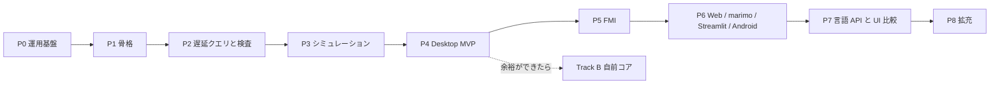

# セッション記録 0e301cfb-c9ff-440e-b48e-89148a3cfe93

| | |
| --- | --- |
| 開始 | 2026-10-30 02:06:35 |
| 最終更新 | 2026-10-30 03:49:50 |
| ブランチ | `main` |
| 作業ディレクトリ | `~/monorepo/Chaos/20261018_GlobeMode` |
| やり取り | 70 件 |

> 読むための整形版。ツール結果と思考は先頭だけを抜いてある。
> メールアドレス・ローカルのユーザー名とパス・トークンらしき文字列は伏せ字にしてある。
> 完全な生ログは作業者の手元の `log/local/raw/` にだけある（コミットしない）。

## 👤 ユーザー　`2026-10-30 02:06:43`

<local-command-caveat>The command below was run directly in Claude Code, not sent to you as a request, and its output goes straight to the user. It's recorded here as context for later messages.</local-command-caveat>

## 👤 ユーザー　`2026-10-30 02:06:43`

<command-name>/model</command-name>
            <command-message>model</command-message>
            <command-args></command-args>

## 👤 ユーザー　`2026-10-30 02:06:43`

<local-command-stdout>Set model to `Fable 5.1` and saved as your default for new sessions</local-command-stdout>

## 👤 ユーザー　`2026-10-30 02:13:30`

# リポジトリを俯瞰し設計方針へのアドバイス、並行して進められそうな作業プランを考えて他のエージェントに与えられる形にして

- このリポジトリでリリースできるまでのどのくらいの時間とトークン量になりそうですか？
- Codexを監査役としてレビュー担当にするのでレビュー履歴のみを残すディレクトリもlogにほしい
- HermesAgentkara

## 🤖 Claude　`2026-10-30 02:13:39`

<details><summary>思考</summary>


</details>

## 🤖 Claude　`2026-10-30 02:13:40`

リポジトリの正典（README・architecture・roadmap・features）と直近の作業記録を読んでから、設計の助言と並行作業プランをファイルに書き、`log/review/` を用意します。

## 🤖 Claude　`2026-10-30 02:13:42`

**🔧 Bash** — List canonical docs, ADRs, sessions, logs

<details><summary>入力</summary>

```json
{
 "command": "wc -l README.md doc/architecture.md doc/roadmap.md doc/features.md && ls doc doc/adr doc/sessions log/work log | head -120 && git log --oneline | wc -l && git log -1 --format=%ci",
 "description": "List canonical docs, ADRs, sessions, logs"
}
```

</details>

## 👤 ユーザー　`2026-10-30 02:13:55`

<details><summary>ツール結果</summary>

```
    36 README.md
   365 doc/architecture.md
   317 doc/roadmap.md
    97 doc/features.md
   815 total
doc:
adr
architecture.md
assets
features.md
licenses.md
mise-setup.html
msl-funnel.md
msl-sim.md
omc-compare.md
research
roadmap.md
sessions

doc/adr:
0001-license-policy.md
0002-rumoca-adapter.md
0003-toolchain.md
0004-ui-tauri-svelte.md
0005-lazy-query-db.md
0006-incremental-ci.md
0007-unsupported-classification.md
0008-local-llm-reviewer.md
0009-structural-index-and-init.md
0010-omc-comparison.md
0011-init-system-matching.md
0012-loops-and-preflight.md
0013-exec-backend.md
0014-session-route-wasm.md
0015-auto-and-reference-tolerance.md
0016-preflight-on-build-lowering.md
0017-lowering-limit-and-hard-timeout-retry.md
0018-no-preflight-limit.md
0019-rpi-aarch64-environment.md
0020-init-re
… （残り 1,962 字は生ログを参照）
```

</details>

## 🤖 Claude　`2026-10-30 02:13:58`

**🔧 Bash** — Read README, roadmap, features

<details><summary>入力</summary>

```json
{
 "command": "cat README.md doc/roadmap.md doc/features.md",
 "description": "Read README, roadmap, features"
}
```

</details>

## 🤖 Claude　`2026-10-30 02:14:00`

**🔧 Bash** — Read architecture doc

<details><summary>入力</summary>

```json
{
 "command": "cat doc/architecture.md",
 "description": "Read architecture doc"
}
```

</details>

## 🤖 Claude　`2026-10-30 02:14:02`

**🔧 Bash** — Read latest work log, log README, repo layout, settings

<details><summary>入力</summary>

```json
{
 "command": "cat log/work/2026-10-30-s032-cvode.md log/README.md && cat log/work/_TEMPLATE.md && ls src/Rust/mod src/Rust/apps src/Svelte 2>/dev/null && find src/Rust/mod -name '*.rs' | xargs wc -l | tail -1 && ls src/Svelte/src 2>/dev/null | head; cat .claude/settings.json | head -60; ls .claude/skills .claude/hooks",
 "description": "Read latest work log, log README, repo layout, settings"
}
```

</details>

## 👤 ユーザー　`2026-10-30 02:14:03`

<details><summary>ツール結果</summary>

```
<persisted-output>
Output too large (59.2KB). Full output saved to: ~/.claude/projects/-home-<user>-monorepo-Chaos-20261018-GlobeMode/0e301cfb-c9ff-440e-b48e-89148a3cfe93/tool-results/b3j531j6g.txt

Preview (first 2KB):
# GlobeMode アーキテクチャ

- 版: v0（2026-10-18、S001）。
- 判断の理由は [adr/](adr/) に、機能の一覧は [features.md](features.md) に、順序は [roadmap.md](roadmap.md) にある。

## 1. 全体像

計算はすべて Rust のコアで行う。UI と各言語の API は、同じ facade（`globe-mode`）と同じ protocol 型（`globe-mode-protocol`）を通してコアを呼ぶ。

```mermaid
flowchart LR
  subgraph Front["フロントエンド（Phase A: Rumoca / Track B: native）"]
    P[parse] --> O[outline] --> CI[class_index / class_interface]
    CI --> F[flat] --> D[dae_structure]
  end
  CI --> G[connect_graph]
  D --> S[simulatability S0–S10]
  S --> X[executable]
  X --> 
… （残り 1,469 字は生ログを参照）
```

</details>

## 👤 ユーザー　`2026-10-30 02:14:03`

<details><summary>ツール結果</summary>

```
<persisted-output>
Output too large (84.2KB). Full output saved to: ~/.claude/projects/-home-<user>-monorepo-Chaos-20261018-GlobeMode/0e301cfb-c9ff-440e-b48e-89148a3cfe93/tool-results/b4h9z76ac.txt

Preview (first 2KB):
# GlobeMode

**An open-source Modelica IDE written in Rust.**

GlobeMode is planned to run on Linux (Debian family), Windows 11, Android, in the browser (WebAssembly, computing on the visitor's machine), as a CLI, and inside marimo notebooks. Features planned:

- an incremental (salsa-based) language service, plus a pre-simulation check that reports why a model cannot be simulated;
- multiple ODE/DAE solvers, selectable by their OpenModelica and Dymola names;
- FMI 2.0 and 3.0 import and export (Model Exchange, Co-Simulation, Scheduled Execu
… （残り 1,477 字は生ログを参照）
```

</details>

## 👤 ユーザー　`2026-10-30 02:14:03`

<details><summary>ツール結果</summary>

```
# S032 `cvode`

| | |
| --- | --- |
| 日付 | 2026-10-30 |
| ブランチ | `feature/s032-cvode` |
| worktree | `.git-worktree/s032-cvode` |
| Phase | P3 |
| セッション文書 | `doc/sessions/S032-cvode/` |
| セッション記録 | `log/sessions/2026-10-21-40b9a39f-6e5f-4daa-8928-20b6496f2093.md` |

## 依頼

「進めて。サブエージェントは Sonnet/high、レスポンスは日本語」。候補 6（残りの計画のソルバ）の続き。S031 の報告で「`ida`・`cvode` は依存を足すので方針を確かめる」と書いたあとの「進めて」なので、licenses.md と architecture.md に計画済みの feature `sundials`（SUNDIALS、BSD-3、許可）として進めた。

## 決めたこと

- `cvode` だけを足す（サブエージェント Sonnet・high）。`ida` は次。部品は常微分方程式の形で導関数を返すので CVODE が先。
- crate は `sundials-sys` 0.6.2（BSD-3-Clause、SUNDIALS 7.1.1 を同梱）。`default-features = false` で `cvode`・`build_libraries`・`static_libraries` だけ。`klu`（LGPL）・openmp・pthreads は使わない。licenses.md に計画済みの crate で、`MeIntegratorBackend` に要る `CV_ONE_STEP`・
… （残り 5,846 字は生ログを参照）
```

</details>

## 🤖 Claude　`2026-10-30 02:14:07`

**🔧 Bash** — Read README/roadmap/features output part 1

<details><summary>入力</summary>

```json
{
 "command": "cd ~/.claude/projects/-home-<user>-monorepo-Chaos-20261018-GlobeMode/0e301cfb-c9ff-440e-b48e-89148a3cfe93/tool-results && sed -n 1,400p b4h9z76ac.txt",
 "description": "Read README/roadmap/features output part 1"
}
```

</details>

## 🤖 Claude　`2026-10-30 02:14:09`

**🔧 Bash** — Read README/roadmap/features output part 2

<details><summary>入力</summary>

```json
{
 "command": "cd ~/.claude/projects/-home-<user>-monorepo-Chaos-20261018-GlobeMode/0e301cfb-c9ff-440e-b48e-89148a3cfe93/tool-results && sed -n 400,900p b4h9z76ac.txt",
 "description": "Read README/roadmap/features output part 2"
}
```

</details>

## 🤖 Claude　`2026-10-30 02:14:12`

**🔧 Bash** — Read architecture doc output

<details><summary>入力</summary>

```json
{
 "command": "cd ~/.claude/projects/-home-<user>-monorepo-Chaos-20261018-GlobeMode/0e301cfb-c9ff-440e-b48e-89148a3cfe93/tool-results && sed -n 1,370p b3j531j6g.txt",
 "description": "Read architecture doc output"
}
```

</details>

## 🤖 Claude　`2026-10-30 02:14:15`

**🔧 Bash** — Crate sizes, funnel/sim status, non-Rust dirs, finish-session skill

<details><summary>入力</summary>

```json
{
 "command": "for c in src/Rust/mod/*; do echo \"$c $(find $c -name '*.rs' | xargs cat | wc -l)\"; done; echo; head -40 doc/msl-funnel.md; echo; head -40 doc/msl-sim.md; echo; cat src/Svelte/README.md; ls src/Rust/apps src/Python src/Julia src/Zig src/Elixir src/Gleam 2>&1 | head -30; cat .claude/skills/finish-session/SKILL.md | head -80",
 "description": "Crate sizes, funnel/sim status, non-Rust dirs, finish-session skill"
}
```

</details>

## 👤 ユーザー　`2026-10-30 02:14:15`

<details><summary>ツール結果</summary>

```
| **シミュレーション前のアサーション（S0〜S10）** | △ | △ | **Must** | P2（S005 で S0〜S6、S007 で S7・S8、S010 で S9・S10 の静的な部分） | `assert_simulatable`。Error があれば `--force` 無しでは実行しない。S005 で S6（構造特異、GM-E6001）と「コンパイラが未対応」の GM-U（[ADR-0007](adr/0007-unsupported-classification.md)）。S007 で S7・S8（[ADR-0009](adr/0009-structural-index-and-init.md)）。`globe check` に S7・S8 の行と `--json` の `s7` / `s8` / `init`。S010 で S9（代数ループ、GM-I9001 / GM-W9001）と S10（パラメータと start 値の評価、experiment annotation。GM-E10001〜GM-E10004 ほか）、`--json` の `s9` / `s10`（[ADR-0012](adr/0012-loops-and-preflight.md)）。S011 で S10 の数値の部分を実行の直前に足した（start 値で評価した t0 の値が有限か GM-W10002、ソルバの名前 GM-E10005 / GM-I10003。[ADR-0013](adr/0013-exec-backend.md)）。S018 で初期化の解き直し（初期化系を 2 回解いて動けば GM-W10004。[ADR-0020](adr/0020-init-resettle-check.md)）。初期化のヤコビ行列の階数は、Rumoca に公開の API が無いので後回
… （残り 6,251 字は生ログを参照）
```

</details>

## 👤 ユーザー　`2026-10-30 02:14:15`

<details><summary>ツール結果</summary>

```
<persisted-output>
Output too large (74.7KB). Full output saved to: ~/.claude/projects/-home-<user>-monorepo-Chaos-20261018-GlobeMode/0e301cfb-c9ff-440e-b48e-89148a3cfe93/tool-results/b9zu0gpj5.txt

Preview (first 2KB):
# GlobeMode

**An open-source Modelica IDE written in Rust.**

GlobeMode is planned to run on Linux (Debian family), Windows 11, Android, in the browser (WebAssembly, computing on the visitor's machine), as a CLI, and inside marimo notebooks. Features planned:

- an incremental (salsa-based) language service, plus a pre-simulation check that reports why a model cannot be simulated;
- multiple ODE/DAE solvers, selectable by their OpenModelica and Dymola names;
- FMI 2.0 and 3.0 import and export (Model Exchange, Co-Simulation, Scheduled Execu
… （残り 1,477 字は生ログを参照）
```

</details>

## 👤 ユーザー　`2026-10-30 02:14:15`

<details><summary>ツール結果</summary>

```
<persisted-output>
Output too large (59.2KB). Full output saved to: ~/.claude/projects/-home-<user>-monorepo-Chaos-20261018-GlobeMode/0e301cfb-c9ff-440e-b48e-89148a3cfe93/tool-results/b7yz3pgsq.txt

Preview (first 2KB):
# GlobeMode アーキテクチャ

- 版: v0（2026-10-18、S001）。
- 判断の理由は [adr/](adr/) に、機能の一覧は [features.md](features.md) に、順序は [roadmap.md](roadmap.md) にある。

## 1. 全体像

計算はすべて Rust のコアで行う。UI と各言語の API は、同じ facade（`globe-mode`）と同じ protocol 型（`globe-mode-protocol`）を通してコアを呼ぶ。

```mermaid
flowchart LR
  subgraph Front["フロントエンド（Phase A: Rumoca / Track B: native）"]
    P[parse] --> O[outline] --> CI[class_index / class_interface]
    CI --> F[flat] --> D[dae_structure]
  end
  CI --> G[connect_graph]
  D --> S[simulatability S0–S10]
  S --> X[executable]
  X --> 
… （残り 1,469 字は生ログを参照）
```

</details>

## 👤 ユーザー　`2026-10-30 02:14:17`

<details><summary>ツール結果</summary>

```
src/Rust/mod/globe-mode-analysis 7165
src/Rust/mod/globe-mode-cli 1748
src/Rust/mod/globe-mode-core 568
src/Rust/mod/globe-mode-db 3387
src/Rust/mod/globe-mode-exec 5900
src/Rust/mod/globe-mode-frontend 5816
src/Rust/mod/globe-mode-graph 315
src/Rust/mod/globe-mode-ir 1235
src/Rust/mod/globe-mode-sim 6379
src/Rust/mod/globe-mode-wasm 600

# MSL 4.1.0 の全例題のファネル（globe check）

`cargo xtask msl-funnel` が生成した。手で編集しない。

| | |
| --- | --- |
| MSL | 4.1.0（sha256 `5409cfa17797…`） |
| Rumoca | v0.10.2（rev `276e82bd`、ライブラリとして呼ぶ） |
| 例題 | 566 本（Rumoca の基準値 566 本と一致。うち partial 13 本（Rumoca の基準値は 13 本）） |
| 検査した本数 | 566 本（全部） |
| 検査器 | `globe_mode_frontend::Checker`（MSL を一度だけ読み、Rumoca の Session を使い回す） |
| 段階 | S0〜S10。S007 から S7（インデックス、Pantelides 法）・S8（初期化）、**S010 から S9（代数ループ）・S10（プリフライトの静的な部分）を含む**（S005 
… （残り 6,876 字は生ログを参照）
```

</details>

## 🤖 Claude　`2026-10-30 02:14:19`

<details><summary>思考</summary>


</details>

## 🤖 Claude　`2026-10-30 02:14:22`

**🔧 Bash** — Read roadmap section

<details><summary>入力</summary>

```json
{
 "command": "cd ~/.claude/projects/-home-<user>-monorepo-Chaos-20261018-GlobeMode/0e301cfb-c9ff-440e-b48e-89148a3cfe93/tool-results && awk '/^# GlobeMode ロードマップ|^# ロードマップ/{p=1} /^# GlobeMode 機能一覧|^# 機能/{p=0} p' b4h9z76ac.txt | cut -c1-600 | head -330",
 "description": "Read roadmap section"
}
```

</details>

## 🤖 Claude　`2026-10-30 02:14:26`

**🔧 Bash** — Read architecture crate table and later sections

<details><summary>入力</summary>

```json
{
 "command": "cd ~/.claude/projects/-home-<user>-monorepo-Chaos-20261018-GlobeMode/0e301cfb-c9ff-440e-b48e-89148a3cfe93/tool-results && grep -n '^## \\|^### ' b7yz3pgsq.txt; awk '/^### 2.2/{p=1} /^## 3/{p=0} p' b7yz3pgsq.txt | cut -c1-400; awk '/^## 4|^## 5|^## 6|^## 7|^## 8/{p=1} p' b7yz3pgsq.txt | cut -c1-400 | head -150",
 "description": "Read architecture crate table and later sections"
}
```

</details>

## 🤖 Claude　`2026-10-30 02:14:29`

**🔧 Bash** — Session index, commit cadence, log sizes, gitignore

<details><summary>入力</summary>

```json
{
 "command": "cat doc/sessions/README.md | tail -40; git log --format='%ci' | awk '{print $1}' | sort | uniq -c; ls log/sessions | wc -l; du -sh log/sessions log/local 2>/dev/null; ls -la log/local/raw 2>/dev/null | tail -3; cat .gitignore",
 "description": "Session index, commit cadence, log sizes, gitignore"
}
```

</details>

## 👤 ユーザー　`2026-10-30 02:14:30`

<details><summary>ツール結果</summary>

```
<persisted-output>
Output too large (58.4KB). Full output saved to: ~/.claude/projects/-home-<user>-monorepo-Chaos-20261018-GlobeMode/0e301cfb-c9ff-440e-b48e-89148a3cfe93/tool-results/byixip6ls.txt

Preview (first 2KB):
# GlobeMode ロードマップ

- 版: v0（2026-10-18、S001）。
- **P** は開発の段階（Phase）、**S** はセッション番号（`doc/sessions/SNNN-*`）。
- 1 つの Phase は複数のセッションにまたがる。セッションの数は目安。

## 全体



## Phase ごとの範囲と完了条件

| Phase | 範囲 | 完了条件 | 目安 |
| --- | --- | --- | --- |
| **P0 運用基盤** | 調査、計画、CLAUDE.md、スキル、セッション記録のフック、スライドと解説書の型
… （残り 1,410 字は生ログを参照）
```

</details>

## 👤 ユーザー　`2026-10-30 02:14:30`

<details><summary>ツール結果</summary>

```
6:## 1. 全体像
32:## 2. 配置
34:### 2.1 ディレクトリ
57:### 2.2 Rust crate（`src/Rust/mod/`）
85:### 2.3 ツールチェーン
97:## 3. 中核の設計
99:### 3.1 フロントエンドと Rumoca アダプタ
119:### 3.2 遅延評価とシミュレーション前のアサーション
201:### 3.3 ソルバ
259:### 3.4 FMI 2.0 / 3.0
298:### 3.5 connect のネットワークグラフ
318:## 4. ターゲットごとの実行方法
331:## 5. 言語 API
344:## 6. UI の比較実験（P7）
352:## 7. 検証の基盤
### 2.2 Rust crate（`src/Rust/mod/`）

**（S002）** と書いたものは実装済み。ほかは予定。

| crate | 責務 | 主な依存 |
| --- | --- | --- |
| `globe-mode-core` **（S002）** | `TextRange`、`Diagnostic{code,severity,stage,message,file,range,notes}`、検査段階 `Stage`（S0〜S10）、診断コード。S005 で `normalize`（防火壁 0 の本文の正規化）、GM-U・GM-E6001・GM-I7001 のコード、`Diagnostic::is_unsupported`。S007 で S7・S8 のコード（`GM-I7002`、`GM-E7001`、`GM-E8001`、`GM-W8001`〜`GM-W8004`）�
| `globe-mode-ir` **（S002）** | フロントエンドに依存しない中立 IR: `Outline`
… （残り 8,034 字は生ログを参照）
```

</details>

## 👤 ユーザー　`2026-10-30 02:14:31`

<details><summary>ツール結果</summary>

```
# セッションの索引

各セッションのスライドと解説書。書き方は `.claude/skills/session-docs/SKILL.md`、雛形は [_template/](_template/)。

| S | 日付 | Phase | 題名 | ブランチ | 状態 | スライド | 解説書 | セッション記録 |
| --- | --- | --- | --- | --- | --- | --- | --- | --- |
| S001 | 2026-10-18 | P0 | 調査と計画、運用基盤 | `feature/s001-research-plan` | 完了 | [slides](S001-research-plan/slides.html) | [解説書](S001-research-plan/解説書.md) | [log](../../log/sessions/2026-10-18-cf689fe6-f0d2-41f8-a25d-1a34aca756c7.md) |
| S002 | 2026-10-18 | P1 | workspace の骨格、Rumoca アダプタ、cargo-deny、Playwright | `feature/s002-workspace-skeleton` | 完了 | [slides](S002-workspace-skeleton/slides.html) | [解説書](S002-workspace-skeleton/解説書.md) | [log](../../log/sessions/2026-10-18-cf689fe6-f0d2-41f8-a25d-1a34aca756c7.md)（S001 と同じセッション） |
| S003 | 2026-10-18 | P1 | MSL で Rumoca と突き合わせ（20
… （残り 13,925 字は生ログを参照）
```

</details>

## 🤖 Claude　`2026-10-30 02:14:35`

<details><summary>思考</summary>


</details>

## 🤖 Claude　`2026-10-30 02:14:38`

**🔧 Bash** — Read roadmap phases P4 onward and candidates

<details><summary>入力</summary>

```json
{
 "command": "cd ~/.claude/projects/-home-<user>-monorepo-Chaos-20261018-GlobeMode/0e301cfb-c9ff-440e-b48e-89148a3cfe93/tool-results && sed -n 30,330p byixip6ls.txt | cut -c1-500",
 "description": "Read roadmap phases P4 onward and candidates"
}
```

</details>

## 🤖 Claude　`2026-10-30 02:14:43`

**🔧 Bash** — Sum token usage across raw session logs

<details><summary>入力</summary>

```json
{
 "command": "for f in log/local/raw/*.jsonl.gz; do echo \"== $f\"; gunzip -c \"$f\" | python3 -I -c '\nimport sys,json\ninp=out=cc=cr=0;n=0;models={}\nfor line in sys.stdin:\n    try: d=json.loads(line)\n    except: continue\n    m=d.get(\"message\") or {}\n    u=m.get(\"usage\") if isinstance(m,dict) else None\n    if not u: continue\n    n+=1\n    inp+=u.get(\"input_tokens\",0); out+=u.get(\"output_tokens\",0)\n    cc+=u.get(\"cache_creation_input_tokens\",0); cr+=u.get(\"cache_read_input_tokens\",0)\n    models[m.get(\"model\")]=models.get(m.get(\"model\"),0)+1\nprint(f\"turns={n} in={inp
… （残り 161 字は生ログを参照）
```

</details>

## 👤 ユーザー　`2026-10-30 02:14:45`

<details><summary>ツール結果</summary>

```
<persisted-output>
Output too large (51.4KB). Full output saved to: ~/.claude/projects/-home-<user>-monorepo-Chaos-20261018-GlobeMode/0e301cfb-c9ff-440e-b48e-89148a3cfe93/tool-results/b033j9ar3.txt

Preview (first 2KB):
Track B の B1〜B2 は IDE の機能（補完、アウトライン）から先に使える。コンパイルのパイプラインは引き続き Rumoca が受け持つ。ただし AST が別物なので、両者を混ぜるのは「IDE 機能か、コンパイルか」の境目に限る。

## 進み具合

### S002（P1 の 1 回目、2026-10-18）で済んだこと

- ルートを virtual workspace にし、4 つの crate を作った: `globe-mode-core`、`globe-mode-ir`、`globe-mode-frontend`（Rumoca アダプタ）、`globe-mode-cli`（`globe outline` / `globe check`）。
- **Rumoca v0.10.2（`276e82bd`）の `rumoca-compile` が、stable 1.99.1 でビルドできることを確かめた**。
  - ネイティブでも `wasm32-unknown-unknown` でも `cargo check` が通る。
  - これで [ADR-0003](adr/0003-toolchain.md) を Accepted にした。
- `mise.toml
… （残り 1,553 字は生ログを参照）
```

</details>

## 👤 ユーザー　`2026-10-30 02:14:50`

<details><summary>ツール結果</summary>

```
== log/local/raw/2026-10-18-40153c9b-1d16-414d-85e1-aa59674d1077.jsonl.gz
turns=324 in=662 out=418223 cache_create=974426 cache_read=70074687 models={'claude-opus-5-5': 324}
== log/local/raw/2026-10-18-63325205-fc9c-4ce6-b38e-0337835ead44.jsonl.gz
turns=22 in=44 out=27745 cache_create=108284 cache_read=1013142 models={'claude-sonnet-5-5': 22}
== log/local/raw/2026-10-18-c74fbe25-624e-4092-95b3-282cf3c8d554.jsonl.gz
turns=2022 in=29748 out=3161724 cache_create=6993093 cache_read=575252873 models={'claude-fable-5-1': 982, 'claude-opus-5-5': 1039, '<synthetic>': 1}
== log/local/raw/2026-10-18-cf689fe6-f0d2-41f8-a25d-1a34aca756c7.jsonl.gz
turns=886 in=1800 out=1601965 cache_create=2319282 cache_read=425802906 models={'claude-opus-5-5': 886}
== log/local/raw/2026-10-19-36fc92f3-f36e-4690-bc9d-a
… （残り 1,041 字は生ログを参照）
```

</details>

## 🤖 Claude　`2026-10-30 02:14:54`

<details><summary>思考</summary>


</details>

## 🤖 Claude　`2026-10-30 02:14:59`

**🔧 Bash** — Extract roadmap phase rows and candidate list

<details><summary>入力</summary>

```json
{
 "command": "cd ~/.claude/projects/-home-<user>-monorepo-Chaos-20261018-GlobeMode/0e301cfb-c9ff-440e-b48e-89148a3cfe93/tool-results && grep -n '^| \\*\\*P[4-8]\\|^| \\*\\*Track\\|^## \\|^### ' byixip6ls.txt | cut -c1-200; echo ----; awk '/候補/{c++} c&&/^- |^\\| [0-9]/{print}' byixip6ls.txt | grep -n '候補\\|^| [0-9]\\+ ' | cut -c1-300 | head -50; echo ----; grep -n '^| \\*\\*P[4-8]' byixip6ls.txt | cut -c1-900",
 "description": "Extract roadmap phase rows and candidate list"
}
```

</details>

## 👤 ユーザー　`2026-10-30 02:15:02`

<details><summary>ツール結果</summary>

```
----
1:- 範囲は S007 の候補のうち `deps_closure`（1）、S7（3）、S8（4）。**omc との照合（5）はユーザーの指示で後回し**にした（omc 未導入。OpenModelica のサイトが重くて取得できない。入れたら再開する）。`Checker` のメモリ（2）は P4
3:- **S7（Pantelides 法と状態選択の候補）**と **S8（初期化系の検査）**を足した（[ADR-0009](adr/0009-structural-index-and-init.md)）。
6:- 範囲は S008 の候補のうち **omc との照合（1）だけ**。ユーザーが OpenModelica 1.27.1 を入れたので、S007 で後回しにした項目を最初に再開した。方法は [ADR-0010](adr/0010-omc-comparison.md)、報告は [omc-compare.md](omc-compare.md)。
9:- 食い違い 2 本（`AdvancedSolenoid`: globe は通し omc は Pantelides の内部エラー。`NonCircularPipes`: globe は不足、omc は冗長な初期方程式 2 本）は S009 の候補にした。
11:- 範囲は S009 の候補のうち **omc と食い違った 2 本の調査（1）** と **S8 の精密化（3）**。1 の調査で `NonCircularPipes` の食い違いが「数だけの S8 は冗長を見られない」ことだったので、3 をそのまま主な実装にした。方法は [AD
12:- **`AdvancedSolenoid` は S6 の限界**（直さない）: 接地の無い部品の単体の検査で、枝 8 本 ≥ 節点 7 つなので二部グラフには完全マッチング
… （残り 3,411 字は生ログを参照）
```

</details>

## 🤖 Claude　`2026-10-30 02:15:06`

**🔧 Bash** — Read roadmap phase rows and current candidate list

<details><summary>入力</summary>

```json
{
 "command": "grep -n 'P4 Desktop\\|P5 FMI\\|P6 Web\\|P7 言語\\|P8 拡充\\|Track B' doc/roadmap.md | cut -c1-700 | head -12; echo ----; grep -n '次回の候補\\|候補の一覧\\|^### .*候補\\|^## .*候補' doc/roadmap.md | head; echo ----; tail -60 doc/roadmap.md | cut -c1-400",
 "description": "Read roadmap phase rows and current candidate list"
}
```

</details>

## 👤 ユーザー　`2026-10-30 02:15:29`

<details><summary>ツール結果</summary>

```
11:  P0[P0 運用基盤] --> P1[P1 骨格] --> P2[P2 遅延クエリと検査] --> P3[P3 シミュレーション] --> P4[P4 Desktop MVP]
12:  P4 --> P5[P5 FMI] --> P6[P6 Web / marimo / Streamlit / Android] --> P7[P7 言語 API と UI 比較] --> P8[P8 拡充]
13:  P4 -.余裕ができたら.-> B[Track B 自前コア]
24:| **P4 Desktop MVP** | CodeMirror 6 と LSP、ライブラリツリー、検査パネル、プロット、sigma.js の connect グラフ | ChuaCircuit で開く・検査・実行・プロットが通る。5k ノードのグラフが 30 fps 以上で動く。RSS の基準値を記録する。CI が .deb と .msi を作る | 6 回 |
25:| **P5 FMI** | Import（ME / CS / SE）とマスター。Export は P5a（Rumoca のテンプレート）の後に P5b（自前のランタイム） | Reference-FMUs が linux64 と win64 で一致する。Export した FMU が FMPy・fmusim・fmuCheck を通る。Clocks（SE）が往復できる | 8 回 |
26:| **P6 Web / marimo / Streamlit / Android** | WorkerBackend、MSL のパッケージ単位の分割読み込み、anywidget、wheel、APK | ブラウザが CSP `connect-src 'self'` のまま実行できる（サーバーで計算しない）。marimo の WASM で 2 
… （残り 6,186 字は生ログを参照）
```

</details>

## 🤖 Claude　`2026-10-30 02:17:16`

<details><summary>思考</summary>


</details>

## 🤖 Claude　`2026-10-30 02:17:21`

Read enough. Measured token usage from the raw session logs, roadmap status, and crate layout are in hand. Now I'll cut a worktree and write the plan file and the `log/review/` directory.

## 🤖 Claude　`2026-10-30 02:17:24`

**🔧 Bash** — Create worktree for the plan session and locate table rows to extend

<details><summary>入力</summary>

```json
{
 "command": "git worktree add -b feature/s033-parallel-plan .git-worktree/s033-parallel-plan main 2>&1 | tail -2 && mkdir -p .git-worktree/s033-parallel-plan/log/review .git-worktree/s033-parallel-plan/doc/plan && grep -n 'log/sessions/\\|log/work/' CLAUDE.md log/README.md | head",
 "description": "Create worktree for the plan session and locate table rows to extend"
}
```

</details>

## 👤 ユーザー　`2026-10-30 02:18:03`

<details><summary>ツール結果</summary>

```
Updating files:  83% (307/368)
Updating files:  84% (310/368)
Updating files:  85% (313/368)
Updating files:  86% (317/368)
Updating files:  87% (321/368)
Updating files:  88% (324/368)
Updating files:  89% (328/368)
Updating files:  90% (332/368)
Updating files:  91% (335/368)
Updating files:  92% (339/368)
Updating files:  93% (343/368)
Updating files:  94% (346/368)
Updating files:  95% (350/368)
Updating files:  96% (354/368)
Updating files:  97% (357/368)
Updating files:  98% (361/368)
Updating files:  99% (365/368)
Updating files: 100% (368/368)
Updating files: 100% (368/368), done.
HEAD is now at c48d87b Merge feature/s032-cvode: cvode（SUNDIALS 7.1.1 の CVODE を sundials-sys 0.6.2 で呼ぶ。feature sundials を立てたビルドだけ。密な線形ソルバ、根探索なし）
log/README.md:26:- コミットの前に、`python3 .claude/hooks/save_sess
… （残り 544 字は生ログを参照）
```

</details>

## 🤖 Claude　`2026-10-30 02:18:31`

Now writing the plan document, the review log directory, and the small pointer edits.

## 🤖 Claude　`2026-10-30 02:20:29`

**🔧 Bash** — Create log/review README and template, add pointers in CLAUDE.md and log/README.md

<details><summary>入力</summary>

```json
{
 "command": "cd ~/monorepo/Chaos/20261018_GlobeMode/.git-worktree/s033-parallel-plan && cat > log/review/README.md <<'EOF'\n# log/review — レビュー履歴\n\n監査役（Codex。副次的に `/local-review` の Bonsai）が出した指摘と、その採否だけを残す。コードの変更はここに書かない。\n\n- 1 レビュー 1 枚。名前は `<日付>-sNNN-<topic>-<レビュアー>.md`（例 `2026-10-31-s033-protocol-facade-codex.md`）。雛形は [_TEMPLATE.md](_TEMPLATE.md)。\n- レビュアーの出力は**原文のまま**貼る。採否と理由は実装側（Claude か人）が書く。指摘を直したら、そのコミットの hash を書く。\n- 書くもの: 対象のコミット範囲（`git diff <base>..<head>`）、レビュアーのモデルと版、指摘、採否、結論。\n- 書かないもの: 差分そのもの、ファイルの全文、メールアドレス・ホームのパス・トークン。コミットの前に `python3 .claude/hooks/sav
… （残り 2,085 字は生ログを参照）
```

</details>

## 👤 ユーザー　`2026-10-30 02:21:54`

<details><summary>ツール結果</summary>

```
 CLAUDE.md     | 5 +++++
 log/README.md | 8 ++++++++
 2 files changed, 13 insertions(+)
```

</details>

## 🤖 Claude　`2026-10-30 02:22:02`

<details><summary>思考</summary>


</details>

## 🤖 Claude　`2026-10-30 02:24:36`

**🔧 Bash** — Write the plan document, link it from the roadmap, run the docs link check

<details><summary>入力</summary>

```json
{
 "command": "cat > doc/plan/2026-10-30-release-estimate-and-parallel-plan.md <<'EOF'\n# リリースまでの見積もりと並行作業プラン（2026-10-30、S033）\n\n- 書いた日: 2026-10-30。S032 までの状態（P3 の完了条件は達成、P4 は未着手）を俯瞰した。\n- 目的: (1) 設計への助言、(2) リリースまでの時間とトークンの見積もり、(3) **他のエージェントにそのまま渡せる作業指示書**（§4）、(4) Codex を監査役にする運用（§5）、(5) 無料プロバイダをワーカーにする戦略（§6）。\n- 正典は [roadmap.md](../roadmap.md)・[architecture.md](../architecture.md)・[features.md](../features.md)。この文書は計画を変えない。変えるときは正典を同じコミットで直す。\n\n## 1. 俯瞰\n\n| 項目 | 状態（2026-10-30） |\n| --- | --- |\n| セッション | S001〜S032（13 日間、2026-10-18〜10-30） |\n| Rust | 10 crate、約 33,000 行（analysis 7.2k・sim 6
… （残り 13,174 字は生ログを参照）
```

</details>

## 👤 ユーザー　`2026-10-30 02:24:45`

<details><summary>ツール結果</summary>

```
[slides] doc/sessions/S030-radau5/slides.html: OK
[slides] doc/sessions/S031-qss/slides.html: OK
[slides] doc/sessions/S032-cvode/slides.html: OK
[slides] doc/sessions/_template/slides.html: OK
[links] 文書 165 件 / 相対リンク 937 件 / 切れ 0 件
 M CLAUDE.md
 M doc/roadmap.md
 M log/README.md
?? doc/plan/
?? log/review/
```

</details>

## 🤖 Claude　`2026-10-30 02:24:52`

<details><summary>思考</summary>


</details>

## 🤖 Claude　`2026-10-30 02:25:02`

**🔧 Bash** — Add judge-model subsection to the plan and recheck links

<details><summary>入力</summary>

```json
{
 "command": "python3 - <<'EOF'\np='doc/plan/2026-10-30-release-estimate-and-parallel-plan.md'; s=open(p).read()\ns=s.replace(\"### 最初の 1 回でやること\\n\",\"\"\"### 判断に特化したモデル（judge / verifier）の使い所\n\nユーザーが挙げた「Jev などの判断特化モデル」は、この文書を書いた時点では名前と提供元を確かめていない【未確認】。導入するときは `doc/research/` に URL と確認日を書く。使い所は生成ではなく**採否の判定**に限る。\n\n| 使い所 | 入力 | 出力 | 効くところ |\n| --- | --- | --- | --- |\n| Codex の指摘の一次選別 | 指摘 1 件 + 該当の差分 | 「要確認 / 不要」と 1 行の理由 | Claude が確かめる件数を減らす。`log/review/` の採否欄の下書きになる |\n| 無料ワーカーの成果の合否 | 成果の差分 + WP の完了条件 | 合 / 否 + 外れた条件 | §6 の「確認の時間が本体を上回る」問題を抑える |\n| 作業記録の数字の照合 | 作業記録 + 検査のログ | 食い違いの一覧 | `
… （残り 390 字は生ログを参照）
```

</details>

## 👤 ユーザー　`2026-10-30 02:25:04`

<details><summary>ツール結果</summary>

```
[links] 文書 165 件 / 相対リンク 937 件 / 切れ 0 件
 CLAUDE.md      | 5 +++++
 doc/roadmap.md | 2 ++
 log/README.md  | 8 ++++++++
 3 files changed, 15 insertions(+)
doc/plan:
2026-10-30-release-estimate-and-parallel-plan.md

log/review:
README.md
_TEMPLATE.md
```

</details>

## 🤖 Claude　`2026-10-30 02:25:23`

作業は worktree `.git-worktree/s033-parallel-plan`（ブランチ `feature/s033-parallel-plan`）に置きました。未コミットです。このセッションはサブエージェントを使わずに済んだので、Opus/Medium の指定は次に起動するときに適用します。

## 書いたもの

- `doc/plan/2026-10-30-release-estimate-and-parallel-plan.md`。俯瞰、設計の助言 8 点、実測の費用、リリースの見積もり、エージェントに貼れる指示書 WP-0〜WP-J、Codex の運用、無料プロバイダと判断特化モデルの戦略。roadmap の「運用上の決まり」からリンクした。
- `log/review/`。README と `_TEMPLATE.md`（対象のコミット範囲、レビュアー、指摘を原文のまま、採否と理由）。CLAUDE.md の表と `log/README.md` に 1 行ずつ足した。
- リンク検査は 937 件中の切れ 0 件。

## 設計の助言（要点）

- P3 は完了している。S026〜S032 の 7 回は P8 のソルバで、リリースを近づけていない。`ida` は P8 へ戻す。
- 次の 1 回は `globe-mode-protocol` と facade `globe-mode` を作ることに使う。UI・LSP・Python・Tauri・wasm がすべてここに依存するので、並行化の分岐点になる。
- プロセス構成（検査の RSS 7.2 GiB を UI から分けるか）を P4 の最初に ADR で決める。sidecar に `globe` の CLI をそのまま使えば新しいコードはほぼ要らない。
- UI はブラウザ版から作り、Tauri は PC か RPi で後にする。WSL の RAM 3 GB では Tauri と Android が厳しい。
- Track B は P4 が出るまで触らない。

## 見積もり

主セッションの生ログ 10 本の `usage` を合計した実測から出した。サブエージェント分は含まないので上側に 1.5 倍を見ている。

| 段 | セッション | 壁時計 | 出力トークン | キャッシュ読み出し |
| --- | ---: | ---: | ---: | ---: |
| 実績 S001〜S032 | 32 | 13 日 | 7.06 M | 1.38 G |
| v0.1 CLI + wasm の配布 | 2〜3 | 1〜2 日 | 0.5〜1 M | 90〜200 M |
| v0.2 Desktop MVP（P4） | 12〜15 | 5〜8 日 | 2.6〜5 M | 0.5〜1 G |
| v1.0（P4 + P5 FMI） | 28〜32 | 2〜3 週 | 6〜10 M | 1.2〜2 G |

本体の実装は roadmap の目安の約 2 倍かかっている（P2 4 → 7 回、P3 5 → 10 回）ので係数 2 を掛けた。UI はまだ 1 行も無く、Svelte と Tauri の生産性は未測定なので、P4 の最初の 2 回で測り直すのが前提です。金額は単価を写さず出していません。

## 無料プロバイダと判断特化モデル

- 向く作業は機械的に検証できるもの（上流 issue の下書き、試験の追加、失敗ログの分類、型の生成、文書の整形）。数値・unsafe・ライセンス・ADR は渡さない。
- worktree を分けて push させず、Claude か Codex がレビューする。無料の経路は学習利用の規約を使う前に確かめる【未確認】。`log/local/` と `data/` は渡さない。
- 判断特化モデルは生成ではなく採否の判定（Codex の指摘の一次選別、無料ワーカーの成果の合否、作業記録の数字の検算）に限る。「Jev」の提供元は確かめていないので【未確認】と書いた。

## 次

- コミットするなら `/finish-session`（スライドと解説書、作業記録 `log/work/2026-10-30-s033-parallel-plan.md` はまだ作っていない）。
- 並行して始めるなら、まず WP-0 を 1 人で、その後 WP-A / WP-B / WP-F / WP-G / WP-H / WP-I を同時に。

スキップしたこと: worktree で `mise install` と `uv sync` は回していない（文書だけなので）。markdownlint 本体は入っていないため、リンク検査だけで表と見出しの空行は目視。

## 👤 ユーザー　`2026-10-30 02:35:38`

<command-message>finish-session</command-message>
<command-name>/finish-session</command-name>

## 👤 ユーザー　`2026-10-30 02:35:38`

Base directory for this skill: ~/monorepo/Chaos/20261018_GlobeMode/.claude/skills/finish-session

# セッションの締め

順番に通す。**どれかが落ちたら、そこで止めて報告する。** 検査を通さずにコミットしない。

以下はすべて worktree（`$WT`）で実行する。`MAIN` は main のチェックアウト。

```bash
MAIN=$(git worktree list --porcelain | awk '/^worktree /{print $2; exit}')
```

## 1. コードの検査（Rust・Python・JS を触ったときだけ）

```bash
mise run check              # 下の 4 つと uv sync --locked をまとめて実行する
# cargo fmt --all --check
# cargo clippy --workspace --all-targets -- -D warnings
# cargo test --workspace
# cargo deny check          # ライセンスと bans。doc/licenses.md と食い違ったら止める
```

- workspace ができる前（P0）は不要。
- Python を触ったら `uv run python -m pytest`、Svelte を触ったら `pnpm -C src/Svelte check` も通す（P1 以降に整える）。

## 2. スライドと解説書を検査する

`/session-docs` の手順でスライドと解説書を書き上げてから、検査する。

```bash
python3 -I .claude/skills/session-docs/check_docs.py
uv run python .claude/skills/session-docs/render_slides.py     # Playwright でブラウザ表示を確かめる
```

期待する結果:

- 全デッキが OK（連番、外部参照 0、`<style>` 0、`style=` 0、共通 CSS と JS を読んでいる）
- 相対リンク切れ 0 件（見出しの anchor も含む）
- `render_slides.py` の問題 0 件。スクリーンショットを目で見て、図の文字のはみ出しが無い

## 3. セッション記録をコピーして伏せ字を検査する

フックは main の `log/local/` に整形版を書いている。最新の状態に書き直してから、worktree の `log/sessions/` にコピーする。

```bash
BRANCH=$(git branch --show-current)
MD=$(CLAUDE_PROJECT_DIR="$MAIN" python3 .claude/hooks/save_session_log.py --latest --match "$BRANCH" --out "$MAIN/log/local")
cp "$MD" log/sessions/
python3 .claude/hooks/save_session_log.py --check log/sessions/*.md
```

- 同じプロジェクトで別のセッションが並行して動いていることがある。`--match "$BRANCH"` で、このブランチ名を含む transcript に絞る。セッション ID が分かっているなら `--session <ID>` の方が確実。

- `--check` の取りこぼしが **0 件**であること。1 件でもあれば、フックの `REDACTIONS` に規則を足して作り直す。手で直さない。
- コミットするのはそのセッションの時点の写し。セッションが続く間、main の `log/local/` 側は更新され続ける。
- `log/local/raw/` の生ログは**絶対にコミットしない**（`.gitignore` 済み）。

## 4. 作業記録と索引を仕上げる

- `log/work/<日付>-sNNN-<topic>.md` の「決めたこと / やったこと / 検証 / 残したこと」を埋める。
  - 検証は**数字で**書く。通っていない項目は「通っていない」と書く。
- [doc/sessions/README.md](../../../doc/sessions/README.md) の索引の行を仕上げる（状態、セッション ID、成果物）。
- 計画を変えたなら、[doc/roadmap.md](../../../doc/roadmap.md) と該当する ADR を同じコミットで直す。

## 5. 漏洩を検査してからコミットする

```bash
git add -A
git status --porcelain                                     # 意図していない差分が無いか読む
LEAK="$(whoami)|$(git config user.email)|ghp_[A-Za-z0-9]{36}|github_pat_[A-Za-z0-9_]{20,}|AKIA[0-9A-Z]{16}|sk-[A-Za-z0-9_-]{20,}"
git diff --cached -U0 | grep '^+' | grep -nE "$LEAK" \
  && echo "漏洩の疑いあり。止める" || echo "漏洩の疑い 0 件"
git commit
```

- **feature ブランチにコミットする。`main` へ直接コミットしない。**
- 見るのは、手元のログイン名、git のメールアドレス、長さまで指定したトークンの形。
  - 「~
- 何か出たら、それが意図した記述かを1件ずつ確かめる。疑わしければ止める。
- コミットメッセージは「何を・なぜ」。末尾に、システムが指示する Co-Authored-By の行を付ける。

## 6. main にマージして push する（CI を回す）

CI は **main を直接 push して回す**（ユーザーの決定。PR は使わない）。

```bash
MAIN=$(git worktree list --porcelain | awk '/^worktree /{print $2; exit}')
BRANCH=$(git branch --show-current)
git -C "$MAIN" status --porcelain        # main に未コミットの変更が無いか。あれば止めて伝える
git -C "$MAIN" merge --no-ff -m "Merge $BRANCH: <要約>" "$BRANCH"
git -C "$MAIN" push origin main
```

- push の前に、5 の漏洩検査を **main と origin/main の差分**に対しても実行する。
  - `git -C "$MAIN" diff origin/main..main -U0 | grep '^+' | grep -nE "$LEAK"` が 0 件であることを確かめる。
- feature ブランチは push しない。
- CI は差分だけを検査する（ADR-0006）。push の前に `mise run ci:plan` で計画を見る。
  - 大きな作り直しや、判定に入っていない種類のファイルを触ったときは、マージのコミットメッセージに `[full-ci]` を入れて全体を検査する。
- push したら Actions の結果を確かめる（`gh` は認証済み）。

  ```bash
  gh run list --branch main --limit 3
  gh run watch <run-id> --exit-status     # 完了まで待つ。長いのでバックグラウンドで実行する
  gh run view <run-id> --log-failed       # 落ちたジョブのログ
  ```

- CI が落ちたら、新しいセッション（worktree）で直して、同じ手順でもう一度 push する。

## 7. CI が通ったら、2 つ以上前の worktree を片付ける

**CI が成功したときだけ**行う（ユーザーの決定）。失敗したら片付けずに、直すセッションに進む。

- 対象: 作った順に並べて、**最新から数えて 2 つ以上前**の worktree（最新と 1 つ前は残す）。
- 消す前に、それぞれ次の 2 つを確かめる。どちらかを満たさないものは消さずに報告する。
  - 未コミットの変更が無い
  - ブランチが main に取り込み済み

```bash
cd "$MAIN"
git worktree list                                         # 作った順を確かめる（ブランチの作成日でもよい）
for t in <2 つ以上前の topic>; do
  test -z "$(git -C .git-worktree/$t status --porcelain)" || { echo "$t に未コミットの変更"; continue; }
  git branch --merged main --format='%(refname:short)' | grep -qx "feature/$t" || { echo "$t は未マージ"; continue; }
  git worktree remove ".git-worktree/$t" && git branch -d "feature/$t"
done
git worktree prune
```

- ブランチは `-d`（取り込み済みのものだけを消す）で消す。`-D` や `--force` は使わない。
- 作業記録には触らない（`log/work/` は main に残っている）。

## 8. 報告する

ユーザーには次を伝える。

- 何を作ったか・変えたか
- 検査の結果（数字）
- ブランチ名と worktree のパス、main のコミット、CI の結果（run の ID とジョブごとの成否）
- 片付けた worktree と、残した worktree
- 積み残しと、次のセッションでやること

worktree の片付けは 7 の条件（CI が成功、2 つ以上前、未コミットの変更が無い、取り込み済み）を満たすものだけを行う。それ以外は消さない。

## 🤖 Claude　`2026-10-30 02:36:11`

<details><summary>思考</summary>


</details>

## 🤖 Claude　`2026-10-30 02:36:13`

セッションを締めます。コードは触っていないので 1 は省き、スライドと解説書から始めます。

## 🤖 Claude　`2026-10-30 02:36:14`

**🔧 Skill**

<details><summary>入力</summary>

```json
{
 "skill": "session-docs"
}
```

</details>

## 👤 ユーザー　`2026-10-30 02:36:20`

<details><summary>ツール結果</summary>

```
Launching skill: session-docs
```

</details>

## 👤 ユーザー　`2026-10-30 02:36:19`

Base directory for this skill: ~/monorepo/Chaos/20261018_GlobeMode/.claude/skills/session-docs

# セッションのスライドと解説書

毎セッション `doc/sessions/SNNN-<topic>/` に2つを作る。雛形は [doc/sessions/_template/](../../../doc/sessions/_template/)。

| ファイル | 読み手 | 役割 |
| --- | --- | --- |
| `slides.html` | 後でこのセッションを振り返る人、レビューする人 | 決めたことを一枚ずつ見せる。1 枚 1 メッセージ |
| `解説書.md` | 次のセッションの作業者（人と Claude） | 決定と理由、再現手順を文章で残す。正典の文書（`doc/*.md`、ADR）へリンクする |

## 共通の章立て

どちらも次の順に書く。スライドは各章を 1〜4 枚にする。

1. **目的**: このセッションで何をするか。依頼の要約と、どの Phase の作業か
2. **決定と理由**: 選択肢と、なぜそれを選んだか。ユーザーと決めたことは明記する
3. **図**: 構成・流れ・対応表
4. **再現手順**: 同じ結果を得るためのコマンドと、検証の数字
5. **次回**: 積み残しと、次のセッションでやること

## スライド（slides.html）の約束

- 読むのは `../../assets/slides.css` と `../../assets/slides.js` の **2 つだけ**。
  - 外部 CDN（フォント、mermaid、highlight.js など）を読まない。`file://` でオフラインのまま開けるようにするため。
  - `<style>` 要素も `style=` 属性も書かない。新しい見た目が要るなら、[doc/assets/slides.css](../../../doc/assets/slides.css) にクラスを足す。
- 色は CSS 変数（`--bg` `--fg` `--muted` `--accent` `--accent-2` `--warn` `--ok` `--line` `--panel` `--code-bg`）だけを使う。ライトとダークは `prefers-color-scheme` で切り替わる。
- 1 枚は `<section class="slide" id="S01">`。id は S01 から連番にする。
- 図はインライン SVG で描く。
  - 色は `fill="currentColor"` か、CSS のクラス（`.svg-box` `.svg-accent` `.svg-line` `.svg-text` など）で付ける。生の色値を書くと、ライトかダークのどちらかで読めなくなる。
  - `<svg>` には `viewBox` を付け、幅は CSS に任せる。
- 使えるクラス（詳細は slides.css）:

  | クラス | 用途 |
  | --- | --- |
  | `.tag` | 左上の章ラベル |
  | `.lead` | 副題 |
  | `.cols-2` `.cols-3` | 段組み |
  | `.card` | 囲み |
  | `.big` | 中央の大きな結論 |
  | `.kpi` | 数字のタイル |
  | `.ok` `.warn` `.ng` | 状態の色 |
  | `table.compact` | 詰めた表 |
  | `.foot` | フッター（slides.js が「n / 全体」を入れる） |

- 操作: ← → / PageUp PageDown / Space / Home End / `#S05` のハッシュで移動する。`p` で全スライドの一覧、印刷は 1 枚 1 ページ。

### トピック別のデッキ（任意、S006 から）

話題が多いセッションは、全体の `slides.html` に加えて、トピックごとのデッキを同じフォルダに置いてよい。

- ファイル名は `NN-<topic>.html`（例 `01-wsl-network.html`）。サブフォルダには置かない（`../../assets/` の相対パスが崩れるため）。
- 約束は `slides.html` と同じ。id は各デッキで S01 から振り直し、3 枚以上にする（render_slides.py が `#S03` を開くため）。
- `slides.html` から各デッキへリンクし、各デッキの最後のスライドに `slides.html` へ戻るリンクを置く。check_docs.py が相互のリンクを確かめる。
- `data-deck` は `GlobeMode SNNN 題名 · NN トピック` のようにして、どのデッキかがフッターで分かるようにする。

## 解説書（解説書.md）の約束

- 冒頭に表を置く: セッション番号、日付、ブランチ、Phase、スライドへのリンク。
- 図は mermaid のコードブロックで書く（GitHub で描画される）。
- 調査した事実には出典を付ける。正典の文書にあるものはリンクで済ませ、二重に書かない。
- markdownlint の警告を出さない。

## 検査

```bash
python3 -I .claude/skills/session-docs/check_docs.py
```

デッキが NG、またはリンク切れが 1 件でもあれば直す。

### ブラウザでの確認（Playwright）

```bash
uv run python .claude/skills/session-docs/render_slides.py            # 全デッキ
```

- Playwright は Python の開発依存（`uv sync` で入る）。初回だけ `uv run playwright install chromium` を実行する。
- 3 つの表示で、全スライドを `file://` から開く。
  - デスクトップ（1600x900）のライト
  - デスクトップ（1600x900）のダーク
  - スマートフォン（390x844）
- 検査すること:
  - コンソールのエラーが無い
  - スライドがはみ出さない
  - ページ番号が操作ボタンに隠れない
  - → キーとハッシュで移動できる
- 問題が 0 件でも、スクリーンショット（既定は `log/local/render/`）を**目で見る**。
  - 特にインライン SVG の中の文字のはみ出しは、機械では検出できない。
  - 図や表の多いスライドは、ライト・ダーク・スマートフォンの3つとも見る。

## 🤖 Claude　`2026-10-30 02:36:45`

**🔧 Bash** — Read slide and 解説書 templates and a recent deck header

<details><summary>入力</summary>

```json
{
 "command": "cat doc/sessions/_template/slides.html; echo =====; cat doc/sessions/_template/解説書.md; echo =====; sed -n 1,40p doc/sessions/S032-cvode/slides.html",
 "description": "Read slide and 解説書 templates and a recent deck header"
}
```

</details>

## 👤 ユーザー　`2026-10-30 02:37:12`

<details><summary>ツール結果</summary>

```
Exit code 1
<!doctype html>
<html lang="ja">
<head>
<meta charset="utf-8">
<meta name="viewport" content="width=device-width, initial-scale=1">
<title>SNNN 題名 — GlobeMode</title>
<link rel="stylesheet" href="../../assets/slides.css">
</head>
<body data-deck="GlobeMode SNNN 題名">

<section class="slide" id="S01">
  <span class="tag">SNNN · YYYY-MM-DD · P?</span>
  <h1>題名</h1>
  <p class="lead">このセッションの結論を1文で</p>
  <div class="big">結論を<b>強調</b>して1〜2行で</div>
</section>

<section class="slide" id="S02">
  <span class="tag">目的</span>
  <h1>このセッションでやること</h1>
  <ul>
    <li>依頼の要約</li>
    <li>どの Phase のどの完了条件に向けた作業か</li>
  </ul>
</section>

<section class="slide" id="S03">
  <span class="tag">決定と理由</span>
  <h1>決めたこと</h1>
  <table>
    <tr><th>項目</th><th>決定</th><th>理由</th></tr>
    <tr><td>…</td><
… （残り 1,055 字は生ログを参照）
```

</details>

## 🤖 Claude　`2026-10-30 02:37:20`

**🔧 Bash** — Read 解説書 template and recent example header

<details><summary>入力</summary>

```json
{
 "command": "cat doc/sessions/_template/解説書.md; echo ----; grep -c 'class=\"slide\"' doc/sessions/S032-cvode/slides.html; grep -n 'cols-2\\|class=\"card\"\\|kpis' doc/sessions/S032-cvode/slides.html | head -5; sed -n 1,25p doc/sessions/S032-cvode/解説書.md",
 "description": "Read 解説書 template and recent example header"
}
```

</details>

## 👤 ユーザー　`2026-10-30 02:37:24`

<details><summary>ツール結果</summary>

```
# SNNN 題名

| | |
| --- | --- |
| セッション | SNNN |
| 日付 | YYYY-MM-DD |
| ブランチ | `feature/sNNN-<topic>` |
| Phase | P? |
| スライド | [slides.html](slides.html) |
| 作業記録 | `log/work/YYYY-MM-DD-sNNN-<topic>.md` |

## 1. 目的

依頼の要約と、どの Phase のどの完了条件に向けた作業か。

## 2. 決定と理由

| 項目 | 決定 | 理由 |
| --- | --- | --- |
| … | … | … |

## 3. 図


## 4. 再現手順

```bash
# 同じ結果を得るためのコマンド
```

検証の結果（数字）:

- …

## 5. 次回

- 積み残し
- 次のセッションでやること
----
6
# S032 cvode

| | |
| --- | --- |
| セッション | S032 |
| 日付 | 2026-10-30 |
| ブランチ | `feature/s032-cvode` |
| Phase | P3 |
| スライド | [slides.html](slides.html) |
| 作業記録 | `log/work/2026-10-30-s032-cvode.md` |

## 1. 目的

ロードマップの候補 6（残りの計画のソルバ）の続き。登録表で未実装（`GM-E10005`）だった `cvode` を、SUNDIALS の CVODE を呼んで使えるようにする。設計は [architecture.md](../../architect
… （残り 759 字は生ログを参照）
```

</details>

## 🤖 Claude　`2026-10-30 02:38:53`

**🔧 Bash** — Write slides, 解説書, work log, index row; run docs check; inspect render_slides options

<details><summary>入力</summary>

```json
{
 "command": "D=doc/sessions/S033-parallel-plan && mkdir -p $D && cat > $D/slides.html <<'EOF'\n<!doctype html>\n<html lang=\"ja\">\n<head>\n<meta charset=\"utf-8\">\n<meta name=\"viewport\" content=\"width=device-width, initial-scale=1\">\n<title>S033 リリースの見積もりと並行作業プラン — GlobeMode</title>\n<link rel=\"stylesheet\" href=\"../../assets/slides.css\">\n</head>\n<body data-deck=\"GlobeMode S033 リリースの見積もりと並行作業プラン\">\n\n<section class=\"slide\" id=\"S01\">\n  <span class=\"tag\">S033 · 2026-10-30 · 計画</span>\n  <h1>リリースの見積もりと並行作業プラン</h1>\n  <p class=\"lead\">S032 までを俯瞰し、他のエージェントに渡せる指示書を書いた</p>\n  <
… （残り 12,514 字は生ログを参照）
```

</details>

## 👤 ユーザー　`2026-10-30 03:28:22`

<details><summary>ツール結果</summary>

```
[links] 文書 168 件 / 相対リンク 946 件 / 切れ 1 件
    doc/sessions/README.md -> ../../log/sessions/2026-10-30-0e301cfb-c9ff-440e-b48e-89148a3cfe93.md（ファイルが無い）
usage: render_slides.py [-h] [--out OUT] [decks ...]

スライドを実際のブラウザ（Playwright の Chromium）で開いて検査する。

positional arguments:
  decks

options:
  -h, --help  show this help message and exit
  --out OUT
```

</details>

## 🤖 Claude　`2026-10-30 03:36:13`

The one broken link is the session log that step 3 will copy. Rendering the new deck and copying the session log now.

## 🤖 Claude　`2026-10-30 03:36:33`

**🔧 Bash** — Render the S033 deck with Playwright

<details><summary>入力</summary>

```json
{
 "command": "MAIN=~/monorepo/Chaos/20261018_GlobeMode && \"$MAIN/.venv/bin/python\" .claude/skills/session-docs/render_slides.py --out \"$MAIN/log/local/render\" doc/sessions/S033-parallel-plan/slides.html 2>&1 | tail -8",
 "description": "Render the S033 deck with Playwright"
}
```

</details>

## 🤖 Claude　`2026-10-30 03:39:38`

**🔧 Bash** — Copy redacted session log into worktree and check for leaks

<details><summary>入力</summary>

```json
{
 "command": "MAIN=~/monorepo/Chaos/20261018_GlobeMode && MD=$(CLAUDE_PROJECT_DIR=\"$MAIN\" python3 .claude/hooks/save_session_log.py --latest --session 0e301cfb-c9ff-440e-b48e-89148a3cfe93 --out \"$MAIN/log/local\") && echo \"$MD\" && cp \"$MD\" log/sessions/ && python3 .claude/hooks/save_session_log.py --check log/sessions/*.md",
 "description": "Copy redacted session log into worktree and check for leaks"
}
```

</details>

## 👤 ユーザー　`2026-10-30 03:49:50`

<details><summary>ツール結果</summary>

```
[render] doc/sessions/S033-parallel-plan/slides.html [desktop-light] 9 枚 → ~/monorepo/Chaos/20261018_GlobeMode/log/local/render/S033-parallel-plan/slides/desktop-light
[render] doc/sessions/S033-parallel-plan/slides.html [desktop-dark] 9 枚 → ~/monorepo/Chaos/20261018_GlobeMode/log/local/render/S033-parallel-plan/slides/desktop-dark
[render] doc/sessions/S033-parallel-plan/slides.html [mobile] 9 枚 → ~/monorepo/Chaos/20261018_GlobeMode/log/local/render/S033-parallel-plan/slides/mobile
[render] デッキ 1 件 / 問題 0 件
```

</details>

